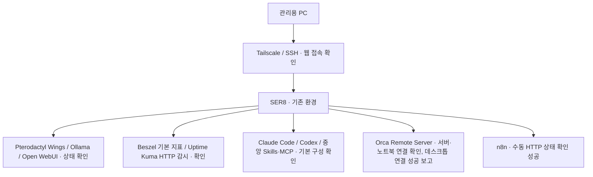

# SER8 통합 홈서버 & AI 개발 환경

> 기존 SER8 게임 서버와 로컬 AI 서비스를 보호하면서, 원격 접속·모니터링·AI 개발 도구·자동화를 단계적으로 통합하는 개인 프로젝트입니다.

## 현재 상태

**2026-10-23 후속 반영:** 데스크톱 Orca의 SER8 연결과 Beszel·Uptime Kuma LAN 직접 접속은 사용자 성공 보고입니다. 집에서는 SSH 터널 없이 모니터링을 사용하며 기존 localhost 접근도 유지합니다. 앞선 서버 조사에서 Beszel 시스템 1개와 최근 수집이 확인됐지만, 데스크톱 localhost의 빈 목록 원인은 미확정입니다. 공유기 DHCP 예약 목록에 SER8 주소·MAC이 등록된 화면을 확인한 사실을 반영하며, 재부팅·DHCP 재할당 후 검증은 하지 않았습니다. 실행 중 작업의 기기 간 인계는 미검증이고, 외부 백업·자동 백업 적용·n8n 정기 실행은 사용자 선택으로 보류합니다. 이번 편집에서 서버를 재측정하지 않았습니다. [근거와 한계](./evidence.md#2026-10-23-접속-결과와-운영-선택)

**2026-10-22 직접 점검:** 노트북의 기존 Orca 연결에서 SER8 일반 셸 명령 실행과 독립 프로젝트 등록을 확인했습니다. Orca 사용자 서비스는 active·enabled, linger yes, 재시작 0회입니다. Claude·Codex·gh 인증 상태는 정상이며 실제 에이전트 작업은 실행하지 않았습니다.

**후속 사용자 제공 출력:** 모니터링·n8n 컨테이너 상태와 Orca UFW 규칙 순서를 보완했습니다. 게임 서버는 모두 중지, SSH는 비밀번호 인증 사용 중, 백업은 날짜·config 폴더 존재만 확인한 상태입니다. 서버 설정 변경·재시험은 하지 않았으며 [근거와 한계](./evidence.md#2026-10-22-사용자-제공-권한-조회-결과--후속-확인)를 구분합니다.

**기존 사용자 보고:** 노트북 → SER8 기본 원격 개발 경로와 Unknown 제거 후 사라짐을 확인받았습니다. 별도 앱 저장소의 개발 환경 준비·노트북 main 일치 확인은 기존 보고이며, 앱 검수·모델 평가는 홈서버 구성 범위에 포함하지 않습니다. n8n 첫 수동 HTTP 성공은 사용자 화면 근거이고 정기 실행은 보류합니다. 2026-10-21 구축 이력은 환경 점검 기록에서 당시 상태로 구분합니다.

현재 사용 순서와 구성별 설치·설정·실행·사용 확인은 **[usage-guide.md](./usage-guide.md)**를 중심으로 읽습니다. 상세 수치와 조회 한계는 [환경 점검 기록](./evidence.md)에 있습니다.

| 영역 | 현재 근거와 한계 |
|---|---|
| Git | 초기 점검 당시 로컬 9857069·원격 096e2e1. 후속 사용자 승인으로 문서 보존 커밋 후 일반 merge 통합. stash 2개 보존 |
| 원격 개발 | Orca 1.4.237 서버·노트북 연결 직접 확인, YOLO 유지. Claude·Codex는 같은 작업 공간에서 순차 사용 |
| 지침·확장 | 프로젝트별 지침과 공용 스킬·CLI별 플러그인 구분 확인. ai-workspace의 공통 지침은 다른 형제 저장소에 자동 상속되지 않음 |
| 모니터링 | 사용자 제공 출력: Beszel Hub·Agent 실행 중, Uptime Kuma·Open WebUI healthy. 앞선 서버 조사에서 시스템 1개·최근 수집 확인. LAN 접속 성공은 사용자 보고 |
| n8n | 사용자 제공 출력: 실행 중, healthy 표시 없음. 기존 첫 수동 HTTP 성공은 사용자 화면 근거, 현재 요청 재시험·예약·알림·AI 연동 없음 |
| 백업 | 사용자 제공 출력: 날짜·config 폴더 존재만 확인, 압축본·현재 무결성·복원 미확인. 자동화 초안 미실행, 외부 장치·보관 정책 미정, 외부 백업·자동 백업 적용은 사용자 선택으로 보류. Open WebUI 제외 유지 |
| SSH·방화벽 | 사용자 제공 결과: 비밀번호 인증 사용 중·공개키 허용, Orca Tailscale 허용 → 일반 차단 순서 유지. 기존 광범위한 허용 규칙은 의존성 확인 전 보존 |
| 게임 서버 | 사용자 제공 출력: 모두 중지 상태, 종료 코드 0·1·137 기록. 자동 시작·삭제하지 않음 |
| 사용자 후속 확인 | Unknown은 제거 후 사라졌다는 사용자 확인으로 완료. 재발 근거 없음, 복구 작업 안 함. 데스크톱 연결 성공은 사용자 보고, 실행 중 작업 인계는 미검증 |
| 과거 구축 근거 | Beszel 기본 지표·Uptime Kuma HTTP 감시·수동 백업·개발 도구 사용은 기존 로그·사용자 보고로 보존하며 이번 설치/실행 재검증과 구분 |

서비스 active·소켓 수신·인증 상태는 실제 AI 응답·게임 접속·재부팅 후 복구나 성능 검증을 의미하지 않습니다. 실제 운영 데이터·DB·키·주소·사용자명·호스트명·포트는 공개하지 않습니다.

호스트 식별정보를 가린 AI 편집 참고본입니다. 원본 실행 증빙과 구분하며, 실제 상태 판단은 사용자 제공 로그·보고를 기준으로 합니다.

## 프로젝트를 시작한 이유

SER8에는 이미 게임 서버 운영 환경과 Ollama·Open WebUI가 있습니다. 이 환경에 개발 도구와 자동화를 추가하려면, 먼저 현재 실행 상태와 자원 여유를 파악하고 기존 서비스에 미치는 영향을 확인해야 합니다.

도구를 한꺼번에 설치하기보다 **기존 서비스 보호 → 원격 접속 → 모니터링 → 개발 환경 → 자동화 → 검증** 순서로 확장할 계획입니다. 각 단계는 설치 여부와 실제 동작 결과를 따로 기록합니다.

## 기술 구성 — 과거 제공 자료 기준

| 구분 | 확인된 환경 |
|---|---|
| 하드웨어 | SER8, AMD Ryzen 7 8745HS, 8코어 / 16스레드 |
| 운영체제 | Ubuntu 24.04.5 LTS |
| 메모리 | OS 표시 총 14GiB, 점검 당시 available 12GiB, swap 4GiB |
| 저장 공간 | 루트 ext4 468GB, 사용 105GB, 여유 339GB — 제공된 `df -hT` 표시 기준 |
| 컨테이너 | Docker 29.1.3, Docker Compose 2.40.3 설치 및 설정 검증·서비스 실행 확인 |
| 기존 서비스 | Pterodactyl Wings, Ollama, Open WebUI |
| 관리·보호 | SSH socket 활성·자동 시작, UFW 활성 |

available 메모리와 디스크 여유는 당시의 스냅샷입니다. 새 서비스를 동시에 실행해도 충분하다는 성능 검증 결과로 사용하지 않습니다. 상세 근거와 한계는 [환경 점검 기록](./evidence.md)에 정리했습니다.

## 운영 구조와 확장 계획

원격 접속, Beszel 기본 지표, Uptime Kuma HTTP 감시, AI 개발 도구 구성은 확인했습니다. 나머지 연결은 아래 상태 표기처럼 향후 계획입니다.

| 영역 | 도입 목적 | 검증할 내용 |
|---|---|---|
| Tailscale / SSH | 원격 관리 경로 정리 | 웹 접속 확인, 재접속·인증 방식·접근 범위는 추가 검증 |
| Beszel | 서버 자원 관찰 | Hub·Agent와 기본 지표 확인, 컨테이너별 통계·GPU 정확성은 미검증 |
| Uptime Kuma | 서비스 가용성 확인 | HTTP 응답 감시 확인, 외부 알림 미사용·장애·복구 시험 생략 |
| Claude Code / Codex + 중앙 Skills·MCP | 개발 도구와 공용 작업 지침·연동 설정 관리 | 실행 위치, 최소 권한, 인증정보 분리, 실제 작업 |
| Orca Remote Server | SER8에 작업 환경을 모아 노트북·데스크톱에서 이어 사용 | 1.4.237 설치·사용자 서비스·노트북 재접속 확인, YOLO 유지 결정 반영, 데스크톱 연결 성공은 사용자 보고. 개별 세션의 실제 인자·실행 중 작업 인계·재부팅 후 복구는 미검증 |
| n8n | 반복 작업 자동화 | 2.44.5 설치·계정 생성(사용자 보고), 수동 HTTP 상태 확인 워크플로 성공(사용자 화면). 예약 실행·외부 알림·AI 연동은 미구성 |

Webmin은 기존 프로젝트에서 사용한 시스템 관리 도구이고, Beszel은 이번 확장에서 Hub·Agent를 실행해 자원 관찰에 사용한 도구입니다. Webmin의 기존 사용 기록만으로 Beszel이 설치되었다고 판단하지 않습니다.

## 직접 판단한 운영 원칙

| 점검 내용 | 판단 | 다음 작업 |
|---|---|---|
| Wings·Ollama·Open WebUI가 이미 존재 | 새 도구 설치 전에 기존 서비스 보호 필요 | 설정·데이터·자원·백업과 복구 경로 확인 |
| `docker compose` 명령 사용 불가 | Docker 엔진과 Compose 준비 상태를 구분해 Compose 패키지 설치 | 버전·문법 검사·Agent 실행 확인, 기존 서비스 상태 재확인 |
| UFW 활성 상태에 광범위한 허용 규칙 존재 | 방화벽 활성만으로 접근 제한 완료라 판단할 수 없음 | 필요한 통신과 실제 외부 도달 가능성을 확인한 뒤 규칙 정리 |
| 백업 전용 도구 일부 미설치, rsync 존재 | 도구 존재와 백업 성공은 다른 근거 | 저장 위치·일정·복구 시험을 확인 |
| Beszel Agent 추가 시 Compose 들여쓰기 오류 발생 | 서비스 항목이 `services` 하위에 오도록 수정 | 문법 검사 통과 후 Agent 실행·시스템 온라인 확인 |

단계별 작업과 완료 조건은 [구축 계획](./roadmap.md)에서 관리합니다.

## 기존 프로젝트와의 관계

- [Ubuntu 기반 홈 게임 서버 인프라 구축](https://github.com/kosmos-s/G.study/blob/main/portfolio/home-game-server/README.md): 하드웨어 도입, OS 전환, 게임 서버 운영과 과거 성능 기록을 다룹니다.
- [깐보's Ptero](https://github.com/kosmos-s/G.study/blob/main/portfolio/kkanbo-ptero/README.md): Pterodactyl 기반 Discord 게임 서버 상태 현황판을 다룹니다.

이번 기록은 같은 SER8의 통합 운영·AI 개발 환경 확장에 집중합니다. 과거 문서의 Ubuntu 24.04.4 LTS·물리 RAM 16GB·SSD 512GB 표기와 이번 OS 표시값은 시점과 측정 기준이 다릅니다. 업그레이드 과정이나 차이의 원인은 확인하지 않았으며, 기존 기록을 새 값으로 덮어쓰지 않습니다. 기존 Discord 봇의 완료 상태를 n8n 자동화의 완료 근거로 사용하지 않습니다.

## 현재 한계와 공개 범위

- Beszel 기본 지표는 확인했지만 컨테이너별 통계, 장기 수집 안정성, GPU 수집 정확성은 미검증입니다.
- Agent 시작 시 WebSocket 인증 `401` 경고가 있었으며, 시스템 온라인 확인만으로 경고 해소를 단정하지 않습니다.
- Tailscale 경유 웹 접속은 확인했지만 재부팅 후 재접속, 접근 제어, SSH 공개키 인증 전환은 미검증입니다.
- Uptime Kuma는 HTTP 응답 감시까지만 확인했습니다. 외부 알림은 사용하지 않기로 했고, 장애·복구 시험은 사용자 선택으로 생략했습니다.
- 백업은 같은 서버의 수동 백업입니다. 다른 저장장치 복사, 자동 백업, 복원 시험은 하지 않았고 Open WebUI는 백업 대상에서 제외했습니다. 백업 스크립트와 systemd 예약 예시는 정적 검토·문법 검사 후 GitHub에 반영했으나 실행·설치하지 않았습니다. 외부 저장장치는 아직 정하지 않았으며, 외부 백업과 자동 백업 적용은 사용자 선택으로 보류합니다.
- 문서 스킬은 의존성 설치·불러오기와 도구 실행까지만 확인했습니다. 실제 문서 생성·렌더링은 미검증입니다.
- agent-browser는 사용자 선택으로 제외했습니다. 전용 CLI·공용 스킬·Claude 링크·전용 브라우저·설치 목록 항목 제거 완료를 보고받았습니다.
- handoff 출처는 미확인이고 n8n 정기 실행은 사용자 선택으로 보류합니다. Orca YOLO 유지, 노트북에서 두 에이전트 순차 읽기 전용 실행 성공과 Unknown 해결은 사용자 보고입니다. 데스크톱 연결 성공도 사용자 보고이며, 개별 세션 전체의 실제 권한 인자·기기 간 실행 중 작업 인계·재부팅 복구는 미검증입니다.
- 여러 서비스의 동시 부하, AI 모델 응답 성능, 재부팅 후 전체 서비스 복구는 미검증입니다.
- 실제 네트워크 주소·도메인·호스트명·사용자명·서비스별 포트와 노출 경로·인증정보는 공개하지 않습니다.

원본 로그 대신 필요한 사실만 추려 기록했습니다. 앞으로 추가할 화면과 로그도 민감정보를 마스킹한 뒤 공개합니다.

## 상세 기록

- [현재 구성과 사용 가이드](./usage-guide.md) — 사용 순서·설치 위치·정리 후보·다음 작업
- [환경·구축 증거](./evidence.md) — 확인 결과, 공개 가능한 화면과 측정 한계
- [문제 해결 기록](./troubleshooting.md) — Compose 들여쓰기, SSH 터널, 인증 경고
- [단계별 계획](./roadmap.md) — 완료 범위와 다음 검증 항목
- [모니터링 백업 자동화 초안](./backup-automation.md) — 백업 대상, 중지 방식, 오류 처리, 예약 예시 (미실행)
- [n8n 최소 구성과 첫 수동 워크플로](./n8n-setup.md) — 버전·Compose 원칙, 접속 방법, HTTP 상태 확인 워크플로, UFW 타임아웃 해결
- [Orca 원격 서버 구성](./orca-remote-server.md) — 설치·서비스 전환, Tailscale 전용 제한, 독립 프로젝트 재등록, Unknown 항목, 데스크톱 연결 절차
