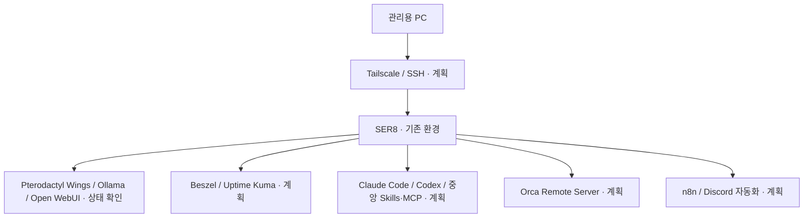

# SER8 통합 홈서버 & AI 개발 환경

> 기존 SER8 게임 서버와 로컬 AI 서비스를 보호하면서, 원격 접속·모니터링·AI 개발 도구·자동화를 단계적으로 통합하는 개인 프로젝트입니다.

## 현재 상태

**2026-10-21 기록 기준으로 기존 환경 점검과 확장 계획 정리까지 진행했습니다.** 새 통합 환경의 구축 완료를 의미하지 않습니다. 서버에 새로 접속해 재검증한 결과가 아니라, 사용자가 제공한 확인 정보와 이전 대화의 명령 출력에 근거한 기록입니다.

| 구분 | 확인 결과 |
|---|---|
| 기존 서비스 | Pterodactyl Wings·Ollama `active / enabled`, Open WebUI 컨테이너 `healthy` |
| 원격 접속 | SSH socket `active / enabled` 확인 |
| 환경 점검 | CPU·메모리·디스크·Docker·방화벽·백업 도구 상태 확인 |
| Beszel | Hub 설치 명령 안내까지 진행, 사용자 실행 결과 미확인 |
| 통합 환경 구축 | Tailscale, 모니터링, AI 개발 도구, 원격 개발, 자동화는 향후 계획 |

`active`, `enabled`, `healthy`는 점검 당시의 서비스·컨테이너 상태입니다. 실제 게임 접속, AI 응답, 재부팅 후 복구까지 검증했다는 뜻은 아닙니다.

## 프로젝트를 시작한 이유

SER8에는 이미 게임 서버 운영 환경과 Ollama·Open WebUI가 있습니다. 이 환경에 개발 도구와 자동화를 추가하려면, 먼저 현재 실행 상태와 자원 여유를 파악하고 기존 서비스에 미치는 영향을 확인해야 합니다.

도구를 한꺼번에 설치하기보다 **기존 서비스 보호 → 원격 접속 → 모니터링 → 개발 환경 → 자동화 → 검증** 순서로 확장할 계획입니다. 각 단계는 설치 여부와 실제 동작 결과를 따로 기록합니다.

## 기술 구성

| 구분 | 확인된 환경 |
|---|---|
| 하드웨어 | SER8, AMD Ryzen 7 8745HS, 8코어 / 16스레드 |
| 운영체제 | Ubuntu 24.04.5 LTS |
| 메모리 | OS 표시 총 14GiB, 점검 당시 available 12GiB, swap 4GiB |
| 저장 공간 | 루트 ext4 468GB, 사용 105GB, 여유 339GB — 제공된 `df -hT` 표시 기준 |
| 컨테이너 | Docker 29.1.3, `docker-compose-v2` 미설치, `docker compose` 명령 사용 불가 확인 |
| 기존 서비스 | Pterodactyl Wings, Ollama, Open WebUI |
| 관리·보호 | SSH socket 활성·자동 시작, UFW 활성 |

available 메모리와 디스크 여유는 당시의 스냅샷입니다. 새 서비스를 동시에 실행해도 충분하다는 성능 검증 결과로 사용하지 않습니다. 상세 근거와 한계는 [환경 점검 기록](./evidence.md)에 정리했습니다.

## 확장할 운영 구조

아래는 **목표 구성**이며, 아직 연결이나 동작을 검증하지 않았습니다.

| 영역 | 도입 목적 | 검증할 내용 |
|---|---|---|
| Tailscale / SSH | 원격 관리 경로 정리 | 접속·재접속, 인증 방식, 접근 범위 |
| Beszel | 서버 자원과 컨테이너 상태 관찰 | Hub·Agent 연결, 실제 지표 수집 |
| Uptime Kuma | 서비스 가용성 확인과 알림 | 대상 응답, 장애·복구 감지 |
| Claude Code / Codex + 중앙 Skills·MCP | 개발 도구와 공용 작업 지침·연동 설정 관리 | 실행 위치, 최소 권한, 인증정보 분리, 실제 작업 |
| Orca Remote Server | 원격 개발 작업 환경 구성 | 사용할 제품·버전·공식 출처 확정 후 연결 검증 |
| n8n / Discord | 점검·알림 등 반복 작업 자동화 | 수동 시험, 실패 처리, 중복 알림 방지 |

Webmin은 기존 프로젝트에서 사용한 시스템 관리 도구이고, Beszel은 이번 확장에서 자원 관찰용으로 검토한 도구입니다. Webmin의 기존 사용 기록만으로 Beszel이 설치되었다고 판단하지 않습니다.

## 직접 판단한 운영 원칙

| 점검 내용 | 판단 | 다음 작업 |
|---|---|---|
| Wings·Ollama·Open WebUI가 이미 존재 | 새 도구 설치 전에 기존 서비스 보호 필요 | 설정·데이터·자원·백업과 복구 경로 확인 |
| `docker compose` 명령 사용 불가 | Docker 엔진과 Compose 준비 상태를 구분 | 패키지 호환성과 기존 컨테이너 영향 확인 후 도입 |
| UFW 활성 상태에 광범위한 허용 규칙 존재 | 방화벽 활성만으로 접근 제한 완료라 판단할 수 없음 | 필요한 통신과 실제 외부 도달 가능성을 확인한 뒤 규칙 정리 |
| 백업 전용 도구 일부 미설치, rsync 존재 | 도구 존재와 백업 성공은 다른 근거 | 저장 위치·일정·복구 시험을 확인 |
| Beszel 설치 명령만 안내됨 | 설치 성공 근거 부족 | 실행 결과·Hub·Agent·지표 확인 전까지 미완료 유지 |

단계별 작업과 완료 조건은 [구축 계획](./roadmap.md)에서 관리합니다.

## 기존 프로젝트와의 관계

- [Ubuntu 기반 홈 게임 서버 인프라 구축](https://github.com/kosmos-s/G.study/blob/main/portfolio/home-game-server/README.md): 하드웨어 도입, OS 전환, 게임 서버 운영과 과거 성능 기록을 다룹니다.
- [깐보's Ptero](https://github.com/kosmos-s/G.study/blob/main/portfolio/kkanbo-ptero/README.md): Pterodactyl 기반 Discord 게임 서버 상태 현황판을 다룹니다.

이번 기록은 같은 SER8의 통합 운영·AI 개발 환경 확장에 집중합니다. 과거 문서의 Ubuntu 24.04.4 LTS·물리 RAM 16GB·SSD 512GB 표기와 이번 OS 표시값은 시점과 측정 기준이 다릅니다. 업그레이드 과정이나 차이의 원인은 확인하지 않았으며, 기존 기록을 새 값으로 덮어쓰지 않습니다. 기존 Discord 봇의 완료 상태를 n8n 자동화의 완료 근거로 사용하지 않습니다.

## 현재 한계와 공개 범위

- Beszel 설치·접속·수집 결과는 아직 확인하지 못했습니다.
- Tailscale은 점검 당시 미설치이며, 나머지 계획 도구의 설치·연동 완료 근거도 없습니다.
- 여러 서비스의 동시 부하, AI 모델 응답 성능, 장애 알림, 전체 백업 복구는 미검증입니다.
- 실제 네트워크 주소·도메인·호스트명·사용자명·서비스별 포트와 노출 경로·인증정보는 공개하지 않습니다.

원본 로그 대신 필요한 사실만 추려 기록했습니다. 앞으로 추가할 화면과 로그도 민감정보를 마스킹한 뒤 공개합니다.
