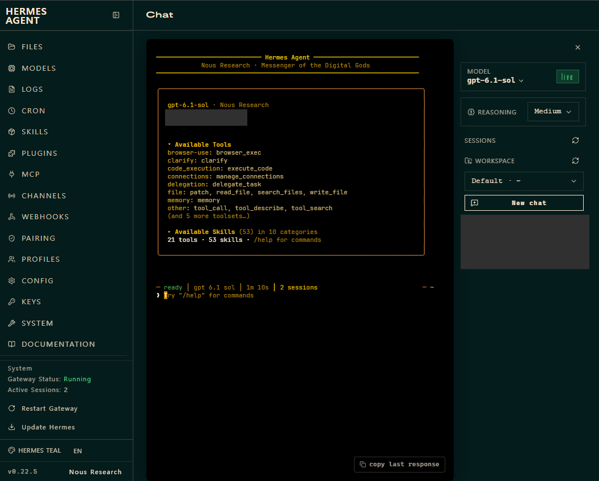

# SER8 통합 홈서버 & AI 개발 환경

게임 서버와 로컬 AI를 사용하던 SER8에 원격 개발·모니터링·개인 비서를 더해, PC와 휴대폰에서 집의 작업 환경을 사용할 수 있도록 구성한 개인 프로젝트입니다.

> 최신 후속 기록: 2026-11-18 개발 입구·인계 정책 정리 · 2026-11-17 첫 개발 과제·이어달리기 운영 보고 · 2026-11-14 앱 위임·재접속 직접 관찰. 기존 운영·사진 기록: 2026-10-24~25. 직접 확인과 사용자 제공 보고를 구분합니다.

원본 캡처의 개인정보 영역만 불투명하게 가렸습니다. 실제 휴대폰 접속·작업 성공은 사용자 보고이며, 화면에 표시된 도구 전체를 실행 검증했다는 뜻은 아닙니다.

## 핵심 결과

| 영역 | 확인한 결과 | 근거 |
|---|---|---|
| 원격 개발 | Orca 서버·사용자 서비스 구성, 노트북 재접속 확인. 데스크톱·모바일 연결 성공 | 당시 서버 점검 기록 + 후속 사용자 보고 |
| 개인 비서 | Hermes 웹 로그인·PC 및 휴대폰 접속·실제 작업 성공 | 제공된 서비스 출력·화면 + 사용자 보고 |
| 접근 문제 해결 | 서버 내부에서는 응답하지만 PC에서 TCP 접속이 실패하던 문제를 Tailscale 대상 포트 허용으로 해결 | 진단 출력·정책 화면 + 조치 후 접속 성공 보고 |
| 모니터링 | Beszel 기본 자원 지표와 Uptime Kuma HTTP 감시 확인 | 당시 점검 기록·원본 기반 마스킹 화면 |
| 자동화 실험 | n8n 수동 HTTP 상태 확인에서 `200`·`ok=true` 확인 | 실패·성공 실행 화면. 정기 실행은 보류 |

## 현재 사용하는 개발 방식

- 직접 설계·디버깅·수정할 때는 **Orca**에서 작업하고 결과를 검토한다.
- 자리를 비우며 작은 과제를 맡길 때는 **Hermes 앱**을 사용한다. 기존 bridge → Orca 작업자 경로를 유지한다.
- 한 과제는 시작한 쪽에서 끝내고, 직접 개입이 필요할 때만 작업 중단 확인·변경 보존·메모 갱신·검토 1회로 인계한다.
- 병합·push는 승인 후, 배포는 별도 요청 후 진행한다.

[평소 사용법](./usage-guide.md) · [작업 규칙](./agent-work-modes.md) · [변경 과정과 이유](./workflow-decision-2026-11-18.md)

## Hermes에서 Orca에 작업 위임 — 2026-11-14

Hermes 웹에서 요청하고 기존 Orca의 Codex 작업자 1명에게 README 요약을 맡긴 뒤, 완료 메시지와 결과를 회수했다는 **사용자 제공 Hermes 실행 보고**를 반영했습니다. 최초 완료 명령의 `orca` 이름 충돌은 같은 작업자에게 개발용 경로로 보고만 다시 요청해 복구했습니다.

- 사용자: 목표·변경 제한·완료 기준 전달. Hermes: 조정·오류 복구·결과 회수. Codex: README 읽기·요약.
- 프로젝트 파일 24개 해시·Git HEAD·작업 트리 비교에서 변경 없음이 보고됐습니다. 이번 문서 편집에서는 서버 원시 로그·해시 목록을 직접 검증하지 않았습니다.
- 이 웹 시험에서는 무개입 반복 실행, Claude 위임·실제 코드 수정, 브라우저 종료 후 결과 회수·자동 알림을 확인하지 않았습니다. 이후 앱 시험과 개발 과제의 확인 범위는 아래 후속 기록에서 구분합니다.

[시험 과정·수행 주체·한계](./hermes-orca-delegation.md)

## 앱 위임과 첫 개발 과제 — 후속 기록

2026-11-14에는 Hermes 데스크톱 앱에서 Claude 읽기 전용 위임 3회, 앱 종료 중 서버 작업 완료, 재실행 후 같은 대화·완료 알림 복원을 직접 관찰했습니다. 짧은 대기 작업 시험이며 장시간 실행·서버 재부팅 시험은 아닙니다. [앱 검증 기록](./hermes-app-orca-validation.md)

2026-11-17에는 사용자가 `/음악` 설정 유지 과제를 시작해 병합까지 완료했다고 보고했습니다. 플레이어 데이터에 설정을 저장하는 구현 커밋과 `main` 포함 여부는 GitHub에서 직접 확인했습니다. 실제 사용량 소진에 따른 Codex↔Claude 교대, 이번 구현의 실서버 배포·게임 동작은 별도 확인 대상입니다. [첫 개발 과제와 이어달리기 기록](./hermes-relay-development-2026-11-17.md)

## 시작한 이유

SER8의 게임 서버·Ollama·Open WebUI를 유지하면서 노트북·데스크톱·휴대폰에서 개발과 개인 작업을 이어 쓰고 싶었습니다. 새 도구를 추가할 때마다 설치 여부, 접속 여부, 실제 작업 결과를 따로 확인하고 기록하는 것이 목표였습니다.

## 내가 수행한 작업과 AI 지원

AI의 조사·명령 제안·설정 및 문서 작성 지원을 받으며 구축했습니다. 기존 오픈소스 도구를 설치·연결한 프로젝트이며, 해당 도구 자체를 개발한 것은 아닙니다.

| 구분 | 실제 수행 범위 |
|---|---|
| 직접 수행 | 안내받은 명령을 SER8·Windows에서 실행하고 출력 제공, Tailscale 접근 정책의 누락 포트 추가, 웹 비밀번호 변경, PC·휴대폰 접속 및 작업 동작 확인 |
| 사용 목적과 운영 선택 | 기존 구독 로그인 경로 우선, 개인 비서 화면으로 웹 선택, Claude·Codex 순차 사용, OpenClaw 보관 방향 선택, 외부·자동 백업과 n8n 정기 실행 보류 |
| AI 지원·실행 | 2026-11-14 Hermes가 Orca의 Codex 작업자에 읽기 전용 작업 위임·완료 보고 복구·결과 회수(사용자 제공 보고), 도구·공식 자료 조사, 로그 해석과 진단 순서·명령·스크립트 초안 제안, 사용자 승인 아래 SER8의 Claude Code 세션에서 Orca 설치·서비스 전환·프로젝트 재등록·상태 조회 직접 실행, GitHub 문서·이미지 정리 |

설치 과정과 상세 명령을 모두 독립적으로 설계했다고 표현하지 않습니다. 각 단계의 직접 조회·사용자 실행·성공 보고 범위는 [환경·구축 기록](./evidence.md)에서 확인할 수 있습니다.

## 구성

| 계층 | 도구와 역할 |
|---|---|
| 서버 | SER8 · Ryzen 7 8745HS · RAM 16GB급 · Ubuntu 24.04.5 LTS |
| 접속·실행 관리 | Tailscale, SSH·tmux, systemd 사용자 서비스 |
| 개발·개인 작업 | Orca + Claude Code·Codex, Hermes 웹 |
| 기존 서비스·모니터링 | Pterodactyl Wings, Ollama·Open WebUI, Beszel·Uptime Kuma |
| 자동화 실험 | n8n 수동 워크플로, 미적용 백업 스크립트 초안 |

관리 기기에서 Tailscale로 SER8에 연결해 Orca 또는 Hermes 웹을 사용합니다. 프로젝트 파일과 실행 환경은 SER8에 두며, 실제 주소·계정·포트·인증정보는 공개하지 않습니다. [구조·기술 선택과 당시 환경](./architecture.md)

## 대표 문제 해결

**Hermes: ping은 성공하지만 웹 접속은 시간 초과.** AI가 서비스·HTTP 응답·호스트 방화벽·패킷 관찰·Tailscale 접근 정책을 확인하는 순서와 명령을 제안했습니다. 저는 SER8·Windows에서 명령을 실행하고 출력을 제공했으며, 대상 서버의 새 TCP 포트가 빠진 허용 목록을 수정한 뒤 웹 접속 성공을 확인했습니다. ICMP 연결과 서비스별 TCP 허용은 별도라는 점을 배웠습니다. [진단 근거와 조치](./troubleshooting.md#hermes-web-access-policy)

**Orca: SSH 창을 닫으면 서버가 오프라인.** 제 승인 아래 SER8의 Claude Code 세션이 SSH 세션의 포그라운드 실행을 사용자 서비스로 전환하고 서비스 상태·노트북 재접속 기록을 직접 조회했습니다. 이 과정을 통해 상시 서버 프로세스와 대화형 터미널 작업을 구분하게 됐습니다. [서비스 전환 과정](./orca-remote-server.md#서버가-꺼진-문제와-서비스-전환)

## 현재 한계와 다음 확인

재부팅 후 전체 서비스 복구, 여러 서비스의 동시 부하, Hermes의 새 세션 메모리 재사용·브라우저 종료 후 장시간 작업·완료 알림은 미검증입니다. 백업의 외부 저장·예약 실행·복원 시험도 완료하지 않았습니다. 우선 현재 환경을 실제 업무에 사용하고, 필요한 항목부터 검증할 계획입니다. 상세 보류·미완료 목록은 [단계별 계획](./roadmap.md)에 둡니다.

## 상세 문서

| 문서 | 내용 |
|---|---|
| [현재 사용 가이드](./usage-guide.md) | 접속·실행·사용 순서 |
| [구조와 기술 선택](./architecture.md) | 도구 역할·하드웨어·기존 프로젝트와의 관계 |
| [문제 해결 기록](./troubleshooting.md) | Hermes·Orca·모니터링·n8n 진단 |
| [날짜별 근거와 화면](./evidence.md) · [이미지 가림 범위](./images/README.md) | 확인 출처·과거 이력·공개 이미지 |
| [Orca](./orca-remote-server.md) · [Hermes](./hermes-assistant.md) · [AI 도구](./ai-tools-guide.md) | 설치·연결·운영 범위 |
| [Hermes → Orca 위임 시험](./hermes-orca-delegation.md) | Codex 읽기 작업·결과 회수·명령 충돌 복구와 검증 한계 |
| [Hermes 앱 위임 검증](./hermes-app-orca-validation.md) | 읽기 전용 위임 3회, 앱 종료·재실행 후 결과 복원 |
| [첫 개발 과제와 이어달리기 기록](./hermes-relay-development-2026-11-17.md) | 음악 설정 저장 구현·main 포함, 사용자 완료 보고, 개발·배포 절차와 남은 검증 |
| [Claude·Codex 작업 방식](./agent-work-modes.md) | 직접 개발·위임의 입구 선택, 이어달리기와 예외 인계, 병렬 시도 기록 |
| [개발 방식 변경 과정과 이유](./workflow-decision-2026-11-18.md) | 사용자 선택, 다른 사용자 사례 비교, 실제 적용 범위와 검증 한계 |
| [n8n](./n8n-setup.md) · [백업 초안](./backup-automation.md) · [계획](./roadmap.md) | 수동 실험·미적용 예시·남은 검증 |
