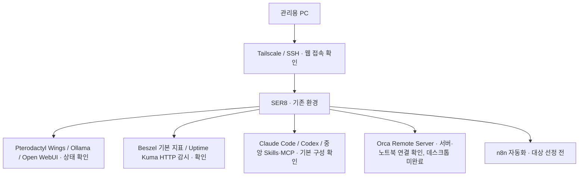

# SER8 통합 홈서버 & AI 개발 환경

> 기존 SER8 게임 서버와 로컬 AI 서비스를 보호하면서, 원격 접속·모니터링·AI 개발 도구·자동화를 단계적으로 통합하는 개인 프로젝트입니다.

## 현재 상태

**2026-10-21 기록 기준으로 Docker Compose 설치, Tailscale 경유 SSH 터널 사용, Beszel 기본 지표 수집, Uptime Kuma HTTP 응답 감시, 모니터링 데이터 수동 백업, Claude Code·Codex 개발 환경 구성까지 확인했습니다. 2026-10-22에는 SER8 Claude Code 세션에서 Orca 헤드리스 서버 설치·사용자 서비스 전환·독립 프로젝트 등록을 직접 확인했습니다([Orca 원격 서버 구성](./orca-remote-server.md)).** 전체 통합 환경의 구축 완료를 의미하지 않습니다. 서버에 새로 접속해 재검증한 결과가 아니라, 사용자가 제공한 확인 정보·로그·화면·설치 보고에 근거한 기록입니다. Context7 문서 조회는 앞선 SER8 Claude Code 세션에서 직접 호출했다고 보고받았습니다. 이번 GitHub 반영 작업에서는 서버에 접속해 재측정하지 않았습니다.

| 구분 | 확인 결과 |
|---|---|
| 기존 서비스 | Pterodactyl Wings·Ollama `active / enabled`, Open WebUI 컨테이너 `healthy` |
| 원격 접속 | Tailscale 경유 SSH 터널을 이용한 Beszel 웹 접속 확인, 인증·접근 범위 정리는 진행 예정 |
| 환경 점검 | CPU·메모리·디스크·Docker·방화벽·백업 도구 상태 확인 |
| Beszel | Hub HTTP 응답 성공, Agent 실행, 시스템 온라인과 CPU·메모리·디스크·온도 표시 확인 |
| Uptime Kuma | 2.5.6 설치, `healthy`·관리자 대시보드 접속, Beszel·Ollama·Open WebUI HTTP 감시 온라인 확인 |
| 백업 | Beszel·Uptime Kuma 수동 백업 확인. 자동화 스크립트·systemd 예시는 정적 검토·문법 검사 후 커밋·push 완료, 실행·예약 적용·복원 시험은 하지 않음 |
| AI 개발 환경 | Claude Code·Codex 설치·인증·실행, 공통 작업 지침, Superpowers·find-skills·Context7 MCP 구성 확인 |
| 확장 스킬·플러그인 | 문서 스킬·skill-creator·K-skill 130개와 ECC 선택 구성 발견 보고, 문서 Python 의존성 import 및 LibreOffice·pandoc·qpdf 실행 확인 |
| GitHub 연동 | GitHub CLI 로그인·일반 push 성공, Codex GitHub MCP 실제 조회 성공. Claude GitHub MCP는 조회 성공 후 사용자 선택으로 비활성화하고 git·gh 사용 |
| Orca 원격 서버 | 1.4.237 사용자 전용 설치, systemd 사용자 서비스 `active`·`enabled`, Tailscale 전용 접근 제한, 독립 프로젝트 등록, 노트북 재접속 확인. 노트북 Unknown 항목 정리·에이전트 권한 모드 조정·데스크톱 연결은 미완료 |
| 제외·보류 | agent-browser는 사용자 선택으로 전용 CLI·스킬·브라우저 제거 완료 보고, handoff 출처 확인 대기 |
| 통합 환경 구축 | 모니터링·수동 백업·AI 개발 도구 기본 구성 완료, 백업 자동화·외부 저장·재부팅 복구·원격 개발·자동화는 미완료 |

`active`, `enabled`, `healthy`는 점검 당시의 서비스·컨테이너 상태입니다. 실제 게임 접속, AI 응답, 재부팅 후 복구까지 검증했다는 뜻은 아닙니다.

## 프로젝트를 시작한 이유

SER8에는 이미 게임 서버 운영 환경과 Ollama·Open WebUI가 있습니다. 이 환경에 개발 도구와 자동화를 추가하려면, 먼저 현재 실행 상태와 자원 여유를 파악하고 기존 서비스에 미치는 영향을 확인해야 합니다.

도구를 한꺼번에 설치하기보다 **기존 서비스 보호 → 원격 접속 → 모니터링 → 개발 환경 → 자동화 → 검증** 순서로 확장할 계획입니다. 각 단계는 설치 여부와 실제 동작 결과를 따로 기록합니다.

## 기술 구성

| 구분 | 확인된 환경 |
|---|---|
| 하드웨어 | SER8, AMD Ryzen 7 8745HS, 8코어 / 16스레드 |
| 운영체제 | Ubuntu 24.04.5 LTS |
| 메모리 | OS 표시 총 14GiB, 점검 당시 available 12GiB, swap 4GiB |
| 저장 공간 | 루트 ext4 468GB, 사용 105GB, 여유 339GB — 제공된 `df -hT` 표시 기준 |
| 컨테이너 | Docker 29.1.3, Docker Compose 2.40.3 설치 및 설정 검증·서비스 실행 확인 |
| 기존 서비스 | Pterodactyl Wings, Ollama, Open WebUI |
| 관리·보호 | SSH socket 활성·자동 시작, UFW 활성 |

available 메모리와 디스크 여유는 당시의 스냅샷입니다. 새 서비스를 동시에 실행해도 충분하다는 성능 검증 결과로 사용하지 않습니다. 상세 근거와 한계는 [환경 점검 기록](./evidence.md)에 정리했습니다.

## 운영 구조와 확장 계획

원격 접속, Beszel 기본 지표, Uptime Kuma HTTP 감시, AI 개발 도구 구성은 확인했습니다. 나머지 연결은 아래 상태 표기처럼 향후 계획입니다.

| 영역 | 도입 목적 | 검증할 내용 |
|---|---|---|
| Tailscale / SSH | 원격 관리 경로 정리 | 웹 접속 확인, 재접속·인증 방식·접근 범위는 추가 검증 |
| Beszel | 서버 자원 관찰 | Hub·Agent와 기본 지표 확인, 컨테이너별 통계·GPU 정확성은 미검증 |
| Uptime Kuma | 서비스 가용성 확인 | HTTP 응답 감시 확인, 외부 알림 미사용·장애·복구 시험 생략 |
| Claude Code / Codex + 중앙 Skills·MCP | 개발 도구와 공용 작업 지침·연동 설정 관리 | 실행 위치, 최소 권한, 인증정보 분리, 실제 작업 |
| Orca Remote Server | SER8에 작업 환경을 모아 노트북·데스크톱에서 이어 사용 | 1.4.237 설치·사용자 서비스·노트북 재접속 확인, 에이전트 권한 모드·데스크톱 연결·재부팅 후 복구는 미검증 |
| n8n | 반복 작업 자동화 | 외부 알림 미사용 결정을 반영해 첫 업무 선정, 실행·실패 처리 확인 |

Webmin은 기존 프로젝트에서 사용한 시스템 관리 도구이고, Beszel은 이번 확장에서 Hub·Agent를 실행해 자원 관찰에 사용한 도구입니다. Webmin의 기존 사용 기록만으로 Beszel이 설치되었다고 판단하지 않습니다.

## 직접 판단한 운영 원칙

| 점검 내용 | 판단 | 다음 작업 |
|---|---|---|
| Wings·Ollama·Open WebUI가 이미 존재 | 새 도구 설치 전에 기존 서비스 보호 필요 | 설정·데이터·자원·백업과 복구 경로 확인 |
| `docker compose` 명령 사용 불가 | Docker 엔진과 Compose 준비 상태를 구분해 Compose 패키지 설치 | 버전·문법 검사·Agent 실행 확인, 기존 서비스 상태 재확인 |
| UFW 활성 상태에 광범위한 허용 규칙 존재 | 방화벽 활성만으로 접근 제한 완료라 판단할 수 없음 | 필요한 통신과 실제 외부 도달 가능성을 확인한 뒤 규칙 정리 |
| 백업 전용 도구 일부 미설치, rsync 존재 | 도구 존재와 백업 성공은 다른 근거 | 저장 위치·일정·복구 시험을 확인 |
| Beszel Agent 추가 시 Compose 들여쓰기 오류 발생 | 서비스 항목이 `services` 하위에 오도록 수정 | 문법 검사 통과 후 Agent 실행·시스템 온라인 확인 |

단계별 작업과 완료 조건은 [구축 계획](./roadmap.md)에서 관리합니다.

## 기존 프로젝트와의 관계

- [Ubuntu 기반 홈 게임 서버 인프라 구축](https://github.com/kosmos-s/G.study/blob/main/portfolio/home-game-server/README.md): 하드웨어 도입, OS 전환, 게임 서버 운영과 과거 성능 기록을 다룹니다.
- [깐보's Ptero](https://github.com/kosmos-s/G.study/blob/main/portfolio/kkanbo-ptero/README.md): Pterodactyl 기반 Discord 게임 서버 상태 현황판을 다룹니다.

이번 기록은 같은 SER8의 통합 운영·AI 개발 환경 확장에 집중합니다. 과거 문서의 Ubuntu 24.04.4 LTS·물리 RAM 16GB·SSD 512GB 표기와 이번 OS 표시값은 시점과 측정 기준이 다릅니다. 업그레이드 과정이나 차이의 원인은 확인하지 않았으며, 기존 기록을 새 값으로 덮어쓰지 않습니다. 기존 Discord 봇의 완료 상태를 n8n 자동화의 완료 근거로 사용하지 않습니다.

## 현재 한계와 공개 범위

- Beszel 기본 지표는 확인했지만 컨테이너별 통계, 장기 수집 안정성, GPU 수집 정확성은 미검증입니다.
- Agent 시작 시 WebSocket 인증 `401` 경고가 있었으며, 시스템 온라인 확인만으로 경고 해소를 단정하지 않습니다.
- Tailscale 경유 웹 접속은 확인했지만 재부팅 후 재접속, 접근 제어, SSH 공개키 인증 전환은 미검증입니다.
- Uptime Kuma는 HTTP 응답 감시까지만 확인했습니다. 외부 알림은 사용하지 않기로 했고, 장애·복구 시험은 사용자 선택으로 생략했습니다.
- 백업은 같은 서버의 수동 백업입니다. 다른 저장장치 복사, 자동 백업, 복원 시험은 하지 않았고 Open WebUI는 백업 대상에서 제외했습니다. 백업 스크립트와 systemd 예약 예시는 정적 검토·문법 검사 후 GitHub에 반영했으나 실행·설치하지 않았습니다. 외부 저장장치는 아직 정하지 않았습니다.
- 문서 스킬은 의존성 설치·불러오기와 도구 실행까지만 확인했습니다. 실제 문서 생성·렌더링은 미검증입니다.
- agent-browser는 사용자 선택으로 제외했습니다. 전용 CLI·공용 스킬·Claude 링크·전용 브라우저·설치 목록 항목 제거 완료를 보고받았습니다.
- handoff 출처 확인과 n8n 자동화는 미완료입니다. Orca는 서버 설치·상시 실행·노트북 재접속까지 확인했고, 노트북 Unknown 항목 정리, 에이전트 권한 모드 조정 후 Claude·Codex 실행 확인, 데스크톱 연결이 남아 있습니다.
- 여러 서비스의 동시 부하, AI 모델 응답 성능, 재부팅 후 전체 서비스 복구는 미검증입니다.
- 실제 네트워크 주소·도메인·호스트명·사용자명·서비스별 포트와 노출 경로·인증정보는 공개하지 않습니다.

원본 로그 대신 필요한 사실만 추려 기록했습니다. 앞으로 추가할 화면과 로그도 민감정보를 마스킹한 뒤 공개합니다.

## 상세 기록

- [환경·구축 증거](./evidence.md) — 확인 결과, 공개 가능한 화면과 측정 한계
- [문제 해결 기록](./troubleshooting.md) — Compose 들여쓰기, SSH 터널, 인증 경고
- [단계별 계획](./roadmap.md) — 완료 범위와 다음 검증 항목
- [모니터링 백업 자동화 초안](./backup-automation.md) — 백업 대상, 중지 방식, 오류 처리, 예약 예시 (미실행)
- [Orca 원격 서버 구성](./orca-remote-server.md) — 설치·서비스 전환, Tailscale 전용 제한, 독립 프로젝트 재등록, Unknown 항목, 데스크톱 연결 절차
