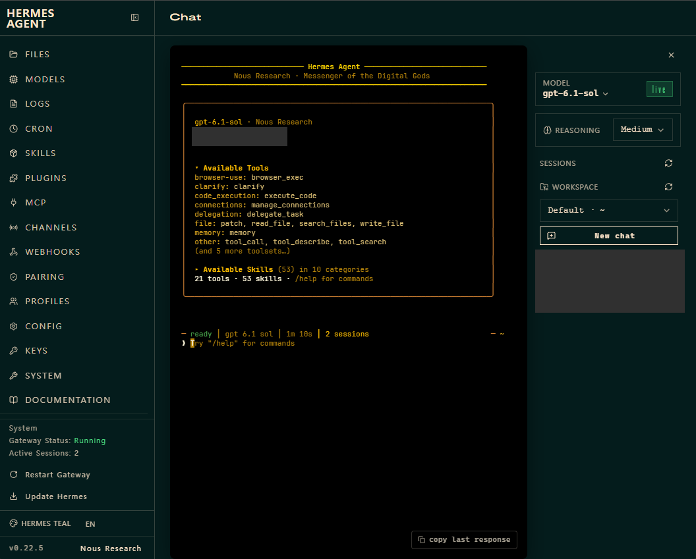

# SER8 통합 홈서버 & AI 개발 환경

게임 서버와 로컬 AI를 사용하던 SER8에 원격 개발·모니터링·개인 비서를 더해, PC와 휴대폰에서 집의 작업 환경을 사용할 수 있도록 구성한 개인 프로젝트입니다.

> 운영 결과 기준: 2026-10-24 · 문서·사진 보완: 2026-10-25. 날짜별 점검 기록과 사용자 제공 화면·성공 보고를 구분합니다.

원본 캡처의 개인정보 영역만 불투명하게 가렸습니다. 실제 휴대폰 접속·작업 성공은 사용자 보고이며, 화면에 표시된 도구 전체를 실행 검증했다는 뜻은 아닙니다.

## 핵심 결과

| 영역 | 확인한 결과 | 근거 |
|---|---|---|
| 원격 개발 | Orca 서버·사용자 서비스 구성, 노트북 재접속 확인. 데스크톱·모바일 연결 성공 | 당시 서버 점검 기록 + 후속 사용자 보고 |
| 개인 비서 | Hermes 웹 로그인·PC 및 휴대폰 접속·실제 작업 성공 | 제공된 서비스 출력·화면 + 사용자 보고 |
| 접근 문제 해결 | 서버 내부에서는 응답하지만 PC에서 TCP 접속이 실패하던 문제를 Tailscale 대상 포트 허용으로 해결 | 진단 출력·정책 화면 + 조치 후 접속 성공 보고 |
| 모니터링 | Beszel 기본 자원 지표와 Uptime Kuma HTTP 감시 확인 | 당시 점검 기록·원본 기반 마스킹 화면 |
| 자동화 실험 | n8n 수동 HTTP 상태 확인에서 `200`·`ok=true` 확인 | 실패·성공 실행 화면. 정기 실행은 보류 |

## 시작한 이유

SER8의 게임 서버·Ollama·Open WebUI를 유지하면서 노트북·데스크톱·휴대폰에서 개발과 개인 작업을 이어 쓰고 싶었습니다. 새 도구를 추가할 때마다 설치 여부, 접속 여부, 실제 작업 결과를 따로 확인하고 기록하는 것이 목표였습니다.

## 내가 수행한 작업과 AI 지원

AI의 조사·명령 제안·설정 및 문서 작성 지원을 받으며 구축했습니다. 기존 오픈소스 도구를 설치·연결한 프로젝트이며, 해당 도구 자체를 개발한 것은 아닙니다.

| 구분 | 실제 수행 범위 |
|---|---|
| 직접 수행 | 안내받은 명령을 SER8·Windows에서 실행하고 출력 제공, Tailscale 접근 정책의 누락 포트 추가, 웹 비밀번호 변경, PC·휴대폰 접속 및 작업 동작 확인 |
| 사용 목적과 운영 선택 | 기존 구독 로그인 경로 우선, 개인 비서 화면으로 웹 선택, Claude·Codex 순차 사용, OpenClaw 보관 방향 선택, 외부·자동 백업과 n8n 정기 실행 보류 |
| AI 지원 | 도구·공식 자료 조사, 로그 해석과 진단 순서 제안, 설치·설정 명령 및 스크립트 초안 작성, 허용된 원격 점검·설치 지원, GitHub 문서·이미지 정리 |

설치 과정과 상세 명령을 모두 독립적으로 설계했다고 표현하지 않습니다. 각 단계의 직접 조회·사용자 실행·성공 보고 범위는 [환경·구축 기록](./evidence.md)에서 확인할 수 있습니다.

## 구성

| 계층 | 도구와 역할 |
|---|---|
| 서버 | SER8 · Ryzen 7 8745HS · RAM 16GB급 · Ubuntu 24.04.5 LTS |
| 접속·실행 관리 | Tailscale, SSH·tmux, systemd 사용자 서비스 |
| 개발·개인 작업 | Orca + Claude Code·Codex, Hermes 웹 |
| 기존 서비스·모니터링 | Pterodactyl Wings, Ollama·Open WebUI, Beszel·Uptime Kuma |
| 자동화 실험 | n8n 수동 워크플로, 미적용 백업 스크립트 초안 |

관리 기기에서 Tailscale로 SER8에 연결해 Orca 또는 Hermes 웹을 사용합니다. 프로젝트 파일과 실행 환경은 SER8에 두며, 실제 주소·계정·포트·인증정보는 공개하지 않습니다. [구조·기술 선택과 당시 환경](./architecture.md)

## 대표 문제 해결

**Hermes: ping은 성공하지만 웹 접속은 시간 초과.** 서버 서비스와 자체 HTTP 응답을 확인한 뒤 호스트 방화벽·패킷 관찰·Tailscale 접근 정책을 비교했습니다. 대상 서버의 새 TCP 포트가 허용 목록에서 빠진 것을 확인하고 추가한 뒤 접속 성공을 확인받았습니다. ICMP 연결과 서비스별 TCP 허용은 별도라는 점을 배웠습니다. [진단 근거와 조치](./troubleshooting.md#hermes-web-access-policy)

**Orca: SSH 창을 닫으면 서버가 오프라인.** SSH 세션의 포그라운드 실행을 사용자 서비스로 전환하고 서비스 상태·재접속 기록을 확인했습니다. 상시 서버 프로세스와 대화형 터미널 작업을 구분하게 됐습니다. [서비스 전환 과정](./orca-remote-server.md#서버가-꺼진-문제와-서비스-전환)

## 현재 한계와 다음 확인

재부팅 후 전체 서비스 복구, 여러 서비스의 동시 부하, Hermes의 새 세션 메모리 재사용·브라우저 종료 후 장시간 작업·완료 알림은 미검증입니다. 백업의 외부 저장·예약 실행·복원 시험도 완료하지 않았습니다. 우선 현재 환경을 실제 업무에 사용하고, 필요한 항목부터 검증할 계획입니다. 상세 보류·미완료 목록은 [단계별 계획](./roadmap.md)에 둡니다.

## 상세 문서

| 문서 | 내용 |
|---|---|
| [현재 사용 가이드](./usage-guide.md) | 접속·실행·사용 순서 |
| [구조와 기술 선택](./architecture.md) | 도구 역할·하드웨어·기존 프로젝트와의 관계 |
| [문제 해결 기록](./troubleshooting.md) | Hermes·Orca·모니터링·n8n 진단 |
| [날짜별 근거와 화면](./evidence.md) · [이미지 가림 범위](./images/README.md) | 확인 출처·과거 이력·공개 이미지 |
| [Orca](./orca-remote-server.md) · [Hermes](./hermes-assistant.md) · [AI 도구](./ai-tools-guide.md) | 설치·연결·운영 범위 |
| [n8n](./n8n-setup.md) · [백업 초안](./backup-automation.md) · [계획](./roadmap.md) | 수동 실험·미적용 예시·남은 검증 |
