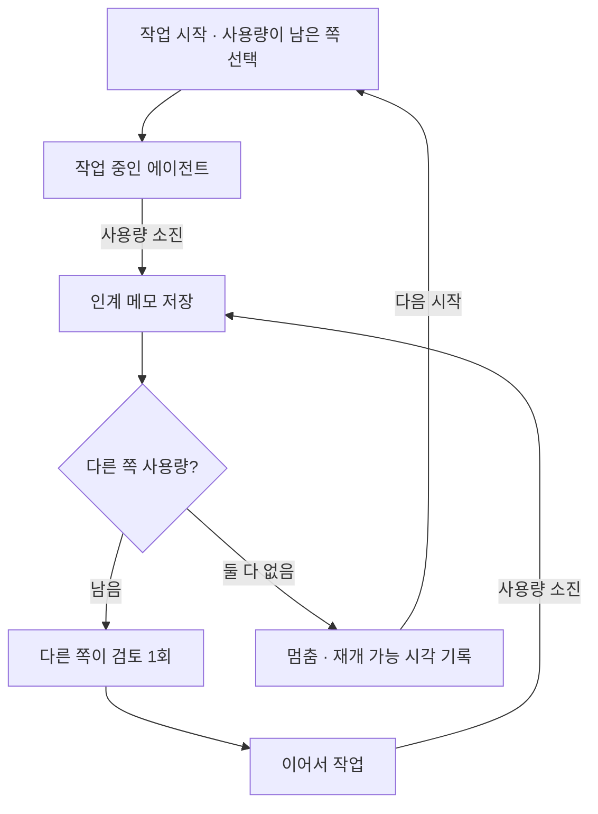

# Claude·Codex 작업 방식 선택지

> 현재 사용 정책: 2026-11-18 KST. 기존 시험 기록: 2026-11-17. 실제 개발 프로젝트(마인크래프트 플러그인)를 Hermes → Orca 로 맡기면서 정리한 방식입니다. 실제 주소·경로·계정은 적지 않습니다.

## 먼저 작업 입구를 고른다

| 상황 | 입구와 방식 |
|---|---|
| 내가 함께 설계·디버깅·수정 | Orca에서 Claude 또는 Codex와 직접 작업하고 검토까지 진행 |
| 자리를 비우며 작은 과제 위임 | Hermes 앱 → 기존 bridge → Orca 작업자 → 결과 회수 |
| 진행 중 직접 개입·다시 위임 | 기존 담당자의 종료 확인 후 같은 작업 폴더·가지에서 인계 |
| 큰 작업의 병렬 비교 | 사용자가 필요하다고 판단해 요청·허용할 때만 선택 |

**한 과제는 시작한 쪽에서 끝낸다.** 도구 사이의 인계는 예외 절차다. 직접 개발에 Hermes를 반드시 거치게 하지 않으며, 기존 Hermes 위임 경로는 유지한다. CLI 직접 실행이나 새 감독 프로그램으로 전환하지 않는다. [변경 과정·이유·다른 사용자 사례](./workflow-decision-2026-11-18.md)

## 개발 완료 후 별도 검토

새 개발 과제는 개발 담당 1명만 편집한다. 개발이 끝나면 작업 종료를 확인하고 요구사항·변경 내용·검사 결과를 고정해 별도 세션의 읽기 전용 검토 담당에게 넘긴다. 검토에서 발견한 수정 사항은 범위를 좁혀 새 개발 과제로 맡긴다. 아래의 사용량 소진에 따른 교대는 미완성 작업을 이어가는 절차다. [개발·검토 2명 구성과 시험 기록](./multi-agent-development-2026-11-18.md)

## A. Hermes에 맡긴 과제의 이어달리기

2026-11-17 후속: 고정 폴더의 신뢰 승인을 마치고 첫 개발 과제를 시작해 병합까지 완료했다는 사용자 보고가 있습니다. 구현 커밋과 main 포함은 GitHub에서 직접 확인했습니다. 실제 한도 소진에 따른 교대·양쪽 소진 후 중단·회복 후 재개는 별도 검증 대상입니다. [첫 개발 과제의 근거와 한계](./hermes-relay-development-2026-11-17.md)

규칙:

1. **시작**: Codex 와 Claude 중 지금 사용량이 남은 쪽으로 시작한다. 둘 다 남으면 과제 성격에 맞는 쪽을 고른다.
2. **사용량이 떨어지면**: 기존 작업자·감시가 실제 멈췄는지 확인하고 변경을 보존한 뒤 Hermes가 인계 메모를 남긴다 — 목표, 끝낸 일, 남은 일, 폴더, 가지, 마지막 커밋, 미커밋 변경, 빌드 결과, 막힌 점. 응답 없음은 종료 증거가 아니다.
3. **넘겨받으면**: 다른 쪽이 먼저 지금까지의 변경을 **한 번 검토**하고(버그·빠진 부분·설계 문제), 고칠 것은 고친 뒤 남은 일을 이어서 한다.
   - Codex 소진 → Claude 가 검토 후 이어서
   - Claude 소진 → Codex 가 검토 후 이어서
4. **둘 다 떨어지면**: 작업을 멈추고, 인계 메모와 각자의 재개 가능 시각(한도 안내에 나오는 시각)을 남긴다. 억지로 다시 시도하지 않는다.
5. **다시 시작할 때**: 먼저 사용량이 생긴 쪽을 고르고, 인계 메모의 **멈춘 곳부터** 이어서 한다. 이때도 3번처럼 검토 1회부터 한다.

Hermes 위임용 작업 폴더: 과제마다 새 작업 폴더(worktree)를 만들지 않고 **하나로 고정**해서 계속 쓴다. 과제마다 그 안에서 작업 가지만 새로 판다. 이어받는 쪽도 같은 폴더·같은 가지에서 시작한다.

폴더 신뢰(처음 한 번): Orca 는 에이전트가 "이 폴더를 믿는가" 를 물으면 기다리지 않고 바로 실패로 처리한다. 그래서 고정 폴더를 만든 직후 **사용자가 직접** 그 폴더에서 Claude·Codex 를 한 번씩 켜고 경로를 확인한 뒤 신뢰를 고른다. Hermes·에이전트가 대신 승인하거나 설정 파일로 미리 넣지 않는다.

원칙: 에이전트는 모두 Orca 안에서 실행하고, 권한 확인을 건너뛰는 실행 모드는 쓰지 않는다. push·삭제·외부 공개는 사용자 승인 후에만 한다.

## 직접 개발과 예외적인 인계

Orca에서 새로 시작하는 직접 개발은 해당 과제의 작업 폴더·작업 가지를 사용한다. Hermes가 점유한 relay를 동시에 편집하지 않는다. Hermes 과제를 직접 이어받을 때는 다음 네 단계를 거쳐 같은 relay·같은 가지에서 진행한다. 반대 방향도 같다.

1. 기존 담당자가 해당 작업자·감시·자동 재위임을 멈추고 실제 종료를 확인한다.
2. 과제의 변경을 보존한다. 가능한 단계 커밋을 남기고, 미커밋·미추적 변경도 지우지 않고 기록한다.
3. 목표·완료·남은 일·폴더·가지·커밋·변경·검증 결과·막힌 점·담당자를 인계 메모에 갱신한다.
4. 새 담당자가 실제 상태를 대조하고 기존 변경을 한 번 검토한 뒤 진행한다.

같은 폴더에서 담당자만 바꿀 때는 가지를 유지한다. 매번 대기 가지나 main으로 전환하지 않는다. 다른 폴더로 옮길 때만 종료·변경 보존 후 과제 가지를 놓아준다. 다른 worktree가 main을 사용 중일 수 있으므로 main 복귀를 고정 절차로 쓰지 않는다.

Orca 직접 실행도 실제 권한 설정을 확인한다. 과거의 기본값을 현재 설정으로 단정하거나 기본 실행 버튼이 제한 모드라고 가정하지 않는다. 폴더 신뢰는 사용자가 직접 승인하며 권한·샌드박스를 해제해 실행 문제를 넘기지 않는다. 규칙 문서는 실행 권한 제한을 대신하지 않는다.

완료 보고에는 변경·빌드·검토 결과와 미검증 항목을 구분한다. main 병합·push는 승인 후, 배포는 별도 요청 후 진행한다. 평소에는 `날짜 | 과제 | 결과 | 개입 횟수 | 막힌 원인` 한 줄만 남기고, 상세 증거는 실패·새 검증 때 기록한다. 진행 중 과제는 이번 정책 변경만으로 멈추거나 옮기지 않는다.

## B. 병렬 비교 — 2026-11-17 시도 기록

같은 과제(배경 음악 끄기 설정을 재접속 후에도 유지)를 Codex·Claude 에게 동시에 맡기고, 결과를 비교해 합치려고 했습니다. 방식은 [Hermes → Orca 위임](./hermes-orca-delegation.md)과 같은 Orca orchestration(조정자 핸들 → Run → 작업자 시작 → 완료 보고 회수)입니다.

| 단계 | 결과 | 근거 |
|---|---|---|
| Codex 샌드박스 | Ubuntu 24.04 AppArmor 가 bwrap 사용자 네임스페이스를 막아 파일도 못 읽음 → bwrap 전용 AppArmor 프로필 추가 후 통과 | 사용자 실행 + 서버 직접 확인 |
| 첫 실행 | Codex 는 업데이트 선택 화면에서 멈춤. Claude 는 Orca 기본 실행이 권한 확인을 건너뛰는 모드여서 Hermes 가 승인을 거부 | Hermes 실행 보고 |
| 도구 오류 | 작업자 경로·터미널 정보를 비워 저장하는 스크립트 버그 | Hermes 실행 보고 |
| 수정 | Orca 공식 custom argv 경로로 바꿈(작업 폴더 → 직접 정한 실행 명령의 터미널 → 작업자 연결). Claude 는 파일 수정·빌드·git 만 허용, Codex 는 작업 폴더 격리 + 필요 시 승인, 업데이트 확인은 그 실행에만 끔 | 스크립트 문법·실행 인자 서버 확인 |
| 재시도 | Hermes 가 ChatGPT·Codex 구독 사용량 한도에 걸려 실행 전 중단 | Hermes 화면 |
| 재시도 2 (한도 회복 후) | 두 작업자 모두 새 작업 폴더의 신뢰 확인에서 `agent_readiness` 실패(`agent-trust-workspace`). 스크립트는 실패인데도 종료 코드 0 을 냄 → 실패를 찾아 1 로 끝나게 고침. 변경 없이 중단 | Hermes 실행 보고 |

배운 점과 한계:

- 병렬은 같은 시간에 사용량을 두 배로 쓴다. Hermes 와 Codex 작업자가 같은 구독을 쓰면 더 빨리 바닥난다 → 평소에는 A 방식이 맞다고 판단했다.
- 수정한 병렬 도구로 실제 구현·비교·합치기까지 끝낸 적은 아직 없다 (미검증).
- 병렬은 과제마다 새 작업 폴더를 만들기 때문에 매번 신뢰 확인에 걸리고, Orca 는 이를 기다리지 않고 실패 처리한다. 이어달리기에서 폴더를 하나로 고정한 이유다.

## 관련 기록

- [Hermes → Orca 위임 시험](./hermes-orca-delegation.md)
- [AI 도구 사용 범위](./ai-tools-guide.md)
