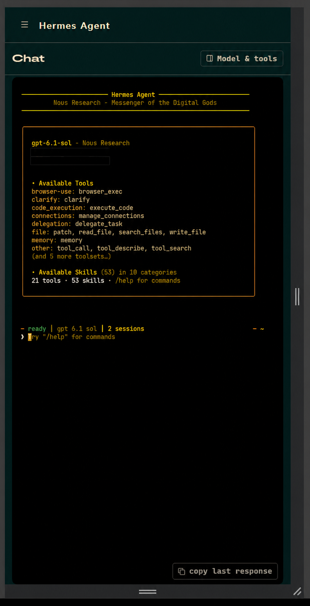
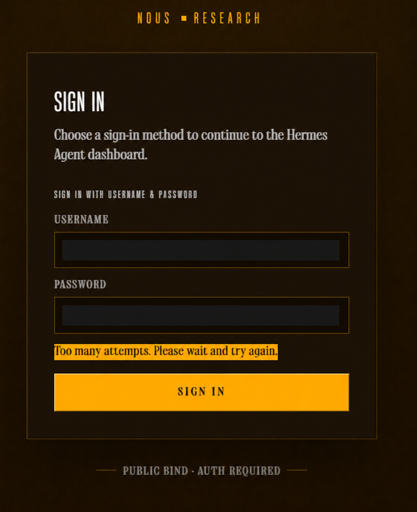
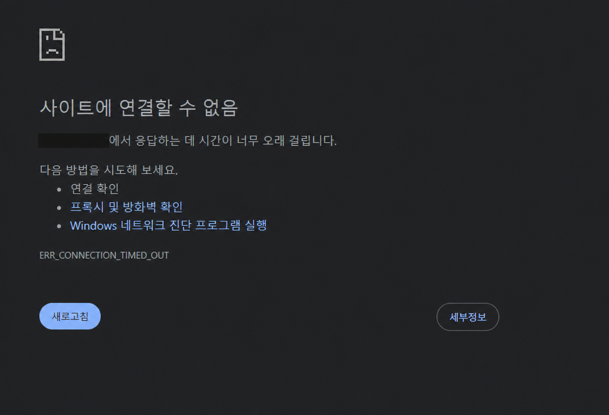
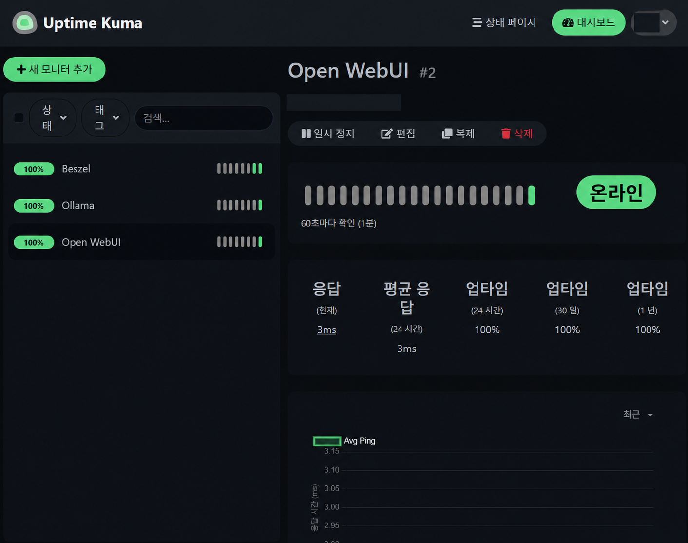
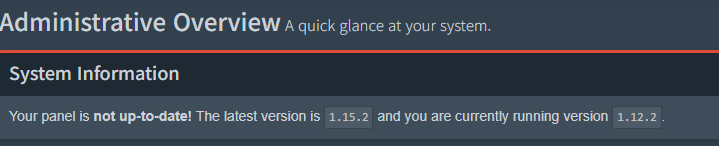
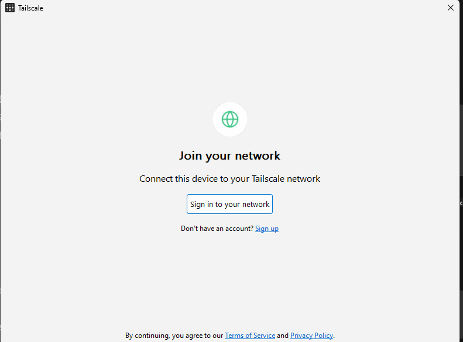
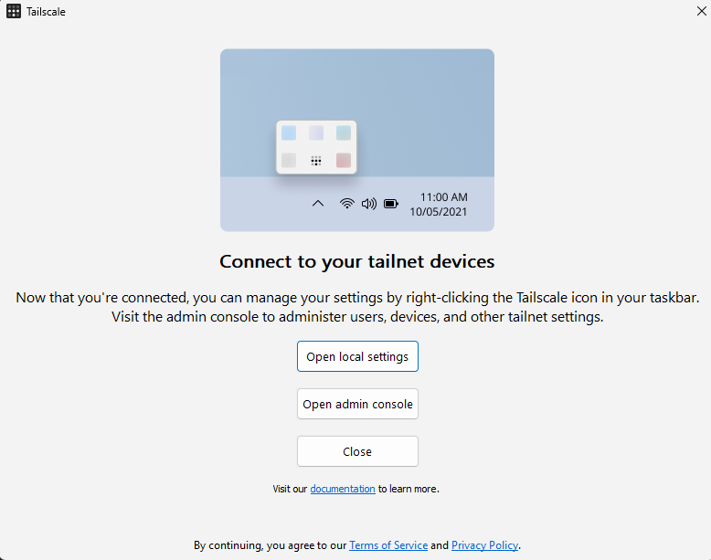
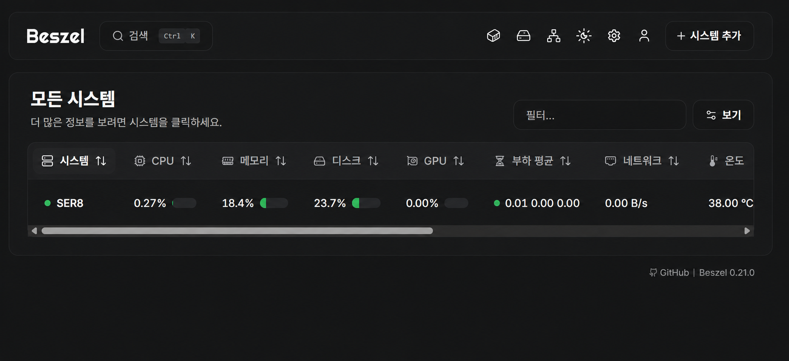
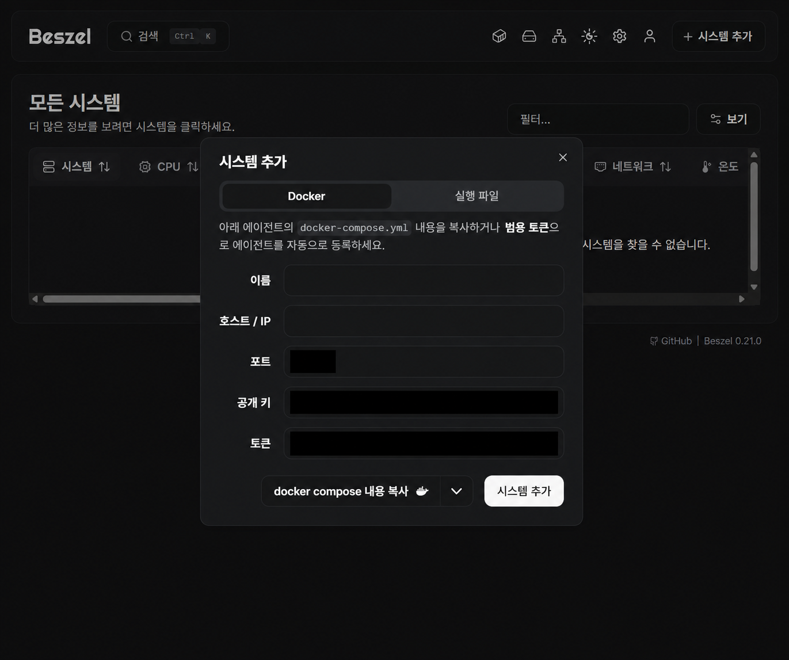
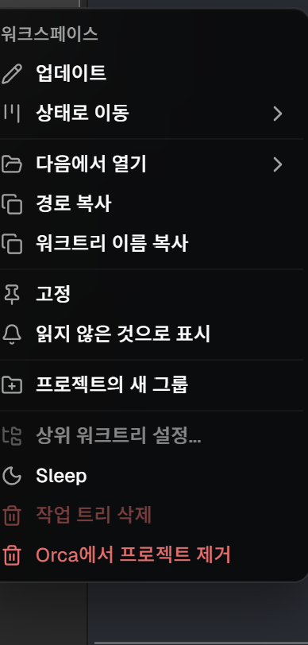

# 환경 점검 기록

> 초기 기록: 2026-10-21. 최신 후속 반영: 2026-10-24. 일반 셸·확장 도구의 날짜별 직접 조회와 이후 사용자 제공 로그·화면·보고를 구분합니다. 과거 절의 직접 확인은 당시 세션 기준입니다.

<a id="update-2026-10-24"></a>
## 2026-10-24 모바일 접속·Hermes 개인 비서 후속 기록

사용자가 전달한 CLI 출력·화면·성공 보고를 정리했습니다. 아래 내용은 이번 편집 환경에서 운영 서버에 재접속해 측정한 결과가 아닙니다. 기존 절의 직접 점검은 각 절의 날짜·범위로 해석합니다. 실제 주소·계정·포트·인증정보는 생략했습니다.

| 항목 | 확인된 사실과 출처 | 한계 |
|---|---|---|
| Orca 모바일 | 모바일 페어링·접속 성공 — 사용자 보고. `orca-serve.service` active 출력 제공 | 실행 중 작업의 기기 간 인계·서버 재부팅 시험 아님 |
| Orca 공용 스킬 | `orca-cli`·`orchestration` 설치 완료 CLI 출력, 공용 경로와 Claude Code·Codex·OpenClaw·Universal 대상 표시 | 설치 완료와 모든 스킬 실행 성공은 구분. Hermes 자동 인식 여부 미확인 |
| Hermes 선택 | 추가 결제 없이 기존 구독 로그인 경로 우선, 웹 화면 사용 선택 — 대화 기록 | 무제한 사용·별도 비용 발생 여부를 측정한 결과 아님 |
| 모델·웹 UI | 선택 화면의 `gpt-6.1-sol`·`Medium`, 웹의 v0.22.5 표시 | 화면 표시 기준. 모델 평가·현재 소스 revision 검증 아님 |
| 웹 사용자 서비스 | `hermes-dashboard.service` loaded·enabled·active, 준비 완료 로그 — 사용자 제공 출력 | 재부팅 후 자동 복구 미검증 |
| 웹 수신·자체 응답 | Tailscale 주소에 TCP LISTEN, 서버 자체 HTTP 302 — 사용자 제공 출력 | 원격 도달·로그인·AI 응답 성공과 별개 |
| PC 접속 장애 | ping 성공·TCP 실패, 접근 정책에서 해당 웹 포트 누락 확인. 정책 보완 후 접속 성공 — 출력·정책 화면·사용자 보고 | 전체 ACL 정비·다른 서비스 도달 시험 아님 |
| 웹 로그인·암호 변경 | 시도 제한 화면 이후 로그인 성공, 비밀번호 변경 완료 — 사용자 보고 | 실제 암호·환경 파일 내용은 저장하지 않음 |
| 휴대폰·실제 작업 | 휴대폰 접속과 작업 모두 잘된다고 확인받음 | 작업별 산출물·자동 테스트·속도·비용 수치는 미제출 |
| 입력·세션 정리 | 우클릭 붙여넣기 및 불필요 세션 삭제 완료 — 사용자 보고 | Ctrl+V 원인 규명·수정 아님 |
| OpenClaw·자동화 | OpenClaw 보관 방향, 외부 백업·자동 백업·n8n 예약 보류 유지 | OpenClaw 실제 중지 상태 재조회, 메신저·예약 업무·완료 알림 미검증 |

구성과 사용 순서는 [Hermes 개인 비서](./hermes-assistant.md), 연결 장애의 판단 과정은 [문제 해결 기록](./troubleshooting.md#hermes-web-access-policy)에 있습니다. 개인 비서 도입을 n8n 예약 자동화 완료로 처리하지 않습니다.

### 공개 이미지와 원본 해석

사용자 원본 중 필요한 8장을 골랐습니다. 5장은 개인정보를 가린 **AI 편집 참고본**, 3장은 인증정보가 없는 메뉴·안내 원본입니다. AI 편집본의 글꼴·배치가 원본과 다를 수 있으므로 독립적인 실행 증거로 삼지 않습니다. 파일별 원본·가림 범위는 [이미지 목록](./images/README.md)에 있습니다.




첫 번째는 웹 구성, 두 번째는 좁은 화면의 UI 참고본입니다. 실제 휴대폰 사용 성공의 근거는 별도로 받은 사용자 보고입니다.





로그인 시도 제한과 연결 시간 초과는 서로 다른 단계의 문제였습니다. 이후 접속·로그인 성공을 보고받았습니다.



2026-10-21 당시 HTTP 감시 화면입니다. 화면의 가용성·응답 시간은 해당 캡처 표시이며 장기 운영 성능으로 일반화하지 않습니다.


설정 메뉴 원본입니다. 모델·추론 선택 사실과 모든 제공 모델의 사용 가능 여부는 구분합니다.



2026-10-23 **업데이트 전** 안내입니다. 이 화면만으로 업데이트 완료를 판단하지 않습니다. 업데이트 이후 현재 버전·정상 동작 여부를 이번 문서 편집에서 재조회하지 않았습니다.

### 남은 확인

지속 메모리의 새 세션 재사용, 브라우저 종료 후 장시간 작업 유지·완료 알림, SER8 재부팅 후 서비스 복구, 허용하지 않은 기기의 차단, 구독 한도·작업별 사용량은 아직 별도 확인 대상입니다. 실제 서버 재시작·장애 시험을 이 문서 작업에 포함하지 않았습니다.

**기존 후속 확인:** Unknown 해결은 사용자 보고, n8n 첫 수동 HTTP 성공은 사용자 화면 근거이며 정기 실행은 보류합니다. 현재 사용은 [사용 가이드](./usage-guide.md)를 따르고 아래 직접 점검·과거 기록의 시점을 구분합니다.

## 2026-10-23 스킬·플러그인·MCP 읽기 전용 조사

SER8 사용자 홈의 설치 파일·선택된 설정 필드·링크 대상·파일 해시를 직접 읽었습니다. `claude plugin list --json`과 `codex mcp list --json`은 목록 조회만 실행했습니다. 스킬 본문은 조사 자료로 읽었으며 실제 스킬·에이전트·helper·MCP 도구 호출과 문서 생성·렌더링 시험은 하지 않았습니다. 상세 목록·사용 예시는 [확장 도구 사용 가이드](./ai-tools-guide.md)에 둡니다.

| 항목 | 직접 확인 | 확인하지 않은 범위 |
|---|---|---|
| 공용·Claude 스킬 | 공용 142개, Claude 직속 137개 중 공용 원본 링크 134·ECC 사본 3, 깨진 링크 0. synced 하위 SKILL.md 13개 별도 존재 | synced의 현재 CLI 노출·우선순위·동기화 주체, 개별 업무 실행 |
| Claude 플러그인 | 목록에서 Superpowers 7.0.0·document-skills·skill-creator 활성, GitHub 비활성 | 개별 스킬·전문 에이전트 실행 |
| Codex 설치 | 시스템 스킬 5개, 플러그인 캐시 10종 디렉터리 존재 | 캐시 전체의 활성·CLI 인식·계정 연결을 단정하지 않음 |
| Context7 | 양쪽 사용자 설정 등록. Codex 목록은 enabled=true·auth_status=not_logged_in | 연결·조회·인증 요구 방식 미검증. 과거 Claude 실제 조회 기록과 구분 |
| ECC 3종 | SKILL.md 차이·보조 파일 목록 비교. Claude 자동 호출 제한, 공용 implicit 호출 금지 메타데이터, security-review의 SQL·CSP·입력 검증 예시 차이 확인 | 차이 작성자·세부 수정 시점·인자 치환 재현·현재 개별 세션 로드 여부 |
| 문서 도구 | LibreOffice·pandoc·qpdf·pdftoppm·tesseract 실행 파일 PATH 해석 확인 | Python import·Node require·실제 생성·렌더링·OCR 안 함 |

조사 단계에서는 설치·업데이트·삭제·설정 변경·커밋·push를 하지 않았습니다. 후속 문서 검토·커밋·게시와 구분합니다. 운영 서비스·다른 프로젝트를 변경하지 않았고 인증정보·환경 변수 전체·원본 설정은 출력하거나 저장소에 복사하지 않았습니다. 기존 agent-browser 제외·Claude GitHub MCP 비활성 및 git·gh 사용·ECC 명시 호출·handoff 출처 미확인·YOLO 유지 결정을 그대로 둡니다.

## 2026-10-23 접속 결과와 운영 선택

이번 반영의 근거는 사용자가 전달한 성공 보고, 앞선 서버 조사 결과와 DHCP 예약 화면 확인 사실입니다. 이번 문서 편집에서 서버 명령·접속·HTTP 요청·재부팅·DHCP 재할당을 실행하거나 화면을 다시 열람한 것은 아닙니다. 아래의 직접 확인은 앞선 조사·화면 확인 당시 범위이며 이번 재측정과 구분합니다. 실제 주소·MAC·호스트명·계정·포트·인증정보와 사진은 추가하지 않습니다.

| 항목 | 결과와 근거 | 한계·현재 선택 |
|---|---|---|
| 데스크톱 Orca → SER8 | 연결 성공 — 사용자 보고 | 노트북·데스크톱 간 실행 중 작업 인계는 미검증 |
| Beszel·Uptime Kuma LAN 접속 | 직접 접속 성공 — 사용자 보고 | 집에서는 SSH 터널 없이 사용, 기존 localhost 접근도 유지. 바인딩·방화벽·중계 방식은 이번에 조사·변경하지 않음 |
| Beszel 등록·수집 | 시스템 1개와 최근 수집 확인 — 앞선 서버 조사 | 장기 수집 안정성·지표 정확성의 검증은 아님 |
| 데스크톱 localhost의 Beszel 빈 목록 | 빈 목록이 보였던 현상, 원인 미확정 | 서버 조사 결과와 구분. LAN 접속 성공만으로 원인·해결을 단정하지 않음 |
| 공유기 DHCP 예약 | 목록에 SER8 주소·MAC 등록 화면 확인 | 등록 화면 확인까지만 반영. 재부팅·DHCP 재할당 후 주소 유지 미검증 |
| 외부 백업·자동 백업 적용·n8n 정기 실행 | 사용자 선택으로 보류 | 완료로 처리하지 않으며 기존 백업 초안·수동 워크플로 유지 |

아래의 데스크톱 미확인·루프백 수신·지표 수집 확인 대기 표현은 당시 기록입니다. 현재 접속 안내는 [사용 가이드](./usage-guide.md)를 우선하며, 과거 SSH 터널은 대안으로 보존합니다.

## 2026-10-22 사용자 제공 권한 조회 결과 — 후속 확인

근거는 사용자가 제공한 PowerShell·SSH 명령 출력과 접속 설명입니다. 앞선 일반 셸의 권한 부족 항목을 보완하며, 이 문서 반영 과정에서 서버 명령·접속·HTTP 요청을 재시험한 결과는 아닙니다. 출력 원문과 실제 주소·사용자명·호스트명·서비스 포트·인증정보는 저장소에 옮기지 않습니다.

| 항목 | 사용자 제공 결과 | 확인 범위와 한계 |
|---|---|---|
| Beszel Hub·Agent | 둘 다 실행 중 | 프로세스 실행 확인. 현재 지표 수집·정확성은 별도 |
| Uptime Kuma·Open WebUI | 둘 다 healthy | 컨테이너 상태 확인. 기능 전체 시험은 아님 |
| n8n | 실행 중, healthy 표시 없음 | 실행 상태까지만 확인. 현재 HTTP 요청 재시험 없음 |
| Orca 접근 제한 | 포트 수신, UFW에서 Tailscale 허용 → 일반 차단 순서 | 의도한 규칙 순서 유지. 외부 도달 가능성 시험은 아님 |
| n8n → Open WebUI | 범위를 지정한 허용 규칙 존재 | 기존 조치 유지. 현재 요청 성공 여부를 재확인하지 않음 |
| Beszel·Kuma·n8n·Ollama | 루프백 주소에서 수신 | 해당 수신 소켓은 직접 LAN 바인딩이 아님. 전체 외부 접근 경로 판단과 구분 |
| 기존 방화벽·DB | 게임·Wings·DB 관련 광범위한 허용 규칙 유지. MariaDB는 루프백·Docker 브리지 주소에서 수신 | 규칙 존재만으로 인터넷 접근 가능 여부를 판단하지 않음. 의존성 확인 전 삭제하지 않음 |
| 수동 백업 | 기존 날짜 폴더와 config 폴더 존재 | 폴더 존재만 확인. 압축 파일 존재·현재 무결성·복원 가능성은 이번 출력으로 확인 불가 |
| 게임 서버 | 컨테이너가 모두 중지 상태. 종료 코드 0·1·137 기록 | 의도적 중지 여부는 미확인. 자동 시작·삭제하지 않음 |
| SSH 인증 | passwordauthentication yes, pubkeyauthentication yes. 이번 비밀번호 접속 성공은 사용자 보고 | 현재 비밀번호 인증 사용 중. 공개키 허용을 키 인증 전환 완료로 기록하지 않음 |
| root SSH 정책 | permitrootlogin without-password | root 비밀번호·키보드 대화형 인증 금지. 인증 없이 root 로그인 허용이라는 의미가 아님 |
| 업데이트 안내 | 즉시 적용 가능 업데이트 총 20개 중 일반 보안 업데이트 6개, 펌웨어 업데이트 안내 장치 2개 | 로그인 안내 기준. 내용 검토·설치는 별도 작업 |

종료 코드 137은 강제 종료 신호와 관련되지만 이 코드만으로 OOM을 단정하지 않습니다. [Docker 공식 문서](https://docs.docker.com/reference/cli/docker/container/ls/#filter-by-exit-signal). SSH의 without-password는 prohibit-password의 이전 별칭이며 root의 비밀번호·키보드 대화형 인증을 막습니다. [OpenSSH 공식 문서](https://man.openbsd.org/sshd_config#PermitRootLogin).

지금은 외부에서 접속 중이므로 SSH·방화벽·중지된 게임 서버 설정을 유지합니다. 다음 실제 작업은 집에서 데스크톱 Tailscale·Orca 연결과 같은 작업 공간 접근 확인입니다. Beszel 지표 수집, 실제 외부 접근 범위, 백업 압축본·무결성·복원 가능성은 아직 별도 확인 대상입니다.

## 2026-10-22 읽기 전용 직접 점검

이 절은 18:24 KST 최초 점검과 그 후 읽기 전용 조회의 기록입니다. 같은 날 후속 승인에 따른 Git 통합·게시와 구분합니다. 노트북의 기존 Orca SER8 연결을 통해 서버 기록 저장소의 일반 셸에서 직접 조회했습니다. 기존 에이전트에 작업을 보내거나 tmux 세션을 조작하지 않았습니다. **직접 조회한 상태**, **사용자 보고**, **과거 문서 기록**은 아래처럼 구분합니다. 현재 사용 순서와 설치 경로·정리 후보 목록은 [사용 가이드](./usage-guide.md)가 중심입니다.

| 영역 | 이번에 직접 확인한 사실 | 확인하지 않은 범위 |
|---|---|---|
| Git | 시작 시 main 9857069·깨끗한 작업 트리. fetch 후 origin/main 096e2e1, 로컬 전용 0·원격 전용 1. stash 2개, 이 저장소의 로컬 브랜치·worktree 각각 1개 | pull·merge·checkout·stash 적용·삭제·커밋·push 안 함 |
| Orca | 1.4.237 사용자 설치, current 링크 정상, 프로필 1개, 사용자 서비스 active·enabled·running·NRestarts 0, linger yes | 재부팅 후 자동 복구 시험 안 함 |
| Orca 실행 구조 | supervise 프로세스와 자식 원격 서버 1개, 별도 내부 daemon-entry 프로세스. 원격 서버는 wildcard 및 loopback TCP 수신, 내부 데몬은 TCP 수신 없고 기존 셸·에이전트 자식 11개 확인 | 별도 내부 데몬을 중복 원격 서버로 단정하거나 종료하지 않음 |
| 프로젝트 등록 | 서로 다른 Git 저장소 2개가 각각 독립 프로젝트·setup·main 작업 공간으로 등록, 잘못된 upstream 없음 | 노트북 UI 전체·데스크톱 화면 직접 확인 아님 |
| 접속·세션 | Tailscale 1.104.2, 서비스 active·enabled, BackendState Running·self online. SSH socket active·enabled, service active·disabled. tmux 3.4, 분리된 기존 세션 1개 | 이번 노트북 비대화형 SSH는 인증 실패, Orca 연결로 진행. tmux attach·새 세션·종료 안 함 |
| 개발 도구 | Claude 2.1.308, Codex 0.163.0, Node 24.22.0, npm 11.19.1, Git 2.43.0, gh 2.45.0. Claude·Codex·gh 인증 상태 명령 정상 | 에이전트 작업·외부 모델/API·MCP 호출·스킬 실행 시험 안 함 |
| Skills·Plugins | 공용 원본 142, Claude 스킬 137(134 링크·별도 ECC 3), Codex 시스템 5. Orca selector 259 발견, 깨진 링크 없음. Claude Superpowers 7.0.0·document-skills·skill-creator 활성, GitHub 비활성 | selector 수는 고유 스킬 수가 아님. 개별 기능 실행·문서 생성·렌더링 미검증 |
| MCP | 양쪽 Context7 설정 이름 확인, Claude GitHub 플러그인 disabled 유지 | MCP 프로세스 시작·연결 시험 안 함. Codex 계정 커넥터의 현재 연결은 별도 미검증 |
| 지침 | ai-workspace와 두 프로젝트에 AGENTS.md·CLAUDE.md 존재. ai-workspace 지침은 그 폴더 범위이며 형제 저장소에 자동 상속되지 않음. 홈 전역 지침은 확인되지 않음 | 지침 자동 로딩의 실제 에이전트 실행 시험 안 함 |
| 운영 서비스 | Docker 29.1.3·Compose 2.40.3 버전 정상, docker·wings·ollama 서비스 active·enabled. Beszel Hub와 n8n의 설정된 loopback 소켓 수신 | Docker 소켓 권한 없어 현재 컨테이너 healthy·실행 이미지·Agent 상태 재확인 못 함. HTTP·AI·게임 응답 요청 안 함 |
| 접근 제한 | 일반 사용자, Docker 그룹 아님. UFW 규칙 파일 읽기 제한, ufw 조회 root 필요. sshd -T는 hostkeys 접근 제약으로 종료 | 실제 UFW 허용 순서·IPv6 정책·Tailscale ACL·유효 SSH 인증 정책 확인 못 함. 기존 제한 설정을 이번에 검증 완료로 올리지 않음 |
| n8n | Compose는 2.44.5 태그·digest와 loopback 바인딩을 지정, 해당 소켓 수신 | 기존 워크플로·DB·인증정보를 열지 않음. 첫 수동 HTTP 성공은 사용자 화면 근거 유지, 재실행·예약 추가 안 함 |
| 백업 | 저장소 초안 존재. 배포 스크립트·모니터링 전용 system/user timer 없음, 사용자 cron 없음. 비공개 백업 루트는 접근 제한 | 현재 수동 백업 목록·무결성·복원 가능성 미확인. 백업·dry-run·예약 배치 안 함 |

### 자원 스냅샷

2026-10-22 18:24 KST의 free·df 조회에서 루트 ext4 468G / 사용 116G / 가용 329G / 27%, 메모리 총 14Gi / 사용 8.2Gi / 가용 6.7Gi, swap 총 4Gi / 사용 1.1Gi였습니다. 수치의 단위는 명령 표시를 유지했습니다. 한 시점의 사용량이며 성능 향상·동시 부하·가용 용량 보장은 아닙니다.

### 보존한 것과 미확인

- 정책: Orca YOLO 유지, Claude·Codex 같은 작업 공간 순차 사용, Claude GitHub는 git·gh 사용, agent-browser 제외, Unknown 해결 완료는 사용자 보고로 유지.
- 최초 점검 단계의 문서 편집은 관련 Markdown에 한정했고 원격 1커밋을 적용하지 않았습니다. 이후 사용자 승인에 따라 외부 비공개 사본·tracked diff와 보존 커밋 dca4730을 확보하고 일반 merge로 통합했습니다. 기존 stash는 그대로 보존합니다.
- 설정 백업·stash·이전 CLI 설치본·플러그인 캐시·프로필 DB 백업은 삭제하지 않았습니다. 상세 의존성과 영향은 [정리 후보](./usage-guide.md#삭제하지-않은-정리-후보)를 참고합니다.
- 당시 권한 부족 항목에 대해 안내한 읽기 전용 명령은 아래와 같습니다. 이후 사용자가 전달한 결과는 위 후속 확인에 반영했습니다. 당시 일반 셸에서는 sudo 비밀번호 입력과 우회를 시도하지 않았습니다. 출력 원문은 공개하지 않으며, 아래 전체 목록을 다시 실행해야 한다는 뜻은 아닙니다.

```bash
sudo docker ps --format '{{.Names}} {{.Status}} {{.Image}}'
sudo docker inspect --format '{{.Name}} {{.State.Status}} {{if .State.Health}}{{.State.Health.Status}}{{end}}' <container-name>
sudo ufw status numbered
sudo ss -lntp
sudo /usr/sbin/sshd -T | awk '$1 ~ /^(passwordauthentication|pubkeyauthentication|permitrootlogin)$/'
sudo find <monitoring-backup-root> -mindepth 1 -maxdepth 1 -printf '%y %f\n'
```

### 096e2e1의 공개 이미지 보존

기존 로컬 공개 이미지 4장은 수정하지 않았습니다. 후속 문서 통합에서 다음 원격 공개 이미지 4장을 일반 merge로 보존했습니다. 원격 기록의 공개 판단과 원본/AI 편집본 구분을 유지하며 이미지를 새로 편집하지 않았습니다.

| 원격 파일 | 근거·해석 |
|---|---|
| [05-orca-connected-ai-edited.png](./images/05-orca-connected-ai-edited.png) | AI 편집 참고본. 원본 실행 증빙 아님 |
| [06-n8n-timeout.png](./images/06-n8n-timeout.png) | 기존 공개 결과 원본. 조치 전 타임아웃 |
| [07-n8n-http-success.png](./images/07-n8n-http-success.png) | 기존 공개 결과 원본. 단일 HTTP 성공이며 성능 검증 아님 |
| [08-orca-removal-menu.png](./images/08-orca-removal-menu.png) | 메뉴 원본. 화면 자체는 제거 실행·해결의 증거가 아니며 해결은 사용자 보고 |

## 과거 기록을 읽는 방법

이 아래의 값·미완료 표현은 각 절의 날짜 당시 기록입니다. 'Orca 미설치', 'tmux 미확인', 'Unknown 최종 확인 전', 'n8n 첫 업무 미정'은 이후 진행으로 바뀌었으므로 현재 미완료 목록으로 사용하지 않습니다. 현재 상태는 위 직접 점검과 사용 가이드, Unknown·수동 HTTP 성공은 사용자 후속 확인을 우선합니다.

## 2026-10-21 확인된 사실 — 과거 기록

| 항목 | 점검 당시 결과 | 근거와 해석 범위 |
|---|---|---|
| 운영체제 | Ubuntu 24.04.5 LTS | 사용자 제공 확인 정보. 업그레이드 실행 과정은 미확인 |
| CPU | AMD Ryzen 7 8745HS, 8코어 / 16스레드 | `lscpu` 출력의 모델·코어·스레드 확인 |
| 메모리 | 총 14GiB, available 12GiB | `free -h` 표시를 정리. 물리 메모리 제품 용량과 구분 |
| swap | 4GiB | `free -h`, `swapon --show` 출력 |
| 루트 파일시스템 | ext4, 전체 468GB / 사용 105GB / 여유 339GB | `df -hT`의 `468G / 105G / 339G` 표시. 반올림된 값이며 물리 SSD 용량과 구분 |
| Docker | 29.1.3 | 버전 출력과 `docker.io` 패키지 확인 |
| Compose | 초기 미설치 → 2.40.3 설치 완료 | 패키지 설치·버전 출력, Compose 문법 검사 통과와 서비스 실행 확인 |
| Pterodactyl Wings | `active / enabled` | systemd 조회. 개별 게임 서버의 실행·접속 상태와 구분 |
| Ollama | `active / enabled` | systemd 조회. 모델 목록·응답·추론 속도는 미검증 |
| Open WebUI | Docker 컨테이너 `healthy` | 컨테이너 상태 출력. 브라우저 로그인·AI 응답은 미검증 |
| SSH socket | `active / enabled` | 추가 socket 조회 결과. 서비스 unit의 부팅 설정과 구분 |
| UFW | 활성, 광범위한 허용 규칙 존재 | 방화벽 출력. 실제 외부 접속 가능 여부는 별도 점검 필요 |
| Tailscale | 초기 미설치 → 경유 SSH 터널과 웹 접속 확인 | 관리 PC의 연결 후 안내 화면, SSH 터널 사용 흐름과 Beszel 웹 접속 확인. 재부팅·정책 검증은 미실시 |
| 백업 도구 | restic·borg·rclone 미설치, rsync 존재 | 도구 조회 결과. 전체 백업 일정·성공·복구 여부는 확인하지 못함 |

원본의 사용자명, 호스트명, 주소, 포트 매핑, 컨테이너 식별자와 인증 관련 정보는 공개 문서에 옮기지 않았습니다.

## 상태를 해석할 때 구분한 내용

### SSH service와 socket

처음 출력에서는 SSH service가 `active`이면서 `disabled`로 표시되었습니다. 추가 확인한 `ssh.socket`은 `active / enabled`였습니다. service의 `disabled` 표기만으로 SSH 자동 시작이 꺼져 있다고 결론 내리지 않았습니다. 실제 재부팅 후 재접속은 별도 검증 항목입니다.

### 백업 도구와 복구 가능성

restic·borg·rclone 미설치가 백업 자체의 부재를 뜻하지는 않습니다. 기존 홈 게임 서버 문서에는 Pterodactyl 백업 생성 기록이 있지만, 이는 과거 게임 데이터 백업 기록입니다. 현재 전체 서버의 백업 성공이나 복구 가능성을 증명하지 않습니다. rsync의 존재만으로 자동 백업이 구성되었다고도 판단하지 않습니다.

### 자원 여유와 성능

available 12GiB와 루트 여유 339GB는 한 시점의 상태입니다. 게임 서버·AI 추론·개발 도구·자동화가 동시에 실행될 때의 메모리 사용량이나 처리 성능은 측정하지 않았습니다. 자원 여유를 근거로 모델 크기나 동시 실행 가능 서비스를 확정하지 않습니다.

### 방화벽과 외부 도달 가능성

UFW 활성과 광범위한 허용 규칙이 함께 확인되었습니다. 이 출력만으로 관리 서비스가 인터넷에 공개되어 있다거나 안전하게 차단되어 있다고 단정하지 않습니다. 실제 접근 경로 점검과 규칙 축소는 향후 작업이며, 주소·포트별 노출 상세는 비공개로 관리합니다.

## 설치 안내와 실제 완료의 구분

| 항목 | 확보된 근거 | 기록 상태 |
|---|---|---|
| Beszel Hub | 컨테이너 실행 출력, HTTP `200 OK` | 실행·응답 확인 |
| Beszel Agent | 컨테이너 실행, Unix 소켓 서버 시작 로그, 대시보드 온라인 | 기본 연결 확인 |
| Beszel 지표 수집 | 대시보드에 CPU·메모리·디스크·온도 표시 | 기본 지표 확인, 정확성·장기 안정성은 별도 검증 |
| Tailscale / SSH 접근 경로 개선 | Tailscale 경유 SSH 터널 사용과 Beszel 웹 접속 | 접속 경로 확인, 인증·접근 제어 개선은 미완료 |
| Uptime Kuma | 2.5.6 `healthy`, 관리자 대시보드 접속, HTTP 감시 3항목 온라인 | HTTP 응답 감시 확인, 외부 알림 미사용·장애·복구 시험 생략 |
| 모니터링 데이터 백업 | 수동 백업 생성, 압축 읽기 검사, 체크섬 초기 검사 통과 | 수동 백업 확인, 외부 저장·자동화·복원 시험 미실시 |
| Claude Code / Codex + 중앙 Skills·MCP | 설치·인증·실행, 공통 지침, Skills·MCP 로드, Context7 실제 조회 | 기본 구성 확인, 실제 개발 작업은 후속 |
| Orca Remote Server | 1.4.237 설치, 사용자 서비스 `active`·`enabled`, 독립 프로젝트 등록, 노트북 재접속 기록 (2026-10-22 직접 확인) | 서버·노트북 연결 확인, YOLO 유지 결정 완료, Unknown 해결 완료(사용자 보고)·데스크톱 연결 미완료·재부팅 후 복구 미완료 |
| n8n 자동화 | 설치·계정 생성 보고, 수동 HTTP 확인 200·ok=true 화면 | 수동 실행 성공. 정기 실행은 사용자 선택으로 보류 |

명령을 안내했거나 사용자가 진행 의사를 밝힌 사실은 실행 성공의 근거로 사용하지 않습니다.

## 후속 기록 방식

설치 후에는 날짜, 수행한 변경, 성공·실패 결과, 기존 서비스 영향, 마스킹한 화면·로그를 남길 계획입니다. 재부팅·장애·복구 시험은 실제 수행한 범위만 완료로 변경합니다. Beszel 원본은 브라우저 프로필 표시·접속 정보 때문에 공개를 보류했습니다. 사용자 검수·승인 후 아래에 AI 편집 참고 이미지 2장을 추가했습니다. 원본 실행 증빙과 구분합니다.

## 관련 문서

- [프로젝트 소개](./README.md)
- [단계별 구축 계획과 완료 조건](./roadmap.md)
- [기존 홈 게임 서버 증거 자료](https://github.com/kosmos-s/G.study/blob/main/portfolio/home-game-server/evidence.md) — 과거 운영 기록


## 2026-10-21 추가 구축 결과

- Docker Compose 2.40.3 설치 후 설정 검증과 Hub·Agent 실행을 확인했습니다.
- Hub는 루프백 인터페이스에 바인딩하고, 관리 PC에서는 SSH 터널을 이용해 접속했습니다. 실제 주소와 포트는 공개하지 않습니다.
- Hub와 Agent는 같은 서버의 공유 Unix 소켓으로 연결했습니다.
- Agent에는 Docker 관리자 소켓을 마운트하지 않았습니다. 따라서 컨테이너별 통계는 구축 완료 범위에 포함하지 않습니다.
- Hub 실행 후 Docker·Wings·Ollama는 `active`, Open WebUI는 `healthy`로 표시됐습니다. Agent 추가 후 게임 접속·AI 응답을 재시험한 근거는 없습니다.

| Beszel 화면 항목 | 촬영 순간 표시값 |
|---|---:|
| CPU | 0.27% |
| 메모리 | 18.4% |
| 디스크 | 23.7% |
| 온도 | 38°C |

이 값은 한 시점의 대시보드 표시값입니다. 벤치마크나 성능 개선 수치가 아닙니다. GPU의 0% 표시는 실제 추론 중 수집 정확성을 증명하지 않습니다. 시작 로그의 WebSocket `401` 경고는 후속 로그에서 해소 여부를 확인하지 못했습니다.

## 2026-10-21 모니터링·백업·AI 개발 환경 진행 결과

> 아래 내용은 앞선 SER8 세션의 사용자 제공 로그·화면·설치 보고를 정리한 기록입니다. Context7 직접 호출 결과도 해당 Claude Code 세션의 보고에 근거합니다. 이번 GitHub 반영 작업에서 서버 서비스를 재측정하거나 운영 설정을 변경하지 않았습니다.

### 완료로 보고된 항목

| 항목 | 보고된 결과 | 해석 범위 |
|---|---|---|
| Beszel | Hub·Agent 기본 지표 수집 확인 | GPU 정확성·장기 수집은 미검증 |
| Uptime Kuma | 2.5.6 설치, 컨테이너 `healthy`, 관리자 대시보드 접속 | 설치·접속 확인 |
| HTTP 응답 감시 | Beszel·Ollama·Open WebUI 감시 등록, 세 항목 온라인 | HTTP 응답 확인. AI 응답 품질·게임 접속 검증과 구분 |
| 수동 백업 | Beszel Hub·Agent와 Uptime Kuma 데이터 백업 생성 | 같은 서버 안의 수동 백업 |
| 백업 검사 | 압축 읽기 검사, 체크섬 파일 생성과 초기 검사 통과 | 파일 손상 여부 확인. 복원 가능성 증명과 구분 |
| 체크섬 목록 갱신 | Open WebUI 백업 사본과 구성 기록을 제외하고 목록 갱신 | Open WebUI 백업 제외 결정에 따른 정리 |
| Claude Code·Codex | 설치·인증·실행 확인, 공통 AGENTS.md·CLAUDE.md 작성, Codex의 지침 요약 확인 | 실제 개발 작업은 후속 |
| Skills | Claude Superpowers 7.0.0, Codex Superpowers 6.4.2, 공용 find-skills 발견 확인 | 설치·발견 확인 |
| Context7 MCP | Claude Code·Codex 양쪽 등록, 도구 로드 확인 | 아래 실제 조회 결과 참고 |

### Context7 실제 조회

2026-10-21 이 저장소를 준비한 Claude Code 세션에서 Context7 도구를 직접 호출했습니다. Python 표준 `logging` 문서를 조회해 CPython 저장소의 `Doc/howto/logging.rst`, `Doc/library/logging.rst` 기반 예시(`logging.basicConfig`, `logging.getLogger(__name__)`)를 받았습니다. 인증·사용량 제한 오류는 없었습니다. Codex 쪽 실제 조회와 Context7 계정 연동 방식은 확인하지 않았습니다.

### 사용자 선택

- 외부 알림은 사용하지 않습니다.
- 장애·복구 시험은 생략했습니다.
- 백업 복원 시험은 수행하지 않았습니다.
- Open WebUI는 백업 대상에서 제외하고, HTTP 응답 감시는 유지합니다.

### 미완료·미검증

- 다른 저장장치로 백업 복사
- 자동 백업 구성
- 서버 재부팅 후 전체 서비스 복구 확인
- Beszel GPU 지표 정확성과 장기 수집 검증
- Orca 원격 개발 연결
- n8n 자동화

백업 파일, 체크섬 대상 원본, 데이터베이스, Compose 인증정보, 대화 데이터는 이 저장소에 추가하지 않습니다.

## 2026-10-21 확장 스킬·문서 의존성·GitHub 연동 정리

> 사용자 제공 설치 보고, SER8 터미널 출력, CLI의 MCP 조회 결과를 정리했습니다. 이번 GitHub 반영 작업은 문서만 변경했으며 서버에 접속하지 않았습니다. 파일 설치, CLI 발견, 실제 실행을 구분합니다.

### 설치·발견과 실행 범위

| 항목 | 확인 근거 | 현재 범위 |
|---|---|---|
| Claude Code / Codex | 버전 출력과 각각의 실행·인증 결과 | Claude Code 2.1.306 / Codex CLI 0.163.0 |
| Superpowers | 설치 및 새 세션 발견 보고 | Claude 7.0.0 / Codex 6.4.2 유지 |
| find-skills | 공용 원본과 Claude 연결, 양쪽 발견 보고 | 설치·발견 확인 |
| Context7 | 양쪽 도구 로드, Claude의 Python logging 문서 조회 보고 | Claude 실제 조회 성공, Codex 실제 조회는 미검증 |
| Document Skills | Anthropic docx·pdf·pptx·xlsx 스킬을 양쪽에서 발견했다고 보고 | 설치·발견 확인, 실제 문서 생성·렌더링 미검증 |
| skill-creator | Claude 플러그인과 Codex의 이름을 구분한 Anthropic 스킬 발견 보고 | 기존 Codex 시스템 스킬과 구분, 실제 제작 작업 미검증 |
| K-skill | Linux 대상 130개를 양쪽에서 발견하고 지침을 받아온 설치 보고 | macOS 전용 kakaotalk-mac 제외. 개별 외부 API·계정 인증·업무 실행은 미검증 |
| ECC 선택 구성 | 스킬 3개와 Claude 전문 에이전트 4종 설치 보고 | 명시 요청 시 사용. Hooks·전역 규칙·추가 MCP는 도입하지 않음. Codex 전문 에이전트 대응 구성은 보류 |
| Orca 관련 스킬 | orca-cli·computer-use·orchestration 발견 보고 | 스킬만 준비, Orca 앱·원격 개발 연결은 미완료 |
| handoff | 동일한 Windows 원본의 출처를 확인하지 못한 설치 보고 | 설치 보류 |
| agent-browser | CLI·브라우저 설치 및 AppArmor 거부 로그를 대조한 진단 보고 | 사용자 선택으로 전용 CLI·스킬·브라우저·설치 목록 항목 제거 완료 보고. AppArmor 프로필은 적용하지 않음 |

Notion 및 Codex의 기존 플러그인은 설치·발견 보고에 포함됐으나, 외부 콘텐츠 읽기·쓰기와 기능별 실행을 일괄 검증한 것은 아닙니다. 앱·계정 커넥터 기능과 로컬 CLI 스킬을 같은 설치 항목으로 합산하지 않습니다.

### 문서 실행 의존성

사용자가 제공한 설치 로그에서 사용자 전용 Python 가상환경의 패키지 설치와 다음 모듈 import 성공을 확인했습니다: docx, openpyxl, pandas, pypdf, reportlab, pdfplumber, pptx, pytesseract, pdf2image, markitdown.

도구 버전 출력은 LibreOffice 24.2.7.2, pandoc 3.1.3, qpdf 11.9.0으로 확인됐습니다. apt 설치 명령에는 PDF 변환·OCR 관련 의존성이 포함됐습니다. 이 결과는 패키지 import와 명령 실행의 근거이며, Word·PPT·Excel·PDF 결과물의 생성·렌더링·OCR 품질을 검증한 결과가 아닙니다.

### GitHub 인증과 사용자 선택에 따른 복구

- HTTPS push가 처음에는 GitHub 인증정보를 읽지 못해 실패했습니다.
- GitHub CLI의 브라우저 인증과 Git credential helper 연결 후 일반 push가 성공했습니다. 토큰이나 인증 설정 파일은 공개하지 않습니다.
- Codex GitHub MCP는 ChatGPT 계정 커넥터를 통해 저장소와 최근 커밋을 조회했다고 보고받았습니다. git·gh 호출로 대체하지 않은 조회 결과입니다.
- Claude GitHub MCP는 토큰 환경변수 부재로 실패한 뒤, 기존 GitHub CLI 인증 토큰을 실행 시 전달한 세션에서 저장소·커밋 조회에 성공했습니다.
- 이후 사용자가 Claude GitHub MCP를 사용하지 않기로 결정했습니다. 인증용 셸 함수를 제거하고 시작 파일 문법·기존 설정 보존을 확인한 복구 보고와, 플러그인 비활성화 성공·일반 Claude 실행 경로·GitHub CLI 로그인 유지 출력을 확인했습니다.
- Claude의 GitHub 작업은 기존 인증된 git·gh로 진행합니다. Codex GitHub MCP와 Context7은 유지합니다. 별도 PAT 파일 생성 완료를 주장하지 않습니다.

### 제외·미완료 항목

- agent-browser: 사용자 선택으로 전용 CLI·공용 스킬·Claude 링크·전용 브라우저·설치 목록 항목 제거 완료를 보고받았습니다. 전용 AppArmor 프로필은 존재하지 않아 적용·삭제하지 않았고 전역 설정·다른 프로필·문서 의존성·다른 스킬·설정 백업은 유지했습니다. 실패 원인은 Ubuntu의 비특권 user namespace 제한(AppArmor)으로 내려받은 Chrome이 샌드박스를 시작하지 못한 것이며, 해당 Claude Code 세션에서 실행 실패와 거부 로그를 직접 대조했습니다. 브라우저 실행 성공으로 기록하지 않습니다.
- handoff: 동일 출처 확인 후 설치 여부 결정.
- 문서 스킬: 실제 문서 생성·렌더링은 미검증.
- Orca: 원격 작업 공간 연결·CLI 실행 경로·재접속 확인 필요.
- 백업 외부 복사·자동화, GPU 정확성·장기 수집, 재부팅 후 전체 서비스 복구, n8n 자동화는 미완료.
- 외부 알림은 미사용, 장애·복구 시험과 백업 복원 시험은 이번 범위에서 생략 상태 유지.

## 2026-10-21 백업 초안 검토 완료와 원격 개발 방향

> 백업 수정·문법 검사 결과는 사용자가 제공한 SER8 Claude Code 작업 보고에 근거합니다. 이번 문서 갱신에서는 GitHub 원격 main의 커밋과 문서를 직접 조회했으며 서버 운영 상태를 재측정하지 않았습니다.

### 백업 초안의 현재 위치

- [`8670ee5`](https://github.com/kosmos-s/ser8-home-server-ai/commit/8670ee5b7ff83464615d1defca824f679be0d013)가 원격 main에 반영된 것을 확인했습니다. [백업 설명](./backup-automation.md), 스크립트와 systemd 예시가 포함돼 있습니다.
- 보고된 정적 검토 결과: Agent도 원래 실행 중이면 중단 대상에 포함, 전체 상태 조회 실패 시 작업 중단, 원래 실행 중인 대상만 복구, 재시작 실패 시 오류 보고, 기존 백업을 보존하는 임시 디렉터리 처리와 저장 위치 검사 보완.
- `bash -n` 통과 보고가 있으나 shellcheck는 설치되지 않아 실행하지 않았습니다. 백업 실행·dry-run·서비스 중단·systemd 설치·예약 활성화는 하지 않았습니다.
- Compose 상태 출력 해석, 실제 중지 시간·재시작·백업 결과는 실행으로 확인하지 않았습니다. 스크립트 안전성·복원 가능성을 실증한 결과로 표현하지 않습니다.
- 외부 저장장치·마운트 위치·예약 시간·보관 정책은 미정입니다. 동기화용 stash와 변경 전 백업은 보존했다는 보고이며, 복원 시험은 사용자 선택에 따라 생략 상태입니다.

### Orca 원래 계획 재확인

- stablyai/orca의 헤드리스 서버를 SER8에 두고 노트북과 데스크톱이 같은 서버의 프로젝트·작업 공간·에이전트 세션을 이용하는 구성이 원래 목표입니다.
- 관련 스킬 설치를 Orca 본체나 서버 설치 완료로 취급하지 않습니다. 서버 설치·실행 계정 결정·두 기기 연결·상시 실행은 아직 미완료입니다.
- Claude·Codex는 같은 Worktree에서 순차적으로 사용한다는 원칙을 유지합니다. 각 PC의 로컬 앱 설정 전체 동기화를 보장하는 구성으로 표현하지 않습니다.
- tmux는 SSH 터미널 프로그램을 분리·재접속하는 도구이고, Orca 서버는 프로젝트·터미널·에이전트 세션을 관리합니다. Orca 서버 사용을 위해 tmux를 필수 설치할 필요는 없습니다. tmux 실제 설치·사용 여부는 미확인입니다.
- 공식 참고: [Orca Remote Servers](https://www.onorca.dev/docs/remote-servers), [tmux Getting Started](https://github.com/tmux/tmux/wiki/Getting-Started).
- 다음 순서: Orca 실행 계정·설치 버전 및 방법 확정 → SER8 서버 실행 → 두 PC 연결·같은 작업 이어 사용 확인 → 상시 실행 구성. n8n은 외부 알림 미사용 결정에 맞춰 첫 업무를 정합니다.

## 2026-10-22 Orca 원격 서버 구성

> 이 섹션의 서버 상태는 SER8에서 SSH 접속 후 tmux 안에서 실행한 Claude Code 세션이 직접 조회한 결과입니다. UFW 규칙 순서는 사용자가 `sudo ufw status numbered` 출력으로 확인해 전달한 내용이고, 노트북 사이드바 표시는 사용자 보고입니다. 실제 주소·포트·식별자·프로필 백업은 공개하지 않습니다. 상세 경위는 [Orca 원격 서버 구성](./orca-remote-server.md)에 정리했습니다.

### 직접 확인

| 항목 | 결과 |
|---|---|
| 설치 | stablyai/orca 1.4.237 공식 안정 릴리스, 릴리스 매니페스트 sha512 일치, 사용자 디렉터리 설치, CLI `orca-ide` (GNOME 화면 낭독기 `orca`와 구분) |
| 상시 실행 | 공식 `serve service install`로 systemd 사용자 서비스 구성, `active`·`enabled`·재시작 0회, linger 켜짐, 일반 사용자 계정·기존 프로필 |
| 수신 | 모든 IPv4 인터페이스에 바인딩되어 UFW로 Tailscale 경로만 허용 |
| 프로젝트 | 잘못된 프로젝트 연결 해제 후 독립 Git 프로젝트로 재등록, 브랜치 `main`, 작업 전후 Git 상태 동일 |
| 노트북 연결 | 서비스 전환 후 페어링 클라이언트 접속 기록 갱신 (서버 기록) |
| 에이전트 인식 | 서비스 PATH에서 `claude`·`codex` 확인, 두 CLI 로그인 상태 명령 정상 종료, Orca 관리 계정 없음(기존 로그인 사용) |
| Orca에서 Claude 실행 | 작업 공간 터미널로 실행됐으나 Orca 기본 인자인 권한 생략 모드 동의 화면에서 승인하지 않고 종료 |
| tmux | 3.4 설치, 이번 작업 세션이 tmux 안에서 실행됨 |

### 사용자 보고·미검증

- UFW 규칙 순서(IPv4·IPv6 모두 Tailscale 허용 → 같은 포트 일반 차단)는 사용자 제공 출력에 근거합니다.
- 노트북 사이드바의 독립 프로젝트 아래 `main` 표시와 Unknown 잔여 항목은 사용자 보고입니다. 서버에는 이전 등록이 남아 있지 않아 노트북 쪽 상태로 판단했으며, 노트북은 직접 조회하지 못했습니다.
- 서버 세션에서는 Codex 실행을 시험하지 않았습니다. 이후 사용자가 노트북 Orca의 SER8 프로젝트에서 Claude → Codex를 순서대로 실행해, 둘 다 `AGENTS.md`를 읽고 지침을 요약하는 데 성공했다고 보고했습니다(읽기 전용, 사용자 보고).
- 서버 프로필의 에이전트 기본 인자는 읽기 전용 재확인 시점에도 권한 생략 모드였습니다. 노트북 실행 세션에 적용된 모드는 미확인이며 설정은 바꾸지 않았습니다.
- Unknown 항목은 사용자가 노트북 UI에서 제거했다고 보고했습니다. 사라졌는지는 최종 확인 전입니다.
- 실제 재부팅 후 자동 시작, 데스크톱 연결(확인 당시 Tailscale 오프라인), 실제 개발 작업 수행은 미검증입니다.
- 자동 백업은 외부 저장장치가, n8n은 첫 업무가 정해지지 않아 설치·활성화하지 않았습니다.


## 2026-10-22 에이전트 권한 모드 사용자 선택

- 사용자는 Orca에서 YOLO(권한 확인 생략) 모드를 유지하기로 명시적으로 결정했습니다. manual·auto로 변경하는 작업은 진행하지 않습니다.
- 이는 기존 서버 프로필의 YOLO 기본 인자 확인과 별개의 운영 선택 기록입니다. 이번 문서 반영에서 서버 설정을 수정하거나 개별 에이전트 프로세스 인자를 재측정하지 않았습니다.
- YOLO 선택은 요청하지 않은 서비스 중단·삭제·운영 배포에 대한 포괄적 지시가 아닙니다. 저장소의 AGENTS.md에 정한 작업 범위와 명시적 요청 원칙을 유지합니다.
- 사용자는 외부에서 노트북으로 작업 중입니다. 데스크톱 연결·같은 작업 공간 이어 사용은 미검증 상태로 두며, Unknown 항목은 UI 제거 보고 이후 사라졌는지 최종 확인 전입니다.

## 공개 화면

### 관리 PC의 Tailscale 로그인 전 안내



계정 정보가 표시되지 않은 클라이언트 초기 화면입니다. 서버 설치·접속 성공의 근거로 사용하지 않습니다.

### 관리 PC의 Tailscale 연결 후 안내



클라이언트의 연결 후 안내 화면입니다. 이 화면만으로 SER8과의 통신·접근 정책·재접속 성공을 입증하지 않습니다.

## Beszel 공개용 참고 이미지 — AI 편집본

> 2026-10-21 사용자 검수·승인 후 추가했습니다. 아래 이미지는 실제 캡처를 AI 이미지 편집으로 처리한 참고 자료입니다. 주소창·브라우저 프로필을 제거하고, 시스템 추가 화면의 공개 키·연결 토큰·포트 값을 가렸습니다. 편집 과정에서 글꼴·배치·크기가 일부 달라졌으므로 원본 캡처나 수치·설정 검증의 증거로 사용하지 않습니다. 실제 구축 결과는 위의 확인 기록을 기준으로 합니다.

### Beszel 기본 지표 화면



주소창과 브라우저 프로필을 제거한 편집본입니다. 기본 지표 화면을 설명하기 위한 참고 자료입니다.

### Beszel 시스템 추가 화면



주소창·브라우저 프로필을 제거하고 공개 키·연결 토큰·포트 값을 검은색으로 가렸습니다. 공개 키 자체는 비밀키가 아니지만 실제 연결정보를 최소화하기 위해 함께 가렸습니다. 이미지에서 가리는 작업은 실제 토큰의 교체·폐기를 의미하지 않습니다.

## 공개를 보류한 자료

- Beszel 대시보드 원본: 공개하지 않으며, 위의 사용자 승인 AI 편집본만 참고 이미지로 공개.
- 시스템 추가·설정 편집 원본: 공개하지 않으며, 시스템 추가 화면의 사용자 승인 AI 편집본만 위에 공개.
- 터미널·네트워크 원본: 사용자명·호스트명·주소·포트 등은 공개하지 않고 필요한 사실만 기록.

토큰 교체·폐기 완료는 확인하지 않았습니다. 검수 전 원본이나 실제 설정 파일을 공개 저장소에 추가하지 않습니다.

## 2026-10-22 최신 진행 정리와 화면 공개

이 절은 원격 096e2e1 작성 당시 기록입니다. 당시 GitHub 편집에서는 서버에 접속하지 않았으며 사용자 제공 보고·첨부 캡처를 정리했습니다. 위의 후속 직접 점검과 구분합니다.

- Unknown: 사용자가 UI에서 이전 항목을 제거한 뒤 사라졌다고 확인했습니다. 앞선 절의 최종 확인 대기 상태는 이 후속 확인으로 갱신합니다.
- 원격 개발 준비: 별도 앱 저장소의 SER8 clone·프로젝트 전용 가상환경·의존성·Orca Git 등록 완료 보고가 있습니다. 노트북 main과 서버 기준 main이 일치하고 노트북 작업 트리가 깨끗하다는 보고를 받았습니다. 앱 데이터·DB·인증정보는 이동하지 않았습니다.
- 앱 자체 검수·모델 평가: 홈서버 구축 범위와 분리합니다. 이번 기록에서 완료로 처리하지 않습니다.
- n8n: 설치·계정 생성과 첫 수동 HTTP 성공 결과를 반영했습니다. 정기 실행은 사용자 선택으로 나중에 진행합니다. 외부 알림은 현재 사용하지 않습니다.
- 과거 절의 'Orca 설치 미완료', 'tmux 미확인', 'n8n 미설치', 'Unknown 최종 확인 전'은 당시 진행 상태입니다. 당시 상태는 이 절에 보존하며, 현재 상태는 상단의 2026-10-23 후속 반영과 [사용 가이드](./usage-guide.md)를 우선합니다.

### 이번에 공개한 사진과 선택 기준

| 파일 | 용도 | 처리와 해석 한계 |
|---|---|---|
| 05-orca-connected-ai-edited.png | Orca 연결 화면 설명 | 연결 완료 캡처를 AI로 편집해 호스트·계정·하단 설정을 제거. 원본 증빙으로 사용하지 않음 |
| 06-n8n-timeout.png | 방화벽 조치 전 실패 결과 | 개인정보 없는 결과 원본. 대상 서비스 정상 여부와 노드 실행 완료를 구분 |
| 07-n8n-http-success.png | 조치 후 수동 HTTP 성공 결과 | 개인정보 없는 결과 원본. 단일 실행이며 성능 벤치마크가 아님 |
| 08-orca-removal-menu.png | Unknown 정리 메뉴 구분 | 메뉴 원본. 메뉴 화면 자체는 삭제 실행·해결 증명이 아님; 해결은 사용자 보고 |



'작업 트리 삭제'와 'Orca에서 프로젝트 제거'가 다른 메뉴임을 보여 줍니다. 이 화면만 보고 정상 프로젝트를 제거하지 않도록 대상을 먼저 확인합니다. 이번에는 이전 Unknown 항목에 한해서 처리했습니다.

주소·계정이 보이는 연결 설정 원본, 진단 ID가 있는 충돌 보고, 개인 경로가 보이는 터미널, 중간 등록·중복 화면, 다른 앱의 파일 탐색기 화면은 공개 대상에서 제외했습니다. 충돌 화면의 원인은 확정하지 않았고 재발 여부도 미검증입니다. 원본 파일은 이번 커밋에 추가하지 않습니다.

