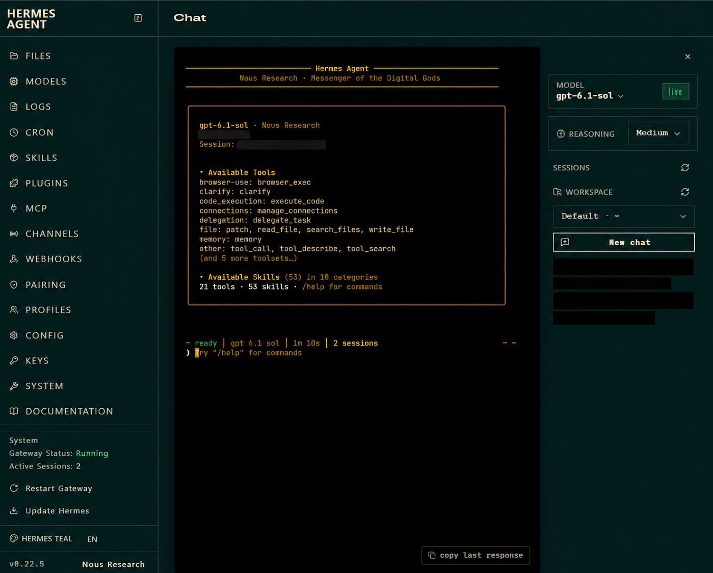
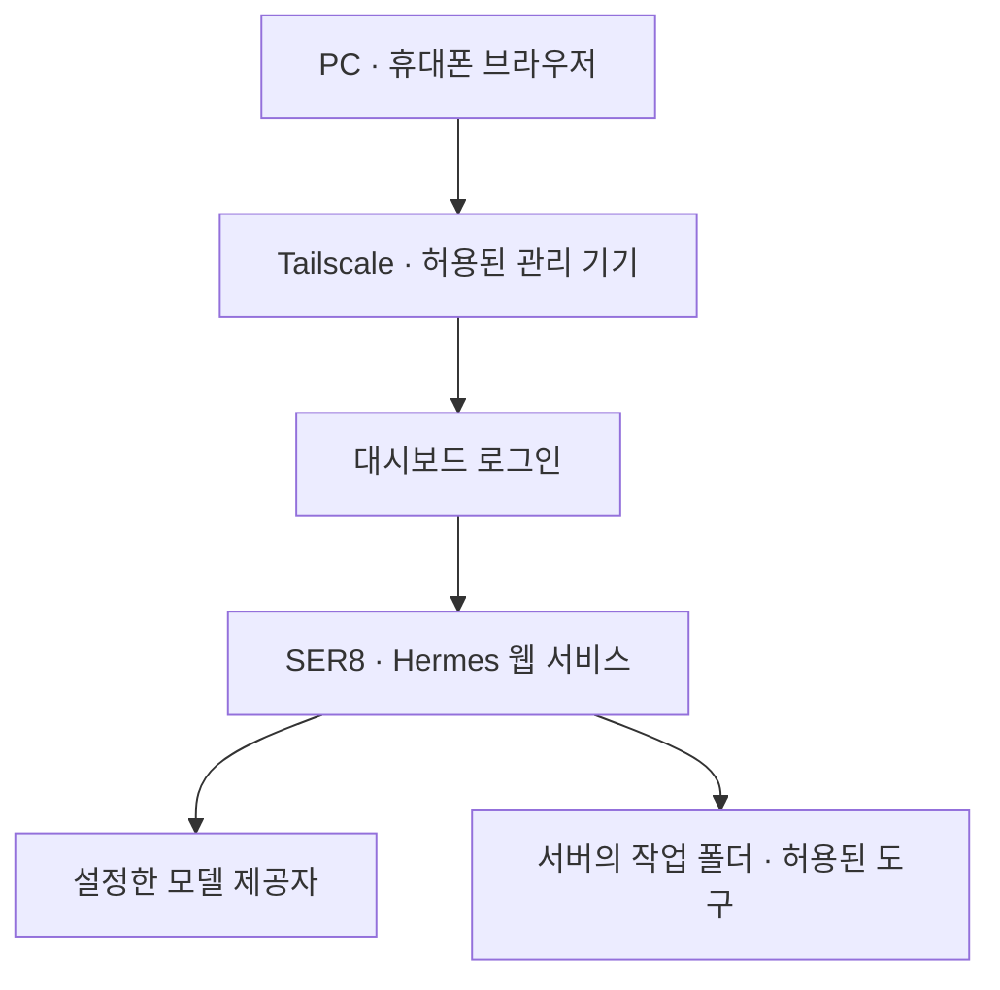
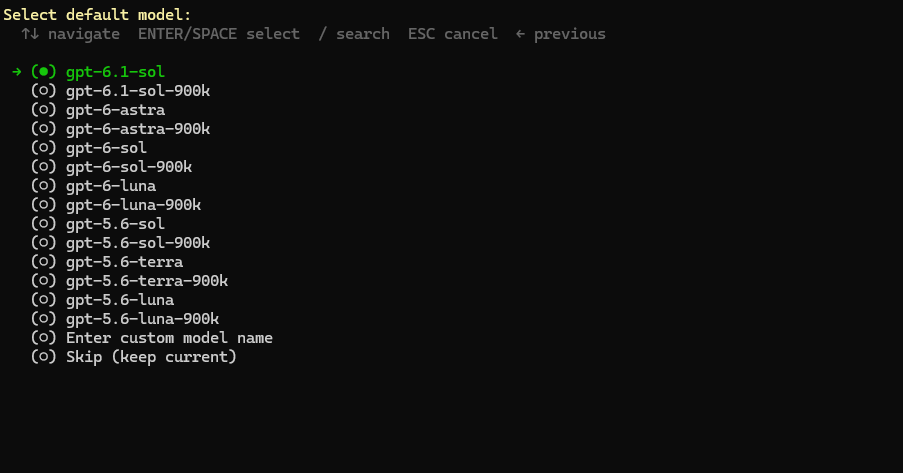
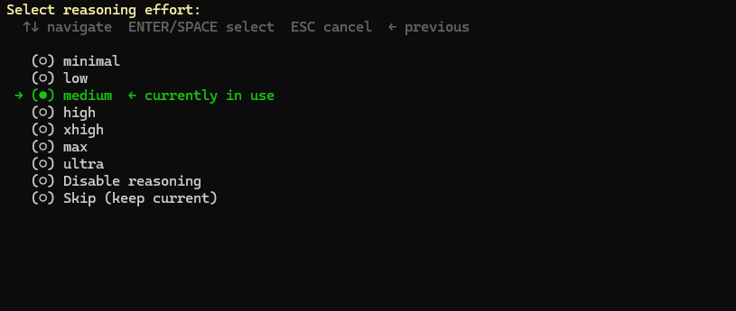

# Hermes 개인 비서 구성과 사용

> 기준일: 2026-10-24. 사용자 제공 명령 출력·화면과 사용자의 접속·작업 성공 보고를 바탕으로 정리했습니다. 이번 GitHub 문서 작업에서는 SER8에 접속하거나 운영 설정을 변경하지 않았습니다. 주소·계정·포트·인증정보는 공개하지 않습니다.

## 시작한 이유와 선택

컴퓨터가 없거나 반복 작업이 번거로울 때 휴대폰에서 요청하고, 집의 SER8이 자료 조사·문서·파일·개발 작업을 처리하는 개인 비서를 목표로 했습니다. 서버 상태 감시에만 한정한 도구가 아니라 일반적인 작업을 맡길 수 있는 환경이 목적입니다.

- 기존 **Orca**는 프로젝트·터미널·Codex·Claude Code를 관리하는 원격 개발 환경으로 유지합니다.
- **Hermes**는 개인 비서의 대화·도구·기억 관리 기능을 시험하기 위해 도입했습니다. 원격으로 일회성 작업을 맡기는 목적은 기존 Orca로도 상당 부분 충족합니다.
- **추가 결제 없이 사용**하는 것을 우선해 기존 ChatGPT/Codex 구독 로그인 경로로 설정했습니다. 별도 유료 API·음성 서비스 도입이나 추가 크레딧 구매를 완료한 것으로 기록하지 않습니다.
- OpenClaw는 삭제 대신 보관하고 실행·자동 시작을 중단하는 방향을 선택했습니다. 이 문서 작업에서 실제 중지·비활성 상태를 다시 조회하지 않았습니다.
- 전용 PC·휴대폰 앱과 Discord를 검토한 뒤, 실제로 연결·작업을 확인한 **웹 대시보드**를 현재 사용 화면으로 선택했습니다.

## 현재 확인 범위

| 항목 | 결과 | 근거·한계 |
|---|---|---|
| Hermes 설치·웹 UI | 사용 가능, 화면에 v0.22.5 표시 | 사용자 제공 화면. 현재 소스 revision·전체 설치 로그는 별도 검증 안 함 |
| 모델·추론 설정 | `gpt-6.1-sol`, `Medium` | 선택 화면과 웹 화면. 모델 평가·속도·한도 측정 아님 |
| 웹 인증 | 사용자명·비밀번호 로그인 사용 | 환경 파일을 사용하는 서비스 구성, 로그인 화면, 이후 접속 성공 보고 |
| 웹 상시 실행 | `hermes-dashboard.service`가 `active (running)`·`enabled` | 사용자 제공 systemd 출력. SER8 재부팅 후 복구 시험은 미실시 |
| 수신·서버 자체 응답 | Tailscale 주소에 TCP 수신, 자체 요청 HTTP 302 | 사용자 제공 `ss`·`curl` 출력. 302만으로 로그인 성공을 판단하지 않음 |
| PC 직접 접속 | Tailscale 접근 정책 보완 후 성공 | 사용자 보고. 기존 localhost SSH 터널 방식과 구분 |
| 휴대폰 접속·실제 작업 | 모두 정상 동작한다고 확인받음 | 사용자 보고. 작업별 입력·산출물·테스트 로그는 제출되지 않음 |
| 붙여넣기 | 웹 입력창의 우클릭 붙여넣기 성공 | 사용자 보고. Ctrl+V 자체 수정·HTTPS 전환은 하지 않음 |
| 지속 메모리 | 기본정보·작업 원칙 저장 문구 안내 | 실제 저장 파일·새 세션에서 기억 재사용은 미검증 |
| 메신저·예약 실행 | 현재 완료로 기록하지 않음 | Discord·Telegram 봇 연동, 예약 업무·완료 알림 미검증 |



이미지는 사용자 원본을 바탕으로 편집한 참고본입니다. 실행 결과의 근거는 위 표의 사용자 출력·보고이며, 편집 이미지를 독립적인 실행 증거로 사용하지 않습니다.

## 연결 구조



작업 파일과 실행 환경은 SER8에 있습니다. 다른 PC에 Hermes를 별도로 설치하는 것과 SER8의 웹에 접속하는 것은 서로 다른 구성입니다. 이 웹을 쓰기 위해 관리 PC의 SSH 포워딩 창을 계속 열어둘 필요는 없습니다.

## 구성 과정

### 1. 모델 로그인과 기본 선택

프로바이더 메뉴에서 OpenAI의 ChatGPT/Codex 구독 경로를 선택해 설정을 진행했습니다. 기존 Codex CLI 인증을 공유하는 선택지가 표시됐으며, 충돌을 줄이기 위해 별도 로그인 경로를 안내했습니다. 모델 선택·웹 동작까지 진행된 사실과 실제 인증 파일 내용은 구분하며 인증 파일은 저장소에 포함하지 않습니다.

기본 모델은 `gpt-6.1-sol`, 추론 강도는 `Medium`으로 선택했습니다. `-900k` 선택지는 이번 기본값으로 사용하지 않았습니다. 선택 화면은 모델의 무제한 사용·성능·계약상 한도를 입증하지 않습니다.





### 2. localhost와 SSH 터널로 최초 사용

처음에는 `hermes dashboard --no-open`으로 로컬 웹을 실행하고, Windows의 SSH 로컬 포워딩을 통해 접속했습니다. PC 재시작 뒤 포워딩만 다시 실행해도 웹이 열려, SER8의 기존 웹 프로세스가 남아 있는 상태와 PC의 SSH 연결을 구분했습니다.

당시 서비스 목록에는 Hermes 서비스가 없었고, 웹 프로세스는 루프백 주소에서 수신했습니다. 화면이 열린다는 사실만으로 자동 실행 서비스가 구성됐다고 판단하지 않았습니다.

### 3. 사용자 서비스와 Tailscale 직접 접속

별도 환경 파일 `~/.config/hermes-dashboard.env`에 웹 로그인과 세션 서명용 설정을 저장하고 파일 접근을 제한했습니다. 해당 파일을 읽는 systemd 사용자 서비스 `hermes-dashboard.service`를 구성했습니다. 이 파일의 실제 값과 실제 서비스 파일은 Git에 올리지 않습니다.

서비스는 Tailscale 주소에 바인딩하고, 해당 인터페이스의 웹 TCP 접근을 UFW에서 허용했습니다. 사용자 출력으로 서비스 `active`·`enabled`와 해당 주소의 수신을 확인했습니다. 이번 편집에서 linger 값을 다시 조회하거나 재부팅하지 않았습니다.

이 서비스는 **웹 대시보드용**입니다. 메신저 봇 게이트웨이의 자동 실행·연결까지 완료됐다는 의미는 아닙니다.

### 4. 웹 접속 차단을 계층별로 확인

서버 내부 HTTP 응답이 있어도 Windows에서는 TCP 연결이 시간 초과로 실패했습니다. UFW·iptables의 허용 상태, Tailscale 인터페이스 캡처, 실제 접근 정책을 순서대로 비교했습니다.

최종적으로 관리 기기 → SER8 허용 목록에 새 웹 포트가 빠진 것을 확인했고, 해당 TCP 항목을 추가한 뒤 사용자가 웹 접속 성공을 보고했습니다. 자세한 경위는 [문제 해결 기록](./troubleshooting.md#hermes-web-access-policy)을 참고합니다.

## 평소 사용 순서

1. SER8을 켜두고 사용할 기기의 Tailscale을 연결합니다.
2. 비공개로 관리하는 웹 주소 `http://<ser8-tailscale-ip>:<hermes-web-port>`를 엽니다.
3. 직접 지정한 웹 계정으로 로그인합니다. 모델 제공자 로그인과 웹 계정은 용도가 다릅니다.
4. Chat에서 작업 폴더·원하는 결과·수정 가능 범위를 포함해 요청합니다. 이 환경에서는 우클릭 붙여넣기 성공을 확인했습니다.
5. 실제 산출물과 실행 기록을 확인합니다. 새 대화는 New chat, 기존 대화의 정리는 `/sessions` 관리 화면을 사용합니다.

예시 요청:

```text
<작업-폴더>의 README를 읽고 프로젝트 목적과 문서에 적힌 진행 상태를 정리해줘.
확인한 사실과 제안을 구분하고, 우선 파일은 수정하지 마.
```

작업을 맡길 때는 원하는 결과물과 완료 기준을 함께 적습니다. 자료 조사·학교 과제·문서·파일 정리·개발에 사용할 수 있지만, 각 작업에 필요한 파일·도구·권한은 별도로 준비해야 합니다.

## 로그인·설정 관리

- 웹 비밀번호는 현재 구성의 `~/.config/hermes-dashboard.env`에서 관리합니다. `HERMES_DASHBOARD_BASIC_AUTH_PASSWORD` 변경 후 해당 사용자 서비스를 재시작하는 방법을 안내했습니다. 사용자가 완료했다고 응답했으며 새 값은 수집하지 않았습니다.
- 로그인 시도 제한 화면이 발생했습니다. [공식 웹 문서](https://hermes-agent.nousresearch.com/docs/user-guide/features/web-dashboard)의 기본값은 IP별 분당 10회이며, 잠시 기다린 뒤 다시 시도하도록 안내했고 이후 접속 성공을 보고받았습니다. 설치본의 제한값을 직접 재측정하지 않았습니다.
- 로그인 제한을 끄거나 무인증 공개 접속을 구성하지 않았습니다. 현재는 Tailscale 내부 HTTP 접속이며 HTTPS 서비스로 전환한 상태가 아닙니다.

## 남은 검증과 보류

- SER8 재부팅 후 웹 서비스·Tailscale 연결의 자동 복구는 미검증입니다. 서비스 등록과 재부팅 시험을 구분합니다.
- 브라우저·휴대폰 화면을 닫은 뒤에도 장시간 작업이 계속되는지, 중단 후 복구·완료 알림이 되는지는 별도 시험이 필요합니다. 웹 서버 상시 실행만으로 보장하지 않습니다.
- 지속 메모리 저장·읽기, 작업별 산출물 품질, 스킬별 실행, 구독 사용량·속도는 아직 체계적으로 검증하지 않았습니다.
- 전용 Hermes Desktop·휴대폰 앱과 Discord·Telegram 연동은 추가 완료 항목이 아닙니다.
- 외부 백업·자동 백업 적용·n8n 정기 실행 보류 결정은 그대로 유지합니다.

## 참고와 상세 기록

- [공식 웹 대시보드 문서](https://hermes-agent.nousresearch.com/docs/user-guide/features/web-dashboard)
- [공식 모델 제공자 문서](https://hermes-agent.nousresearch.com/docs/integrations/providers)
- [Tailscale Grants 문서](https://tailscale.com/docs/features/access-control/grants)
- [사용자 제공 근거와 공개 사진](./evidence.md#update-2026-10-24)
- [이미지 원본·편집 구분과 가림 범위](./images/README.md)
- [Orca 원격 개발 환경](./orca-remote-server.md)
