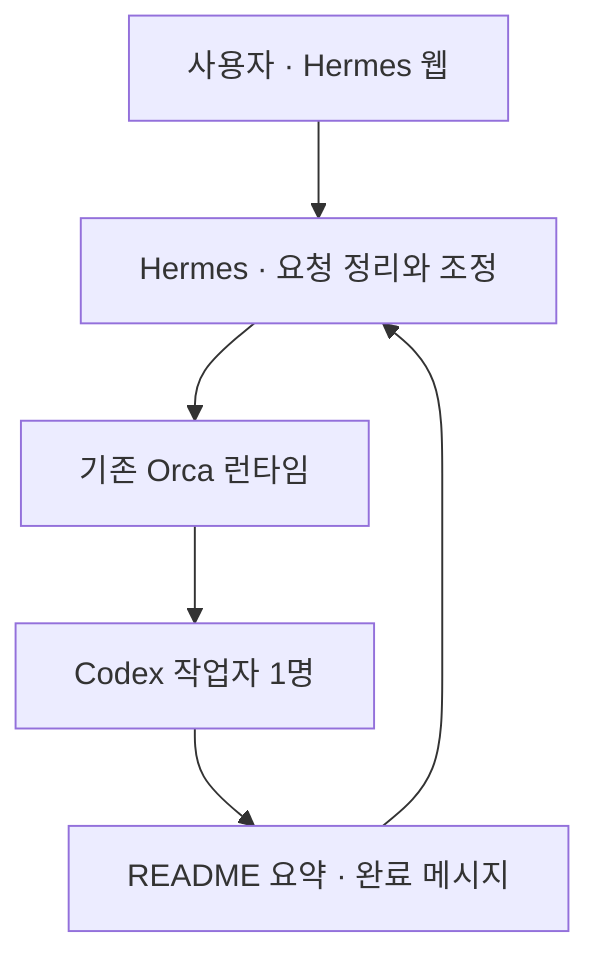

# Hermes 웹에서 Orca 작업 위임

> 기준일: 2026-11-14 KST. 사용자가 전달한 **Hermes 실행 결과 보고**를 근거로 작성했습니다. 문서 편집 에이전트는 SER8에 접속하거나 작업을 재실행하지 않았으며, 원시 터미널 로그·작업 DB·해시 목록을 직접 대조하지 않았습니다. 실제 주소·계정·경로·작업 식별자는 공개하지 않습니다.

## 목표와 확인된 범위

웹 개인 비서에 요청하면 기존 개발 환경의 에이전트에게 일을 맡기고 결과까지 받는 것이 목표입니다. 별도의 개발 도구를 새로 만든 것이 아니라, 기존 Hermes·Orca·Codex를 연결한 구성입니다.



이번 보고에서는 **대화가 열린 상태에서 README 읽기 전용 작업 한 건을 위임하고 결과를 회수**했습니다. 첫 완료 보고에 명령 충돌이 있었고, Hermes가 같은 작업자에게 완료 보고만 다시 요청해 복구했습니다. 무개입 반복 실행·실제 코드 개발·장시간 무인 운영 전체를 검증한 결과는 아닙니다.

## 역할과 수행 주체

| 주체 | 이번 수행 범위 |
|---|---|
| 사용자 | 웹에서 위임 목표·변경 제한·완료 기준을 전달하고, Hermes의 점검·실행 보고를 문서화 대화에 제공 |
| Hermes | 기존 Orca 상태 조회, 조정자 연결, 작업 배정, 오류 복구 요청, 완료·출력 회수와 보고. README 원문 대조도 수행했다고 보고 |
| Orca | 조정자 핸들 발급·Run 연결, Codex 작업자 실행, Task·Dispatch·메시지함 관리 |
| Codex | 이 저장소의 README 읽기와 한국어 요약, 수정된 명령으로 완료 보고 |
| 문서 편집 에이전트 | 전달된 보고를 공개 지침에 맞춰 정리하고 문서·링크를 검사. 서버 실행 사실의 독립 검증은 하지 않음 |

## 사전 점검 보고

- 개발용 Orca 1.4.237, Claude Code 2.1.309, Codex CLI 0.163.0이 조회됐습니다. CLI 존재와 로그인·업무 수행 성공은 구분합니다.
- 기존 Orca 사용자 서비스의 `active / running`·`enabled`, `Restart=on-failure`, `Linger=yes`가 보고됐습니다. 실제 로그아웃·재부팅 시험은 아닙니다.
- `status --json`에서 `ok: true`, `ready`, `reachable: true`, `connected`가 보고됐습니다.
- 당시 헤드리스 모드였으며 프로젝트·워크트리 조회는 성공했습니다. 데스크톱 창·브라우저 자동화 설정과는 별개입니다.
- 최초에는 Orca 관리 터미널이 없었고 일부 명령에서 `no_active_sender_terminal`이 발생했습니다. 단순 런타임 조회 성공과 조정자로서 작업을 배정할 수 있는 상태는 달랐습니다.
- Hermes가 읽는 스킬 목록과 Orca의 설치 스킬 목록은 별도입니다. Orca 안내·설치 목록에서 `orca-cli`·`orchestration`을 확인했다는 보고이지 Hermes에 자동 등록됐다는 뜻은 아닙니다.

## 읽기 전용 위임 시험

| 단계 | 보고된 실행 결과 | 해석 |
|---|---|---|
| 조정자 연결 | Orca가 발급한 새 전용 터미널 핸들로 Run 연결 | 다른 세션 핸들이나 가짜 값은 사용하지 않았다고 보고 |
| 작업 시작 | `orchestration worker-start`로 Codex 1명 실행, `input_accepted` 후 시작 관측 | 요청 수락만으로 완료 처리하지 않음 |
| 실제 작업 | 작업자 기록에서 README 읽기 명령과 요약 출력 확인 | 서버 기능 재시험이 아닌 문서 요약 |
| 최초 완료 보고 | bare `orca`가 화면 읽기 프로그램으로 연결돼 실패 | 요약 작성과 완료 전송은 별도 단계 |
| 복구 | 같은 작업자에게 개발용 절대 경로로 완료 보고만 재요청 | 새 작업자를 만들거나 요약을 중복 실행하지 않음 |
| 결과 회수 | 조정자 메시지함의 `worker_done`, Task `completed`, 결과 `succeeded` 재조회 | 완료 상태와 실제 출력 회수를 함께 보고 |
| 정리 | 출력 `captured`, 작업자 터미널 `released / exited` | 조정자 셸·Run 기록은 남음 |

회수된 요약은 프로젝트 목적, 원격 접속·모니터링·개발 도구·수동 자동화 기능, 백업·재부팅·장기 안정성 등 미검증 범위를 구분했습니다. README는 이후 수정될 수 있으므로 당시 줄 번호나 요약을 현재 운영 상태의 증거로 재사용하지 않습니다.

## 명령 충돌과 복구

이 환경에는 GNOME 화면 읽기 프로그램과 개발용 Orca가 함께 있습니다. 개발용 명령 예시는 다음과 같으며, 실제 사용자 경로는 공개하지 않습니다.

```bash
# 예시: 실제 사용자 홈은 생략
~/.local/bin/orca-ide status --json
~/.local/bin/orca-ide skills get orca-cli
~/.local/bin/orca-ide skills get orchestration
```

조정자에서 올바른 실행 파일을 사용해도 작업자에게 주입된 완료 명령까지 같은 경로가 적용된다고 볼 수는 없었습니다. 이번에는 같은 작업자의 완료 전송만 복구했고, 시스템 명령·전역 PATH·설치 파일은 수정하지 않았다고 보고됐습니다. 자동 주입 명령의 재발 방지와 무개입 반복 성공은 후속 과제입니다. 이번 기록은 실행 가능한 전체 연동 스크립트가 아닙니다.

## 프로젝트 변경 확인과 한계

Hermes는 실행 전후 프로젝트 파일 **24개 해시 비교에서 변경 없음**, README 해시·Git HEAD 동일, Git 작업 트리가 깨끗함을 보고했습니다. 해시 원본 목록은 이번 문서 편집에 제공되지 않아 별도로 재계산하지 않았습니다.

이 시험에서 프로젝트 수정·커밋·push·설치·업데이트·서비스 재시작은 하지 않았다고 보고됐습니다. 이는 시험 당시 범위이며, 이 기록을 게시하기 위한 후속 GitHub 문서 변경과 구분합니다. 운영 데이터·인증정보·작업 DB·서비스 파일·원시 로그는 저장소에 포함하지 않습니다.

## 다음 검증

| 항목 | 상태와 완료 기준 |
|---|---|
| Hermes → Orca → Codex 결과 회수 | **1건 성공 보고**. 최초 완료 보고는 복구가 필요했음 |
| 명령 충돌 재발 방지 | 미검증. 수동 복구 없이 완료 메시지 회수 |
| 재사용 스킬·작업 상태 저장 | 구성 계획만 전달. 작성·인식·복구 성공 보고 없음 |
| Claude Code 위임·교차 검토 | 이번 연동에서는 미검증. 과거 Orca 단독 읽기 시험과 구분 |
| 실제 코드 수정·테스트 | 미검증. 별도 시험 작업공간에서 변경·검증 결과 회수 필요 |
| 브라우저 종료·재접속 | 미검증. 기존 작업 재조회와 결과 회수 필요 |
| 명시적 대화 종료·서비스 재시작·서버 재부팅 | 각각 미검증. 브라우저 종료와 별도 시험 |
| 완료 감시·외부 알림 | 미구성. 서비스 실행 상태만으로 보장하지 않음 |

## 관련 기록

- [날짜별 근거](./evidence.md#update-2026-11-14)
- [Hermes 구성](./hermes-assistant.md)
- [Orca 원격 서버](./orca-remote-server.md)
- [명령 충돌 문제 해결](./troubleshooting.md#orca-delegation-command-collision)
- [단계별 계획](./roadmap.md#hermes-orca-next)
