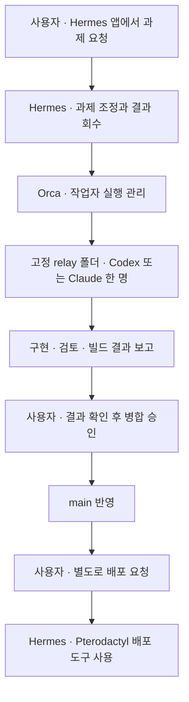

# Hermes 앱에서 첫 개발 과제를 진행한 기록

> 2026-11-17 KST · 사용자 승인으로 공개하는 개발 사례 기록. 사용자에게 전달받은 실행 보고, GitHub에서 직접 확인한 코드·문서, 앞선 서버 검증을 구분합니다. 이 문서 작성 중 에이전트 실행·빌드·배포·서버 설정 변경은 하지 않았습니다.

## 이번에 달라진 점

읽기 전용 작업 위임에서 실제 게임 플러그인의 코드 변경으로 사용 범위가 넓어졌습니다. 사용자는 Hermes 앱에서 `/음악` 설정 유지 과제를 시작해 병합까지 한 차례 완료했다고 보고했습니다. 구현 커밋과 그 커밋이 현재 `main`에 포함된 사실은 GitHub에서 직접 확인했습니다.

Codex와 Claude의 기본 개발 방식은 **고정된 작업 폴더에서 한 명씩 이어서 작업하는 방식**입니다. 같은 과제를 동시에 구현하는 병렬 비교는 별도 선택 기능이며, 이번 사례를 병렬 개발 성공으로 표현하지 않습니다.

## 요청부터 배포까지의 역할

이 그림은 정해 둔 운영 흐름입니다. 각 단계의 실제 실행 근거는 아래 표에서 구분합니다. Hermes·Orca·Codex·Claude 자체를 개발한 것이 아니라, 기존 도구를 연결하고 작업 규칙을 정리해 사용한 프로젝트입니다.

## 무엇을 어디까지 확인했는가

| 항목 | 근거 | 확인 범위와 한계 |
|---|---|---|
| Hermes 앱 위임·재접속 | [2026-11-14 직접 관찰 기록](./hermes-app-orca-validation.md) | Claude 읽기 전용 위임 3회, 앱 종료 중 작업 완료·재실행 후 결과 복원. 이번 개발 과제의 실행 기록과 별도 |
| 고정 작업 폴더 | 앞선 2026-11-17 서버 읽기 전용 검증 | `relay`가 등록된 Git worktree이며 당시 `main`과 동일한 `7af2053`임을 확인. 이후 개발·병합 뒤 현재 HEAD는 재조회하지 않음 |
| 폴더 신뢰 승인 | 사용자 제공 후속 보고 | 사용자가 승인을 완료했다고 보고. 승인 화면·설정은 이번에 직접 재확인하지 않음 |
| 개발 과제 한 차례 완료 | 사용자 제공 후속 보고 | 시작부터 병합까지 완료했다고 보고. 단계별 실행 로그·빌드 출력·검토 기록은 이번에 독립 대조하지 않음 |
| 음악 설정 저장 구현 | GitHub 구현 커밋의 변경 내용 직접 조회 | 메모리의 임시 설정을 플레이어 데이터의 저장·불러오기 경로로 옮긴 코드 확인. 게임 접속·재접속 시험은 하지 않음 |
| 구현의 main 포함 | GitHub 커밋 비교 직접 조회 | 구현 커밋이 현재 `main`의 조상이고 `main`이 그보다 2커밋 앞선 상태 확인. 사용자 승인 대화·병합 절차 자체를 입증하는 자료는 아님 |
| 인계·중단·재개 규칙 | 개발 저장소 `AGENTS.md` 직접 조회 | 규칙 존재 확인. 실제 사용량 소진 → 교대, 양쪽 소진 → 중단 → 회복 후 재개를 실행 검증한 것은 아님 |
| 배포 경로 | 개발 저장소 `OPERATIONS.md`와 사용자 보고 | 빌드 후 `tools/ptero/deploy.py jar`로 jar 업로드·재시작하는 절차 확인. 이번 구현의 실제 배포 성공·적용 버전·게임 동작은 미확인 |

첫 과제를 완료했다는 보고만으로 Codex와 Claude가 실제로 한 번씩 참여했거나 사용량 소진에 따라 자동 교대했다고 단정하지 않습니다. 앱 재접속 시험에서 확인한 기존 bridge의 감시·완료 알림이 새 relay 개발 흐름에서도 동일하게 동작하는지는 별도 확인 대상입니다.

## 첫 사례: 음악 끄기 설정 유지

**과제:** 플레이어가 음악을 끈 상태를 재접속 후에도 유지하도록 변경합니다.

구현 커밋 `1824d1db1311c28fc31685febe0cd1fe88a83cc5`에서 두 파일의 변경을 직접 확인했습니다.

- `Music.java`: 메모리에만 두던 설정 대신 플레이어 데이터의 `musicOff`를 읽고 변경하며, 변경 사실을 저장 대상으로 표시합니다.
- `PlayerData.java`: `music-off` 값을 저장하고 불러옵니다. 기존 데이터에 항목이 없으면 음악을 켠 상태를 기본값으로 사용합니다.

이 변경은 설정을 영속 데이터에 연결한 코드 근거입니다. 재접속·서버 재시작 후 실제 음악 재생 여부는 게임 안에서 확인해야 합니다. 이번 정리에서는 빌드를 다시 실행하지 않았습니다.

## 작업 폴더를 하나로 고정한 이유

앞선 병렬 비교 시도에서는 새 작업 폴더의 신뢰 확인 때문에 작업자 시작이 실패했다고 기록돼 있습니다. 고정 `relay` 폴더를 사용하면 매 과제마다 새 폴더를 만들지 않고, 그 안에서 작업 가지만 바꿔 사용할 수 있습니다. 처음 신뢰 승인은 사용자가 해당 폴더를 확인하고 직접 수행하며 에이전트가 대신 승인하거나 설정을 미리 넣지 않습니다.

인계 때는 같은 폴더와 같은 가지를 유지합니다. Hermes가 목표·완료한 일·남은 일·가지·마지막 커밋·빌드 결과·막힌 점을 인계 메모에 남기고, 넘겨받은 작업자가 기존 변경을 한 번 검토한 뒤 이어서 작업합니다. 두 작업자의 사용량이 모두 소진되면 중단하고 재개 가능 시각을 기록합니다. 사용자가 재개를 요청하면 먼저 사용량이 회복된 쪽으로 이어갑니다.

새 과제를 시작할 때는 이전 작업 종료 여부와 미커밋 변경을 확인하고 `main`을 최신화한 뒤 새 가지를 만드는 절차를 문서에 보완하는 것이 좋습니다. 기존 과제의 인계·재개에서는 작업 가지를 유지해야 합니다. 이는 이번 검토의 개선 제안이며, 해당 지침을 원격 저장소에 반영한 것은 아닙니다.

병렬 도구 `duel.py`는 고정 폴더 이어달리기를 실행하는 도구가 아닙니다. 앞선 `7af2053` 기준 검증에서는 문법 검사 종료 코드 0, 가짜 실패 응답의 오류 반환, 외부 호출을 대체한 `start` 경로 종료 코드 1을 확인했습니다. 실제 Orca·작업자는 실행하지 않았으며, 이 결과를 병렬 개발의 전체 성공으로 확대하지 않습니다.

## 평소 사용하는 순서

1. Hermes 앱에서 과제와 완료 기준을 전달합니다. 예: “이어달리기로 ROADMAP의 남은 일 맨 위 항목을 진행하고, 빌드·검토 결과를 보고해 줘.”
2. 결과를 확인한 뒤 병합을 승인합니다. 배포는 별도 요청으로 남깁니다.
3. 실서버에 적용할 때 배포를 요청합니다. 배포 결과와 실제 게임 동작은 각각 확인합니다.
4. 두 작업자의 사용량이 모두 소진되면 중단 상태와 재개 가능 시각을 확인하고, 이후 “이어서 해”라고 요청합니다.

현재 개발 저장소의 작업 규칙은 `AGENTS.md`, 배포 절차와 게임 안 점검표는 `OPERATIONS.md`에 있습니다. 새 에이전트는 작업 규칙과 해당 과제의 최신 인계 메모·현재 가지·변경 상태를 함께 확인해야 합니다. 규칙 파일만으로 진행 중 과제의 상태까지 알 수 있는 것은 아닙니다.

## 남은 확인

- [ ] 이번 과제의 빌드 결과·검토 기록·사용자 병합 승인 근거를 추가로 대조
- [ ] 실제 Codex↔Claude 교대와 같은 폴더·가지에서의 작업 연속성 확인
- [ ] 양쪽 사용량 소진 시 중단과 회복 후 재개 확인
- [ ] relay 개발 작업의 결과 회수·완료 알림·앱 재접속 시 기존 작업 복원 확인
- [ ] 이번 구현의 실서버 배포 결과와 적용 버전 확인
- [ ] 리소스팩 접근 가능 여부와 음악 설정의 재접속·서버 재시작 후 유지 확인
- [ ] `OPERATIONS.md`의 게임 안 점검표 수행 — 사용자 선택에 따라 나중에 진행

서버 서비스 재시작·호스트 재부팅·동시 부하·백업 복원은 이 기록의 검증 범위에 포함하지 않습니다.

## 후속 문서 보완 항목

이번 게시 범위는 이 사례 기록, 연결된 앱 검증 기록, README의 후속 결과·문서 링크, 작업 방식 문서의 진행 상태입니다. 아래 표의 상세 통합은 후속 작업으로 남깁니다.

| 대상 문서 | 반영할 내용 |
|---|---|
| `README.md` | 실제 개발 과제의 구현 커밋·main 포함 확인과 사용자 완료 보고를 핵심 결과에 추가. 기존 앱 검증과 연결 |
| `agent-work-modes.md` | “규칙 확정, 실제 운영 전”을 첫 과제 완료 보고와 확인 범위에 맞춰 보완. 실제 교대·한도 회복 시험의 미검증 상태는 유지 |
| `evidence.md` | 날짜별로 코드 조회·서버 검증·사용자 보고의 출처를 구분해 추가 |
| `usage-guide.md` | 앱에서 과제 요청 → 결과 확인 → 병합 승인 → 별도 배포 요청 순서 추가 |
| `troubleshooting.md` | 신뢰 확인 실패와 고정 폴더 선택, 시작 실패를 종료 코드 1로 알리는 처리 기록 |

공개본에는 실제 접속 주소·운영 포트·사용자 계정·서버 경로·인증정보·플레이어 데이터를 넣지 않습니다. 비공개 구현 저장소를 공개하거나 소스를 옮기는 작업도 이번 정리에 포함하지 않습니다.

## 참고 근거

- [기존 앱 위임·재접속 직접 관찰 기록](./hermes-app-orca-validation.md)
- [기존 읽기 전용 위임 시험과 한계](./hermes-orca-delegation.md)
- [게시 전 작업 방식 문서](https://github.com/kosmos-s/ser8-home-server-ai/blob/b6d654233f2699595623d0327f922d48a7af5ddc/agent-work-modes.md) — 이어달리기가 “실제 운영 전”으로 표시됐던 기록
- [음악 설정 구현 커밋](https://github.com/kosmos-s/eilas/commit/1824d1db1311c28fc31685febe0cd1fe88a83cc5) — 비공개 저장소 접근 권한 필요
- [main 포함 여부 비교](https://github.com/kosmos-s/eilas/compare/1824d1db1311c28fc31685febe0cd1fe88a83cc5...main) — 조회 시 `ahead`, `ahead_by=2`, `behind_by=0`. 이후 main 변경에 따라 비교 결과는 달라질 수 있음
- [개발 규칙](https://github.com/kosmos-s/eilas/blob/573295f71e5b341236ffe972d393885c1e75e715/AGENTS.md) · [운영 절차와 점검표](https://github.com/kosmos-s/eilas/blob/573295f71e5b341236ffe972d393885c1e75e715/OPERATIONS.md) — 비공개 저장소의 조회 시점 고정 링크
