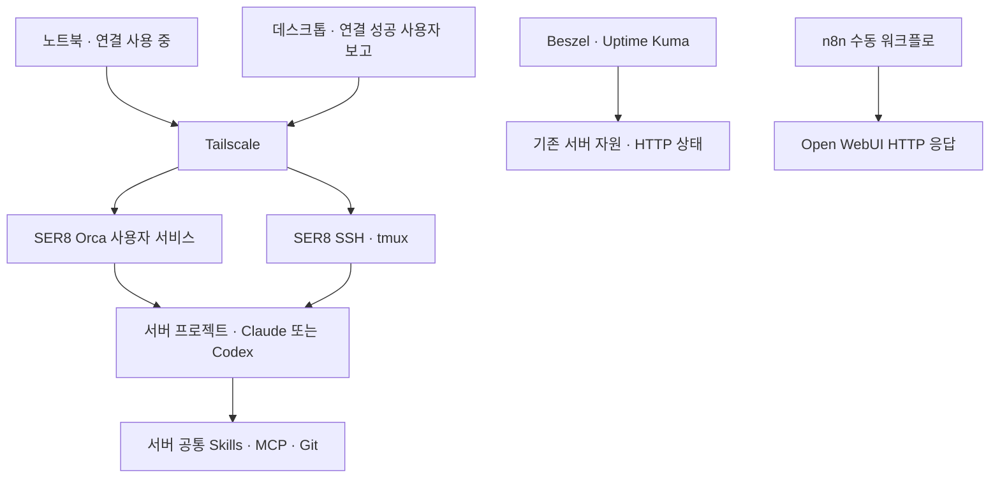

# 현재 구성과 사용 가이드

> 2026-10-23 후속 결과 반영. 2026-10-22 점검과 오늘의 사용자 보고를 구분합니다. 원격 096e2e1의 기존 사용 안내와 최초 SER8 일반 셸의 읽기 전용 직접 점검을 구분해 정리했습니다. 직접 확인·사용자 보고·기존 문서 기록을 함께 표시하며, 예시의 주소·사용자·포트·운영 경로는 placeholder입니다.

## 지금 사용할 수 있는 것

### 2026-10-23 접속 결과와 현재 사용 방식

- **사용자 보고:** 데스크톱 Orca의 SER8 연결 성공. 노트북·데스크톱 간 실행 중 작업 인계는 미검증입니다.
- **사용자 보고:** Beszel·Uptime Kuma LAN 직접 접속 성공. 집에서는 SSH 터널 없이 사용하고 기존 localhost 접근도 유지합니다.
- **앞선 서버 조사:** Beszel 시스템 1개와 최근 수집 확인. 데스크톱 localhost에서 빈 목록이 보였던 원인은 미확정입니다.
- **화면 확인 사실:** 공유기 DHCP 예약 목록에 SER8 주소와 MAC 등록 확인. 재부팅·DHCP 재할당 후 주소 유지 검증은 하지 않았습니다.
- **사용자 선택으로 보류:** 외부 백업·자동 백업 적용·n8n 정기 실행.

이번 문서 편집에서 서버·접속을 재시험하거나 화면을 새로 추가하지 않았습니다. [근거와 한계](./evidence.md#2026-10-23-접속-결과와-운영-선택)를 참고합니다.

### 2026-10-22 사용자 제공 출력 — 당시 상태

2026-10-22 사용자가 실행해 전달한 명령 출력·접속 설명을 반영했습니다. 문서 반영 중 재시험한 결과와 구분합니다. 상세 근거는 [후속 확인 기록](./evidence.md#2026-10-22-사용자-제공-권한-조회-결과--후속-확인)에 있습니다.

| 항목 | 현재 기록과 한계 |
|---|---|
| 모니터링·Open WebUI | Beszel Hub·Agent 실행 중, Uptime Kuma·Open WebUI healthy. 현재 Beszel 지표 수집은 별도 확인 |
| n8n | 실행 중이며 healthy 표시 없음. 기존 수동 HTTP 성공 기록 유지, 이번 요청 재시험 없음. 정기 실행 보류 |
| 수신·방화벽 | Beszel·Kuma·n8n·Ollama 루프백 수신. Orca의 Tailscale 허용 → 일반 차단 순서와 n8n → Open WebUI 범위 지정 허용 규칙 확인 |
| 게임 서버 | 모두 중지 상태, 종료 코드 0·1·137 기록. 의도 확인 전 자동 시작·삭제하지 않음. 137만으로 OOM 단정 불가 |
| SSH | 비밀번호 인증 사용 중이며 공개키 인증도 허용. 키 인증 전환 완료 아님. root의 without-password는 root 비밀번호 인증 금지 |
| 수동 백업 | 기존 날짜·config 폴더 존재만 확인. 압축본 존재·현재 무결성·복원 가능성 미확인 |
| 기존 광범위한 허용 규칙 | 게임·Wings·DB 규칙 보존. MariaDB 루프백·Docker 브리지 수신. 규칙만으로 인터넷 접근 가능 여부를 단정하지 않음 |

당시 다음 작업이었던 데스크톱 연결은 2026-10-23 사용자 성공 보고로 갱신합니다. 실행 중 작업 인계는 미검증입니다. 외부 접속 중 SSH·방화벽·게임 서버 상태를 변경하지 않습니다. 로그인 안내의 업데이트는 총 20개 중 일반 보안 업데이트 6개이며, 장치 2개의 펌웨어 안내도 있습니다. 업데이트 내용 검토·설치는 나중에 별도 진행합니다.

### 최초 직접 점검 기록 — 후속 사용자 결과와 구분

아래 표는 2026-10-22 일반 셸에서 직접 조회한 범위입니다. 당시 권한 부족 항목은 위 사용자 제공 출력으로 보완했으며, 현재 사용 안내는 2026-10-23 후속 결과를 우선합니다.

**SER8의 같은 작업 공간을 노트북 Orca 또는 SSH·tmux로 사용하는 구성입니다.** 서버의 프로젝트·개발 도구·스킬·인증을 사용하고 노트북은 화면·입력을 담당합니다. 아래 최초 점검 당시 데스크톱 연결은 미검증이었으며, 이후 연결 성공은 위 사용자 보고로 구분합니다. 이번에는 기존 Orca 연결의 일반 셸에서 점검했으며 Claude·Codex 작업, MCP 호출, 스킬 실행 시험은 시작하지 않았습니다. 아래 표는 18:24 KST 최초 점검 시점의 설치·설정·실행·실제 사용 근거입니다. 이후 승인된 문서 통합·게시는 별도 Git 이력 절에서 구분합니다.

| 구성 요소 | 설치·경로 | 설정·인식 | 이번 실행 상태 | 실제 사용 확인 범위 |
|---|---|---|---|---|
| Tailscale | 1.104.2, 시스템 명령 | 서비스 enabled | active, BackendState Running·자기 기기 online | 기존 Orca 원격 셸 사용 성공. ACL 전체·재부팅 후 접속은 미검증 |
| SSH | OpenSSH 9.6p1 | socket enabled, service disabled | socket·service 모두 active | 과거 터널 사용 기록. 이번 노트북 비대화형 인증은 실패, 인증 방식 변경 안 함 |
| tmux | 3.4 | 기존 세션 1개 | 분리 상태 세션 목록만 확인 | 과거 SSH 작업 사용 기록. attach·세션 종료 안 함 |
| Orca | 1.4.237, `~/.local/bin/orca-ide` | 사용자 프로필 1개, 독립 Git 프로젝트 2개 | 사용자 서비스 active·enabled, linger yes, NRestarts 0 | 이번 원격 조회·일반 셸 명령 성공. 두 에이전트 순차 실행은 기존 사용자 보고 |
| Claude Code | 2.1.308, `~/.local/bin/claude` | 로그인 상태 정상, 플러그인 목록 인식 | 버전·인증 상태만 조회 | 실제 작업은 이번에 실행 안 함 |
| Codex CLI | 0.163.0, `~/.local/bin/codex` | 로그인 상태 정상 | 버전·인증 상태만 조회 | 실제 작업은 이번에 실행 안 함 |
| Node·Git·gh | Node 24.22.0, npm 11.19.1, Git 2.43.0, gh 2.45.0 | gh 인증 상태 정상 | 버전 조회·git fetch 성공 | 커밋·push 안 함 |
| Skills·Plugins | 공용 원본·Claude 링크·CLI별 캐시 분리 | Orca 설치 목록 259개 selector 인식 | 스킬 실행 시험 안 함 | 개별 도구 동작·계정 인증은 미검증 |
| MCP | Claude·Codex Context7 등록, Claude GitHub 플러그인 disabled | 설정 이름·활성 여부만 확인 | 서버·도구를 호출 안 함 | Claude Context7 성공과 Codex GitHub 조회는 과거 보고 |
| Beszel·Uptime Kuma | Compose 파일·이미지 지정 확인 | Hub loopback, Kuma host network | Hub 해당 loopback 소켓 수신. Docker 상태 조회는 권한 부족 | 기본 지표·HTTP 감시 성공은 기존 기록, 현재 healthy 재확인 아님 |
| n8n | Compose 이미지 2.44.5 태그·digest 지정 | loopback 바인딩 | 해당 소켓 수신, 실행 이미지·DB는 미조회 | 첫 수동 HTTP 성공은 사용자 화면. 이번 재실행·정기 실행 없음 |
| 모니터링 백업 | 스크립트·systemd 예시는 저장소 초안 | 배포 스크립트·전용 timer 없음, 사용자 cron 없음 | 백업·dry-run 안 함, 보관 위치 내부는 권한 부족 | 수동 백업 성공은 과거 기록. 외부 저장·보관 정책·복원은 미완료 |

자원 스냅샷은 2026-10-22 18:24 KST에 루트 디스크 468G 중 116G 사용·329G 가용(27%), 메모리 14Gi 중 8.2Gi 사용·6.7Gi 가용, swap 4Gi 중 1.1Gi 사용이었습니다. 성능·부하 검증 결과가 아닙니다. 서비스 수신은 HTTP 응답이나 AI 응답의 성공과 구분합니다.

## 구성 요소는 어떻게 연결되는가



- **Tailscale**: 관리 기기와 서버를 사설 경로로 연결합니다.
- **Orca**: 프로젝트·작업 공간·터미널·에이전트를 화면에서 선택하는 입구입니다. 원격 호스트가 SER8인지 확인해야 실제로 서버 환경을 사용합니다.
- **SSH와 tmux**: Orca 대신 터미널로 관리하거나 연결이 끊겨도 대화형 작업을 이어 쓰는 경로입니다.
- **systemd 사용자 서비스**: Orca 서버를 상시 실행합니다. Orca 서버를 띄우기 위해 tmux나 별도 serve를 매번 실행하지 않습니다.
- **GitHub**: 커밋한 소스·문서의 원격 보관 및 공유 위치입니다. 실행 중인 세션, 비밀키, 로컬 DB·데이터까지 동기화하지 않습니다.
- **Beszel과 Uptime Kuma**: 각각 자원 지표와 HTTP 응답 상태를 관찰합니다. HTTP 성공은 실제 AI 답변이나 게임 플레이가 정상이라는 의미와 다릅니다.
- **n8n**: 지금은 수동 HTTP 확인 예제까지만 사용합니다. 기존 모니터링을 대체하는 자동 복구 도구가 아닙니다.

## 평소 노트북·데스크톱에서 작업하는 순서

1. 사용할 노트북 또는 데스크톱의 Tailscale을 연결합니다.
2. Orca를 열어 **설정 → 원격 Orca 서버**에서 SER8이 연결됨인지 확인합니다. 이미 등록·연결된 서버를 매번 새로 추가하거나 재페어링하지 않습니다.
3. 사이드바에서 작업할 프로젝트 아래 **SER8 호스트의 작업 공간**을 선택합니다. Local Windows 항목을 고르면 해당 PC 환경에서 실행됩니다.
4. 브랜치와 작업 폴더를 확인하고, 해당 프로젝트의 AGENTS.md를 먼저 읽게 합니다.
5. 같은 작업 공간에서 Claude 또는 Codex 하나를 실행합니다. 다른 에이전트로 넘길 때에는 현재 변경·남은 일을 정리하고 파일 수정이 끝난 뒤 순차적으로 사용합니다.
6. 작업 결과와 diff를 검토합니다. 커밋·push는 요청한 범위만 수행하며, 실제 데이터·인증정보는 포함하지 않습니다.
7. 노트북을 떠날 때 서버 서비스를 중지할 필요는 없습니다. 기존 작업 공간으로 재접속하되, 진행 중이던 명령이 모두 보존됐다고 가정하지 않고 상태를 확인합니다.

사용자는 Orca **YOLO 모드를 유지**하기로 결정했습니다. 이 설정은 에이전트의 승인 절차를 생략하지만 OS 권한을 root로 만들지는 않습니다. AGENTS.md의 요청 범위와 운영 서비스 변경 제한은 계속 적용합니다.

### 두 프로젝트를 구분하기

| 프로젝트 | 목적 | 이번 구축에서 한 범위 |
|---|---|---|
| ser8-home-server-ai | 홈서버 구축·문제 해결·사용법 기록 | 문서와 공개용 예시·사진 관리 |
| LLM Change Tool v2 | 별도 데스크톱 앱 개발 | SER8 소스·가상환경·의존성·Orca 등록, 노트북 main 일치 확인 |

서로 다른 저장소는 별도 Orca 프로젝트로 관리합니다. 같은 앱 저장소의 Windows·SER8 작업 공간이 한 프로젝트 아래 보이는 것은 정상입니다. Git worktree는 별도 작업 디렉터리·브랜치 작업을 위한 것이며, 원격 연결을 위해 반드시 새로 만들 필요는 없습니다.

앱의 회사 데이터·검수 DB·Mock 검수·평가·EXE 배포는 별도 앱 프로젝트의 업무입니다. 이번 홈서버 구축을 계속하기 위해 20건 검수나 유료 API 호출을 할 필요는 없습니다.

### 무엇이 공통이고 무엇이 기기별인가

| 항목 | SER8 원격 사용 시 | 기기별로 남는 것 |
|---|---|---|
| 저장소·브랜치·미커밋 파일 | 같은 서버 작업 공간을 선택하면 같은 파일 사용 | Windows 로컬 clone은 별도 사본 |
| Claude·Codex·전역 스킬 | 서버 설치·인증을 사용 | 로컬 에이전트를 따로 실행하면 로컬 설치 필요 |
| MCP·플러그인 | 서버 각 CLI의 설정 사용 | Claude와 Codex의 설정·지원 기능이 완전히 같지는 않음 |
| 프로젝트 데이터·DB | 실제 서버에 있는 데이터만 사용 | 노트북의 Git 제외 자료는 자동 이동하지 않음 |
| Orca 화면·알림·캐시 | 서버 프로젝트와 세션을 원격으로 표시 | 클라이언트 설정·과거 행은 기기별로 남을 수 있음 |

Claude의 GitHub 작업은 기존 인증된 git·gh를 사용합니다. Claude GitHub MCP는 비활성화 상태로 유지하고, Codex의 계정 커넥터와 같은 인증 방식이라고 가정하지 않습니다.

## SSH·tmux로 이어서 작업하기

아래는 **사용 예시**입니다. 최초 점검에서는 tmux 목록만 조회했고 attach·new·에이전트 실행은 하지 않았습니다.

```bash
ssh <user>@<server-tailscale-address>
tmux ls
tmux attach -t <existing-session>
```

기존 세션이 없고 새 작업이 필요할 때만 새로 만듭니다.

```bash
tmux new -s <new-session>
cd <server-project-path>
claude
# Claude 작업을 마친 뒤 같은 폴더에서 Codex를 순차 사용:
# codex
```

- 분리: Ctrl+b를 누른 뒤 d를 누릅니다. 세션을 종료하는 exit와 다릅니다.
- 이전 출력 보기: Ctrl+b를 누른 뒤 [ 를 눌러 복사 모드에 들어가 방향키·PageUp으로 이동하고 q로 나옵니다. 남아 있는 스크롤 기록 범위에서만 볼 수 있습니다.
- SSH가 끊기면 재접속한 뒤 기존 세션에 attach합니다. 연결이 끊겼다는 이유만으로 같은 작업을 새 세션에서 중복 실행하지 않습니다.
- tmux와 Orca의 터미널·탭 기록은 동일한 것이 아닙니다. 한쪽의 예전 출력이 다른 쪽에 자동 복원된다고 가정하지 않습니다.

## 상태 확인과 연결 문제 대응

읽기 전용 예시입니다. 로그에는 비밀값이 포함될 수 있으므로 원문을 GitHub에 올리지 않습니다.

```bash
systemctl --user is-active orca-serve
systemctl --user is-enabled orca-serve
tmux ls
```

- **Orca만 오프라인**: 노트북 Tailscale → SSH 접속 가능 여부 → Orca 서비스 상태 순으로 확인합니다. 이미 서비스가 있으면 별도 foreground serve를 중복 실행하지 않습니다.
- **Unknown 재발**: 정상 프로젝트와 예전 잔여 항목을 구분합니다. 이번 Unknown은 UI 정리 후 사라졌다고 확인받았습니다. 정상 작업 트리나 프로젝트를 일괄 삭제하지 않습니다.
- **n8n 타임아웃 재발**: 대상 HTTP 상태와 n8n 브리지·UFW 허용 규칙 일치 여부를 확인합니다. Docker 네트워크 재생성 시 기존 규칙이 맞지 않을 수 있습니다.
- **Windows Orca 충돌**: renderer killed 알림이 있었지만 원인은 미확정입니다. 서버 오프라인·Unknown과 동일 원인이라고 단정하지 않습니다.

## 모니터링과 n8n을 쓰는 방법

### 집에서: Beszel·Uptime Kuma LAN 직접 접속

집의 같은 LAN에서 브라우저로 각 서비스의 기존 LAN 접속 주소를 엽니다. 공개용 사용 예시는 `http://<server-lan-address>:<beszel-lan-port>`와 `http://<server-lan-address>:<kuma-lan-port>`이며 실제 운영 값이 아닙니다. 두 서비스의 접속 성공은 사용자 보고이고, 이 사용 방식에는 SSH 터널이 필요하지 않습니다. 구체적인 바인딩·방화벽·중계 방식은 이번 문서 작업에서 조회하거나 변경하지 않았습니다.

공유기 DHCP 예약 목록의 SER8 주소·MAC 등록 화면 확인과, 재부팅·DHCP 재할당 뒤 같은 주소가 유지되는 시험은 구분합니다. 후자는 미검증입니다.

### 대안: 기존 localhost·SSH 터널 접근

기존 localhost 접근도 유지합니다. 다음은 LAN 직접 접속과 구분하는 SSH 터널 대안 예시이며 실제 운영 설정이 아닙니다. 로컬 포트는 기기에서 사용 가능한 값으로 지정하고 터널을 연 채 둡니다.

```bash
ssh -N -L <local-port>:127.0.0.1:<service-port> <user>@<server-tailscale-address>
```

브라우저에서 `http://localhost:<local-port>`를 엽니다. 예전 데스크톱 localhost의 빈 목록 원인은 미확정이므로, LAN 성공만으로 기존 현상의 원인이나 해결을 단정하지 않습니다.

### 서비스별 사용 범위

- Beszel: 자원 추이를 보고 과거와 비교합니다. 현재 GPU 수치의 정확성·동시 부하는 검증하지 않았습니다.
- Uptime Kuma: 등록한 세 서비스의 HTTP 상태를 확인합니다. 외부 알림은 현재 사용하지 않습니다.
- n8n: 기존 SSH 터널을 열고 웹으로 접속한 뒤 이미 만든 수동 워크플로를 실행합니다. 결과의 statusCode·ok·error를 확인합니다. 노드의 녹색 실행 완료만 보지 않습니다.
- n8n 정기 실행은 나중에 진행합니다. 기존 워크플로의 재가져오기·재설치·새 알림 설정은 현재 필수 작업이 아닙니다.

## 앞으로 할 일과 진행 조건

| 우선순위·시점 | 작업 | 진행 조건과 완료 기준 |
|---|---|---|
| 별도 확인 시 | 노트북·데스크톱 간 실행 중 작업 인계 | 데스크톱 연결 성공 보고와 구분. 기존 작업 상태를 확인하며 중복 실행하지 않음 |
| 사용자 선택으로 보류 | 백업을 다른 장치에 보관 | 저장장치·마운트 경로 결정, 실제 복사 결과 확인 |
| 사용자 선택으로 보류 | 자동 백업 적용 | 초안 검토 후 첫 실행·예약 시각·보관 정책 확정. 현재는 미실행 |
| 사용자 선택으로 보류 | n8n 정기 실행 | 첫 수동 워크플로를 기반으로 주기·실행 기록 보관을 결정 |
| 필요할 때 | n8n 업무 확장·AI 연동 | 실제 반복 업무 선정. 외부 알림은 현재 미사용 |
| 필요할 때 | 스킬 마무리 | Codex Context7 실제 조회, 문서 생성·렌더링, handoff 출처 확인 |
| 별도 점검 시 | 접근 범위·업데이트 관리 | Tailscale ACL·기존 UFW 규칙 검토, Orca 수동 업데이트 및 n8n 태그·digest 관리 |
| 별도 점검 시 | Beszel 후속 확인 | 인증 경고·GPU 정확성·장기 수집·컨테이너 통계 필요 여부 검토 |
| 사용자 선택 전 보류 | 재부팅·장애·복원·부하 시험 | 사용자 요청 없이 수행하지 않음. 설정 확인과 실제 시험을 구분 |
| 선택 | 과거 stash·백업 정리, Git 작성자 설정 | 보존 필요성 확인 후 별도 요청으로 처리. 이번에 삭제·변경하지 않음 |

**당장 새 설치를 진행해야만 하는 상태는 아닙니다.** 노트북과 데스크톱의 원격 연결을 사용하고, 데이터 보호의 추가 적용은 사용자 선택으로 보류합니다. 노트북과 데스크톱의 실제 기기 전환 확인 전에는 '모든 기기에서 완전히 동일한 환경 검증 완료'라고 표현하지 않습니다.


## 설치 위치와 지침의 적용 범위

2026-10-23 스킬·플러그인·MCP 읽기 전용 조사와 ECC 3종 비교, 실제 선택·호출 예시는 [확장 도구 사용 가이드](./ai-tools-guide.md)에 분리했습니다. 아래 수치는 2026-10-22 기록이며 최신 조사의 직속 스킬·synced 계층·플러그인 캐시 구분을 함께 참고합니다.

| 위치 | 역할·현재 확인 |
|---|---|
| `~/projects/ser8-home-server-ai` | 이 구축 기록 저장소. 자체 AGENTS.md와 이를 포함하는 CLAUDE.md 적용 |
| `~/projects/ai-workspace` | 초기 공통 작업 공간. 이 폴더의 AGENTS.md·CLAUDE.md는 존재하지만 다른 형제 저장소에 자동 상속되는 전역 지침은 아님 |
| `~/projects/<development-project>` | 별도 앱 소스와 프로젝트별 지침·가상환경. 실제 데이터·검수는 이번 범위 밖 |
| `~/.agents/skills` | 공용 원본 142개. lock 출처는 K-skill 130, vercel-labs/skills 1, stablyai/orca 3; 나머지는 lock만으로 출처 확정 안 함 |
| `~/.claude/skills` | 137개 중 134개는 같은 공용 원본을 가리키는 링크. 나머지 ECC 3개는 내용이 다른 별도 사본 |
| `~/.codex/skills/.system` | 시스템 스킬 5개. 공용 스킬·플러그인 캐시와 설치 단위가 다름 |
| `~/.claude/plugins/cache`, `~/.codex/plugins/cache` | CLI별 플러그인 설치본. 같은 이름이어도 다른 버전·제공 방식이므로 일괄 중복 삭제하지 않음 |
| `~/.local/opt/orca/current` | 설치된 1.4.237을 가리키는 링크. 현재 설치 버전 디렉터리는 1개 |
| `~/.config/orca` | 사용자 프로필·런타임·페어링·세션·프로필 백업. 운영 상태이며 Git 동기화 대상 아님 |
| `<operations-root>/monitoring`, `<operations-root>/n8n` | 운영 Compose·서비스 데이터. 이 문서 저장소와 분리 |
| `<monitoring-backup-root>` | 비공개 백업 위치. 일반 계정으로 내부 조회 불가, 이번 검사·복사 안 함 |

사용자 홈의 `~/.claude/CLAUDE.md`·`~/.codex/AGENTS.md`와 상위 프로젝트 디렉터리의 공통 AGENTS.md는 이번에 확인되지 않았습니다. 현재 확인한 공통 지침은 ai-workspace에 한정됩니다. 다른 프로젝트에서는 그 저장소의 지침을 먼저 읽습니다. 전역 지침을 새로 만들거나 설정을 바꾸지는 않았습니다.

Claude 플러그인 목록은 Superpowers 7.0.0·document-skills·skill-creator 활성, GitHub 비활성으로 확인했습니다. Codex Superpowers 6.4.2와 나머지 플러그인은 별도 캐시에 있습니다. 캐시 파일 존재·설정 등록·Orca selector 발견·실제 도구 실행은 각각 다른 근거입니다. selector 259개를 독립 스킬 259종으로 합산하지 않습니다. agent-browser·handoff는 이번 설치 selector 목록에 없었고 다시 설치하지 않았습니다.

Orca 관리 셸의 PATH에는 같은 디렉터리가 반복됩니다. 대부분 같은 실파일로 해석되므로 여러 버전 설치의 증거는 아닙니다. 이 셸의 bare `orca`는 Orca가 주입한 래퍼가 우선하지만 외부 Linux 셸의 `/usr/bin/orca`는 GNOME 화면 낭독기일 수 있습니다. 서버 명령은 `~/.local/bin/orca-ide`를 기준으로 확인합니다. 번들 Node 런타임은 시스템 Node와 별개이므로 PATH 정리 대상으로 단정하지 않습니다.

## Git 상태와 문서 통합 이력

최초 읽기 전용 점검은 로컬 `main=9857069`, fetch 후 `origin/main=096e2e1`인 상태에서 진행했습니다. 당시 작업 트리는 깨끗했고 로컬 전용 0·원격 전용 1커밋이었습니다. 사용 가이드는 원격 내용을 읽어 작업 파일로 작성했으며, 그 단계에서는 커밋·merge·push를 하지 않았습니다.

이후 같은 날 사용자가 문서 동기화·게시를 명시적으로 승인했습니다. 문서 8개(당시 미추적 usage-guide 포함)와 tracked diff를 저장소 밖 비공개 디렉터리에 보존하고 해시를 확인한 뒤, `dca4730`으로 로컬 변경을 먼저 커밋했습니다. 이어서 origin/main을 일반 merge하고, 충돌 구간별로 원격 사용 안내·공개 사진·이번 직접 점검을 함께 반영했습니다. 로컬 파일 전체로 원격 가이드를 덮어쓰지 않았고 reset·강제 checkout·강제 push를 사용하지 않았습니다.

원격 096e2e1의 공개 이미지 4장은 merge로 보존합니다. 원본/AI 편집본 구분과 상대 링크도 유지합니다. 후속 게시 변경은 이 문서 묶음에 한정하며 운영 설정·데이터·인증정보는 포함하지 않습니다. 정확한 최종 커밋·원격 일치는 Git 이력과 게시 후 조회 결과로 확인합니다.

`stash@{0}`의 README 변경과 `stash@{1}`의 AGENTS.md·evidence.md 변경은 기존 두 stash 그대로 보존하며 적용·삭제하지 않았습니다. Git 작성자 설정이 비어 있어 기존 원격 커밋의 작성자를 해당 커밋 명령의 환경에만 지정합니다. 전역·저장소 작성자 설정은 바꾸지 않습니다.

## 삭제하지 않은 정리 후보

| 후보 | 현재 사용·의존성 | 보존 이유 | 정리 시 영향·다음 판단 |
|---|---|---|---|
| 공용 스킬과 Claude 링크 134쌍 | 같은 실파일을 공유, 깨진 링크 없음 | 링크는 Claude 발견 경로 | 원본 삭제 시 양쪽 사용에 영향. 이름만 보고 제거 금지 |
| ECC 3종의 공용·Claude 사본 | 호출 제어 메타데이터·security-review 예시·보조 파일 차이 확인 | CLI별 별도 사본과 명시 호출 정책 보존 | [비교 결과](./ai-tools-guide.md#ecc-3종-의도와-실제-차이) 참고. 자동 통합·삭제하지 않음 |
| 문서 스킬·skill-creator·Superpowers의 CLI별 설치 | Claude 공식/Anthropic 마켓과 Codex 캐시가 별도 | 버전·호출 방식·시스템 스킬과 역할 다름 | 같은 이름을 같은 설치 단위로 취급하지 않음 |
| Claude 2.1.306·2.1.307 설치본 | 현재 명령은 2.1.308, 기존 세션 의존성은 미확인 | 실행 중 프로세스·롤백 가능성 | 사용 경로와 업데이트 정책 확인 후 별도 정리 |
| Claude GitHub·skill-creator의 이전 캐시 revision | 현재 설치 목록과 다른 revision도 존재 | 캐시·업데이트·롤백 관계 미확인 | GitHub는 계속 비활성. 삭제·재활성화 안 함 |
| Orca 내부 데몬·프로필 DB 백업 5개 | 원격 서버 1개와 별도 내부 데몬. 내부 데몬에 기존 셸·에이전트 자식 프로세스 존재 | 정상 세션·복구 의존성 | 중복 서버로 오인해 종료하거나 DB/WAL/백업을 삭제하지 않음 |
| 셸·Claude·Codex 설정 백업, `~/.tmp`·캐시 | 일부 현재 사용·민감정보 포함 여부 미확인 | 인증 복구·이전 설정 보존 | 내용 공개 없이 의존성 조사 후 별도 요청으로 처리 |
| 동기화 stash 2개·암호화 서버 백업·방화벽 백업 | 복구 필요성·최신 보관본 여부 미확인 | 이번에 내용을 열거나 복원하지 않음 | 삭제하면 과거 변경·복구 경로를 잃을 수 있음 |
| ai-workspace 초기 저장소 | Orca 등록 목록에는 없음, 지침 파일·초기 Git 영역 존재 | 실제 사용 여부는 미확인 | 비어 보이는 브랜치만으로 불필요 판정 금지 |
| 과거 문서의 미완료 표현 | 날짜별 기록에 남아 있음 | 실제 진행 경위 보존 | 현재 판단은 이 가이드와 최신 직접 점검을 우선 |

## 이번 점검의 한계와 다음 순서

- **지금:** 통합 문서를 사용 기준으로 삼고 이후 변경 시 diff·민감정보·링크를 검토합니다. PATH 반복·ECC 사본·오래된 설치본은 목록만 정리했으며 삭제하지 않았습니다.
- **현재 사용:** 데스크톱 Orca 연결과 모니터링 LAN 접속은 성공 보고를 반영했습니다. 기기 간 실행 중 작업 인계와 DHCP 재할당 후 주소 유지는 미검증입니다. 기존 서비스 중단·재페어링을 자동 진행하지 않습니다.
- **사용자 선택으로 보류:** 외부 백업과 자동 백업 적용, n8n 정기 실행. 재개 시 장치·마운트·예약·보관 정책을 결정합니다.
- **남은 확인:** 주요 권한 조회 결과는 사용자 제공 출력으로 보완했습니다. Beszel 빈 목록 원인·장기 수집 안정성·실제 외부 접근 범위·Tailscale ACL·백업 압축본 존재와 현재 무결성·복원 가능성은 별도입니다. 실제 수신 주소·포트와 출력 원문은 공개하지 않습니다.
- 재부팅·장애·복원·부하 시험, 모델 호출·스킬 실행·워크플로 실행은 이번에 수행하지 않았습니다. Unknown은 사용자 확인으로 해결된 상태를 유지하며 재발 근거 없이 복구 작업을 하지 않습니다.

## 관련 기록

- [전체 소개](./README.md)
- [증거와 확인 범위](./evidence.md)
- [진행 계획](./roadmap.md)
- [Orca 설치·연결·문제 해결](./orca-remote-server.md)
- [n8n 수동 워크플로와 방화벽 해결](./n8n-setup.md)
- [백업 자동화 초안 — 미실행](./backup-automation.md)
