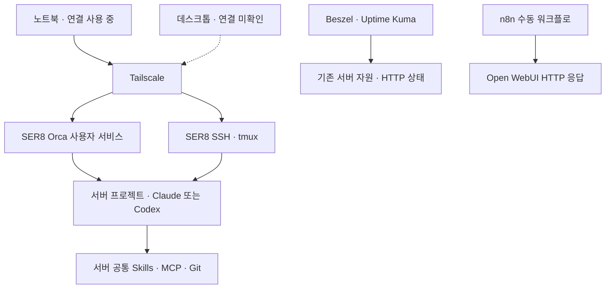

# 현재 구성과 사용 가이드

> 2026-10-22 기준. 이 문서는 사용자 제공 서버 작업 보고·로그·화면과 노트북 조사 보고를 정리한 운영 안내입니다. 이번 문서화에서 서버 상태를 새로 측정하지 않았습니다. 예시의 주소·사용자·경로·포트는 모두 placeholder로 실제 값을 따로 대입해야 합니다.

## 지금 사용할 수 있는 것

**SER8을 공통 실행 환경으로 두고 노트북 Orca 또는 SSH·tmux로 접속해 Claude Code와 Codex를 사용하는 기본 경로가 마련됐습니다.** 서버에는 프로젝트·개발 도구·스킬·인증을 두고, 노트북은 화면과 입력을 담당합니다. 데스크톱에서도 같은 서버에 연결하는 것이 목표이며, 데스크톱 연결은 아직 확인하지 않았습니다.

| 영역 | 현재 결과 | 확인하지 않은 범위 |
|---|---|---|
| 접속 | Tailscale·SSH 터널 사용, 노트북 Orca 연결·재접속 | 데스크톱 연결, ACL 전체 검토, 재부팅 후 접속 |
| 세션 유지 | tmux 3.4 사용, Orca 사용자 서비스 active·enabled·linger 확인 보고 | 실제 서버 재부팅 후 복구, 모든 에이전트 작업의 재연결 |
| 개발 도구 | Claude·Codex 설치·로그인·실행, 공통 지침 읽기 성공 | 실제 앱 개발·Windows GUI·배포 검증 |
| 중앙 스킬 | Superpowers·find-skills·Context7 및 선택 문서·K-skill·ECC 구성 | 모든 스킬의 실행·인증·의존성 완전 검증 |
| 개발 프로젝트 | 홈서버 기록 저장소와 별도 앱 저장소 등록, 앱 프로젝트 전용 가상환경 준비 | 앱 데이터 이동·검수·모델 평가 |
| 모니터링 | Beszel 기본 지표, Uptime Kuma HTTP 감시 | GPU 정확성·장기 수집·컨테이너 통계 |
| 자동화 | n8n 설치·계정 생성, 첫 수동 HTTP 확인 성공 | 정기 실행은 보류, AI 연동·서비스 제어 미구성 |
| 데이터 보호 | 모니터링 수동 백업, 자동화 스크립트 정적 검토 | 외부 저장·실행·예약 적용·복원 |

## 구성 요소는 어떻게 연결되는가



- **Tailscale**: 관리 기기와 서버를 사설 경로로 연결합니다.
- **Orca**: 프로젝트·작업 공간·터미널·에이전트를 화면에서 선택하는 입구입니다. 원격 호스트가 SER8인지 확인해야 실제로 서버 환경을 사용합니다.
- **SSH와 tmux**: Orca 대신 터미널로 관리하거나 연결이 끊겨도 대화형 작업을 이어 쓰는 경로입니다.
- **systemd 사용자 서비스**: Orca 서버를 상시 실행합니다. Orca 서버를 띄우기 위해 tmux나 별도 serve를 매번 실행하지 않습니다.
- **GitHub**: 커밋한 소스·문서의 원격 보관 및 공유 위치입니다. 실행 중인 세션, 비밀키, 로컬 DB·데이터까지 동기화하지 않습니다.
- **Beszel과 Uptime Kuma**: 각각 자원 지표와 HTTP 응답 상태를 관찰합니다. HTTP 성공은 실제 AI 답변이나 게임 플레이가 정상이라는 의미와 다릅니다.
- **n8n**: 지금은 수동 HTTP 확인 예제까지만 사용합니다. 기존 모니터링을 대체하는 자동 복구 도구가 아닙니다.

## 평소 노트북에서 작업하는 순서

1. 노트북의 Tailscale을 연결합니다.
2. Orca를 열어 **설정 → 원격 Orca 서버**에서 SER8이 연결됨인지 확인합니다. 이미 등록·연결된 서버를 매번 새로 추가하거나 재페어링하지 않습니다.
3. 사이드바에서 작업할 프로젝트 아래 **SER8 호스트의 작업 공간**을 선택합니다. Local Windows 항목을 고르면 노트북 환경에서 실행됩니다.
4. 브랜치와 작업 폴더를 확인하고, 해당 프로젝트의 AGENTS.md를 먼저 읽게 합니다.
5. 같은 작업 공간에서 Claude 또는 Codex 하나를 실행합니다. 다른 에이전트로 넘길 때에는 현재 변경·남은 일을 정리하고 파일 수정이 끝난 뒤 순차적으로 사용합니다.
6. 작업 결과와 diff를 검토합니다. 커밋·push는 요청한 범위만 수행하며, 실제 데이터·인증정보는 포함하지 않습니다.
7. 노트북을 떠날 때 서버 서비스를 중지할 필요는 없습니다. 기존 작업 공간으로 재접속하되, 진행 중이던 명령이 모두 보존됐다고 가정하지 않고 상태를 확인합니다.

사용자는 Orca **YOLO 모드를 유지**하기로 결정했습니다. 이 설정은 에이전트의 승인 절차를 생략하지만 OS 권한을 root로 만들지는 않습니다. AGENTS.md의 요청 범위와 운영 서비스 변경 제한은 계속 적용합니다.

### 두 프로젝트를 구분하기

| 프로젝트 | 목적 | 이번 구축에서 한 범위 |
|---|---|---|
| ser8-home-server-ai | 홈서버 구축·문제 해결·사용법 기록 | 문서와 공개용 예시·사진 관리 |
| LLM Change Tool v2 | 별도 데스크톱 앱 개발 | SER8 소스·가상환경·의존성·Orca 등록, 노트북 main 일치 확인 |

서로 다른 저장소는 별도 Orca 프로젝트로 관리합니다. 같은 앱 저장소의 Windows·SER8 작업 공간이 한 프로젝트 아래 보이는 것은 정상입니다. Git worktree는 별도 작업 디렉터리·브랜치 작업을 위한 것이며, 원격 연결을 위해 반드시 새로 만들 필요는 없습니다.

앱의 회사 데이터·검수 DB·Mock 검수·평가·EXE 배포는 별도 앱 프로젝트의 업무입니다. 이번 홈서버 구축을 계속하기 위해 20건 검수나 유료 API 호출을 할 필요는 없습니다.

### 무엇이 공통이고 무엇이 기기별인가

| 항목 | SER8 원격 사용 시 | 기기별로 남는 것 |
|---|---|---|
| 저장소·브랜치·미커밋 파일 | 같은 서버 작업 공간을 선택하면 같은 파일 사용 | Windows 로컬 clone은 별도 사본 |
| Claude·Codex·전역 스킬 | 서버 설치·인증을 사용 | 로컬 에이전트를 따로 실행하면 로컬 설치 필요 |
| MCP·플러그인 | 서버 각 CLI의 설정 사용 | Claude와 Codex의 설정·지원 기능이 완전히 같지는 않음 |
| 프로젝트 데이터·DB | 실제 서버에 있는 데이터만 사용 | 노트북의 Git 제외 자료는 자동 이동하지 않음 |
| Orca 화면·알림·캐시 | 서버 프로젝트와 세션을 원격으로 표시 | 클라이언트 설정·과거 행은 기기별로 남을 수 있음 |

Claude의 GitHub 작업은 기존 인증된 git·gh를 사용합니다. Claude GitHub MCP는 비활성화 상태로 유지하고, Codex의 계정 커넥터와 같은 인증 방식이라고 가정하지 않습니다.

## SSH·tmux로 이어서 작업하기

아래는 **사용 예시**이며 이번 문서화에서 실행하지 않았습니다.

```bash
ssh <user>@<server-tailscale-address>
tmux ls
tmux attach -t <existing-session>
```

기존 세션이 없고 새 작업이 필요할 때만 새로 만듭니다.

```bash
tmux new -s <new-session>
cd <server-project-path>
claude
# Claude 작업을 마친 뒤 같은 폴더에서 Codex를 순차 사용:
# codex
```

- 분리: Ctrl+b를 누른 뒤 d를 누릅니다. 세션을 종료하는 exit와 다릅니다.
- 이전 출력 보기: Ctrl+b를 누른 뒤 [ 를 눌러 복사 모드에 들어가 방향키·PageUp으로 이동하고 q로 나옵니다. 남아 있는 스크롤 기록 범위에서만 볼 수 있습니다.
- SSH가 끊기면 재접속한 뒤 기존 세션에 attach합니다. 연결이 끊겼다는 이유만으로 같은 작업을 새 세션에서 중복 실행하지 않습니다.
- tmux와 Orca의 터미널·탭 기록은 동일한 것이 아닙니다. 한쪽의 예전 출력이 다른 쪽에 자동 복원된다고 가정하지 않습니다.

## 상태 확인과 연결 문제 대응

읽기 전용 예시입니다. 로그에는 비밀값이 포함될 수 있으므로 원문을 GitHub에 올리지 않습니다.

```bash
systemctl --user is-active orca-serve
systemctl --user is-enabled orca-serve
tmux ls
```

- **Orca만 오프라인**: 노트북 Tailscale → SSH 접속 가능 여부 → Orca 서비스 상태 순으로 확인합니다. 이미 서비스가 있으면 별도 foreground serve를 중복 실행하지 않습니다.
- **Unknown 재발**: 정상 프로젝트와 예전 잔여 항목을 구분합니다. 이번 Unknown은 UI 정리 후 사라졌다고 확인받았습니다. 정상 작업 트리나 프로젝트를 일괄 삭제하지 않습니다.
- **n8n 타임아웃 재발**: 대상 HTTP 상태와 n8n 브리지·UFW 허용 규칙 일치 여부를 확인합니다. Docker 네트워크 재생성 시 기존 규칙이 맞지 않을 수 있습니다.
- **Windows Orca 충돌**: renderer killed 알림이 있었지만 원인은 미확정입니다. 서버 오프라인·Unknown과 동일 원인이라고 단정하지 않습니다.

## 모니터링과 n8n을 쓰는 방법

- Beszel: 자원 추이를 보고 과거와 비교합니다. 현재 GPU 수치의 정확성·동시 부하는 검증하지 않았습니다.
- Uptime Kuma: 등록한 세 서비스의 HTTP 상태를 확인합니다. 외부 알림은 현재 사용하지 않습니다.
- n8n: 기존 SSH 터널을 열고 웹으로 접속한 뒤 이미 만든 수동 워크플로를 실행합니다. 결과의 statusCode·ok·error를 확인합니다. 노드의 녹색 실행 완료만 보지 않습니다.
- n8n 정기 실행은 나중에 진행합니다. 기존 워크플로의 재가져오기·재설치·새 알림 설정은 현재 필수 작업이 아닙니다.

## 앞으로 할 일과 진행 조건

| 우선순위·시점 | 작업 | 진행 조건과 완료 기준 |
|---|---|---|
| 집에서 | 데스크톱 Tailscale·Orca 연결 | 같은 서버 프로젝트·작업 공간을 열고 기기 전환 확인. 페어링 링크는 비공개 |
| 저장장치 결정 후 | 백업을 다른 장치에 보관 | 저장장치·마운트 경로 결정, 실제 복사 결과 확인 |
| 별도 실행 요청 후 | 자동 백업 적용 | 초안 검토 후 첫 실행·예약 시각·보관 정책 확정. 현재는 미실행 |
| 나중에 | n8n 정기 실행 | 첫 수동 워크플로를 기반으로 주기·실행 기록 보관을 결정 |
| 필요할 때 | n8n 업무 확장·AI 연동 | 실제 반복 업무 선정. 외부 알림은 현재 미사용 |
| 필요할 때 | 스킬 마무리 | Codex Context7 실제 조회, 문서 생성·렌더링, handoff 출처 확인 |
| 별도 점검 시 | 접근 범위·업데이트 관리 | Tailscale ACL·기존 UFW 규칙 검토, Orca 수동 업데이트 및 n8n 태그·digest 관리 |
| 별도 점검 시 | Beszel 후속 확인 | 인증 경고·GPU 정확성·장기 수집·컨테이너 통계 필요 여부 검토 |
| 사용자 선택 전 보류 | 재부팅·장애·복원·부하 시험 | 사용자 요청 없이 수행하지 않음. 설정 확인과 실제 시험을 구분 |
| 선택 | 과거 stash·백업 정리, Git 작성자 설정 | 보존 필요성 확인 후 별도 요청으로 처리. 이번에 삭제·변경하지 않음 |

**당장 새 설치를 진행해야만 하는 상태는 아닙니다.** 원격 개발의 기본 경로를 사용하면서 데스크톱 연결과 데이터 보호를 다음 단계로 진행할 수 있습니다. 노트북과 데스크톱의 실제 기기 전환 확인 전에는 '모든 기기에서 완전히 동일한 환경 검증 완료'라고 표현하지 않습니다.

## 관련 기록

- [전체 소개](./README.md)
- [증거와 확인 범위](./evidence.md)
- [진행 계획](./roadmap.md)
- [Orca 설치·연결·문제 해결](./orca-remote-server.md)
- [n8n 수동 워크플로와 방화벽 해결](./n8n-setup.md)
- [백업 자동화 초안 — 미실행](./backup-automation.md)
